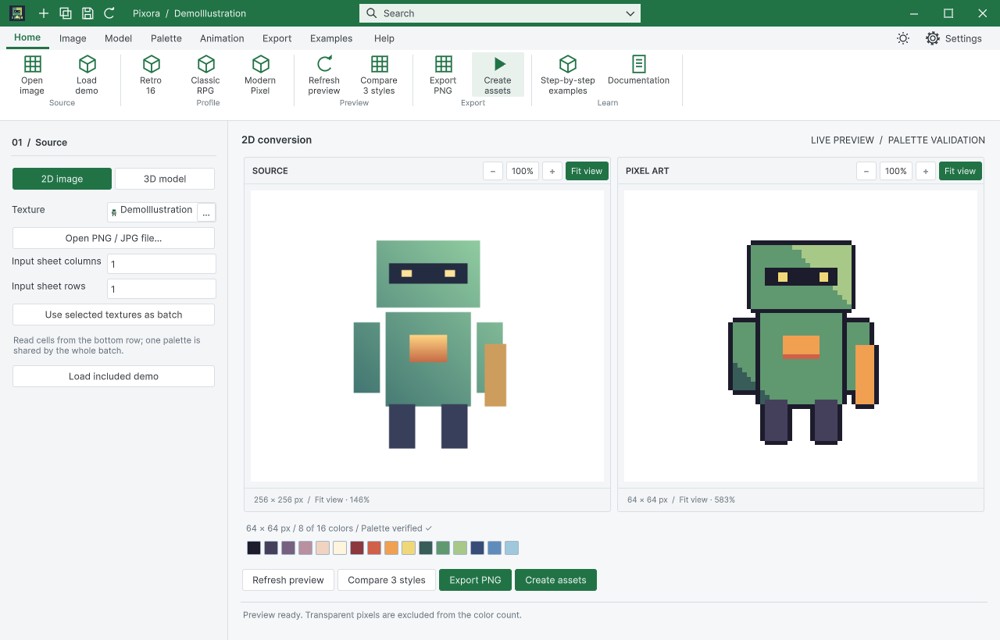
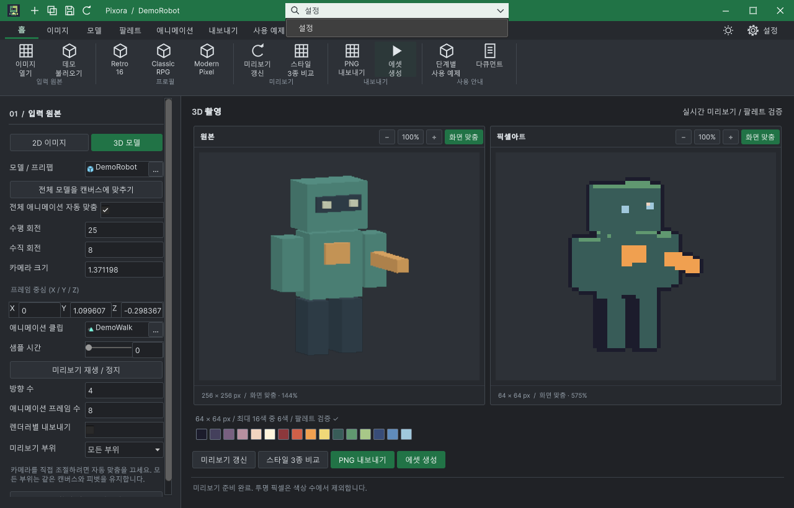
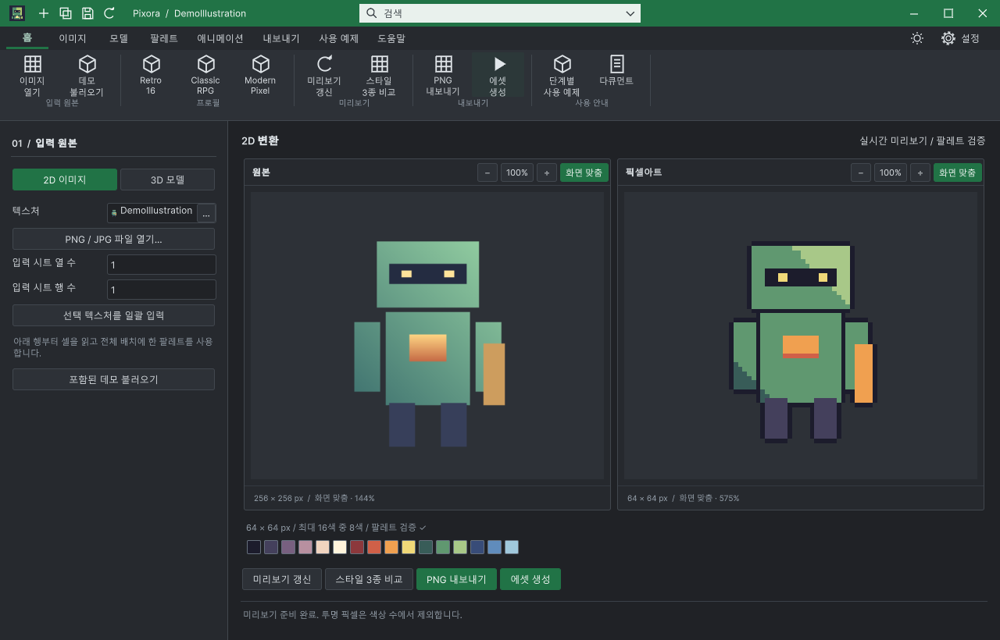

## 작업 결과

Pixora에 새 공통 제목줄을 적용하고 실제 동작·다국어 화면·단독 설치 컴파일 검증을 완료했습니다. 최종 수정은 codex/turnroom-integration의 bdf42a01에 푸시했습니다.

## 변경 내용

### 적용 내용

기존에는 ToolWindow 상속과 템플릿 치수를 사용하면서도 Pixora의 BuildDocumentHeader가 로고·빠른 버튼·제목·테마·창 제어를 별도로 조립했습니다. 검색 입력과 설정 기어가 빠져 있었고 빠른 아이콘 중앙 배치가 공통으로 보장되지 않았습니다.

이제 ToolWindow의 CreateDocumentChrome을 상속해 Common이 제목줄을 조립합니다. Pixora는 새 창·복제·프로필 저장·갱신의 네 명령과 검색할 실제 명령 목록을 전달합니다. 명령 검색에서 결과를 선택하면 해당 기능이 실행됩니다. 테마는 탭 오른쪽 아이콘으로, 설정은 기어와 글자로 표시합니다. 탭 영역은 가로 스크롤로 나누어 설정 영역을 보존합니다.

9개 언어 Studio·가이드의 실제 화면과 안내를 갱신했습니다. 기존 이미지·소스 기록은 Artifacts/ChromeQA/Before에 보존했습니다. 설정·목록과 복원 안내의 참조 이미지도 현재 UI로 갱신했습니다.

## 검증

| 실제 검증 | 결과 |
| --- | --- |
| 설정 기어 | 실제 클릭으로 설정 창 열림·포커스 확인 |
| 명령 검색 | 한국어 설정 입력 → 필터 메뉴 표시 → 실제 선택으로 설정 활성화 |
| 네 빠른 실행 | 새 창·복제·프로필 저장 대화상자 열기/취소·갱신 확인 |
| 창 제어 | 생성한 창 닫기, 1280×820↔1920×1032 최대화/복원, 최소화→목록 복원 |
| 테마 | 실제 클릭으로 light/dark 클래스와 화면 전환 확인 |
| 공통 패널·기본 스타일 | 108개 검사 통과 |
| 단독 설치 | Pixora만 / DataTable만 각각 컴파일 종료 코드 0 |
| 9개 언어 | 실제 Studio 배치·화면과 가이드 각각 캡처, 설정 영역이 창 안에 있고 검색 폭·창 제어 폭 일치 |
| HTML | 9개 문서·99개 장·90개 코드 예제·로컬 이미지·언어 이동 통과 |

108개 패널 검사는 nativeScreenVerified=false 원본을 유지하고 실제 클릭 10개 시나리오와 구분했습니다. 현재 대화에는 node_repl/sky 도구가 없어 대상 프로세스·창을 제한한 Win32 입력/캡처 경로를 사용했습니다. 활성화 시 기본 창으로 넘어가는 도구 문제는 대상 팝업 자체의 포커스를 확인하는 방식으로 처리했습니다. 실제 클릭 없이 성공으로 보고하지 않았습니다.

[실제 조작 범위](../assets/20261030-chrome-Results.json) · [언어별 배치](../assets/20261030-chrome-Languages.json) · [독립 설치](../assets/20261030-chrome-StandaloneBuilds.json) · [무손실 압축·해시](../assets/20261030-chrome-Images.json)

## 남은 사항

Windows / Unity 6000.0.83f1에서 검증했습니다. 다른 운영체제·고DPI는 미확인입니다. DataTable 전체 문서의 기존 과거 캡처/소스 해시 불일치 206건은 남아 실패합니다. 이번 새 제목줄·복원 캡처의 소스·이미지 검사는 오류 0건이며 과거 해시를 임의로 갱신하지 않았습니다. main 병합·Asset Store 출시는 수행하지 않았습니다.

## 작업 시간

- 제안 시간: 최초 대화에서 15–25분으로 제안했습니다. 14:07 작업 인수 때 남은 20–35분으로 재산정했고, 14:18에 독립 설치 검증·문서 재캡처 때문에 추가 10–15분을 안내했습니다. 최초 예상 25분은 초과했습니다.
- 실제로 완료된 시간: 이전 대화에서 전달된 최초 시작 2026-10-30 13:54:43 KST부터 구현·검증·최종 프로젝트 푸시 14:26:50 KST까지 32분 7초입니다. 현재 대화의 인수 시각 14:07:17 KST부터는 19분 33초입니다. 중앙 HTML 생성·배포는 이후 진행하며 최종 채팅에 전체 종료 시각을 기록합니다.
- XERJ: 사용 — 실제 XERJ Status와 DocumentChrome SettingsButton 검색으로 기존 제목줄·리본 후보를 확인하고 현재 소스를 읽었습니다. 신설 공통 파일의 인덱스 갱신 후 DocumentChrome 재검색을 별도로 실행했습니다. 자동 watcher 활성화는 주장하지 않습니다.
