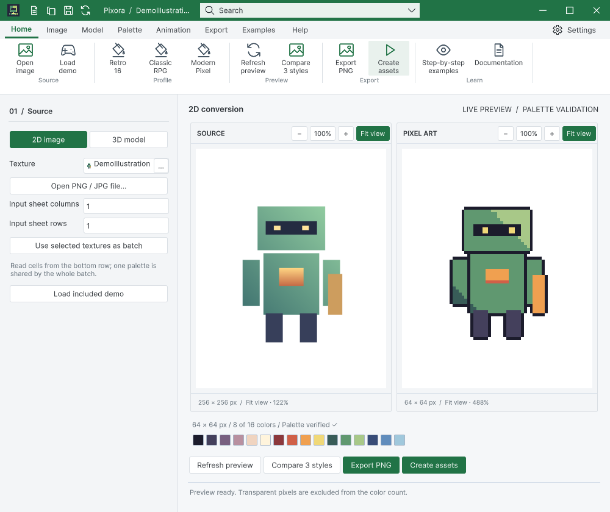
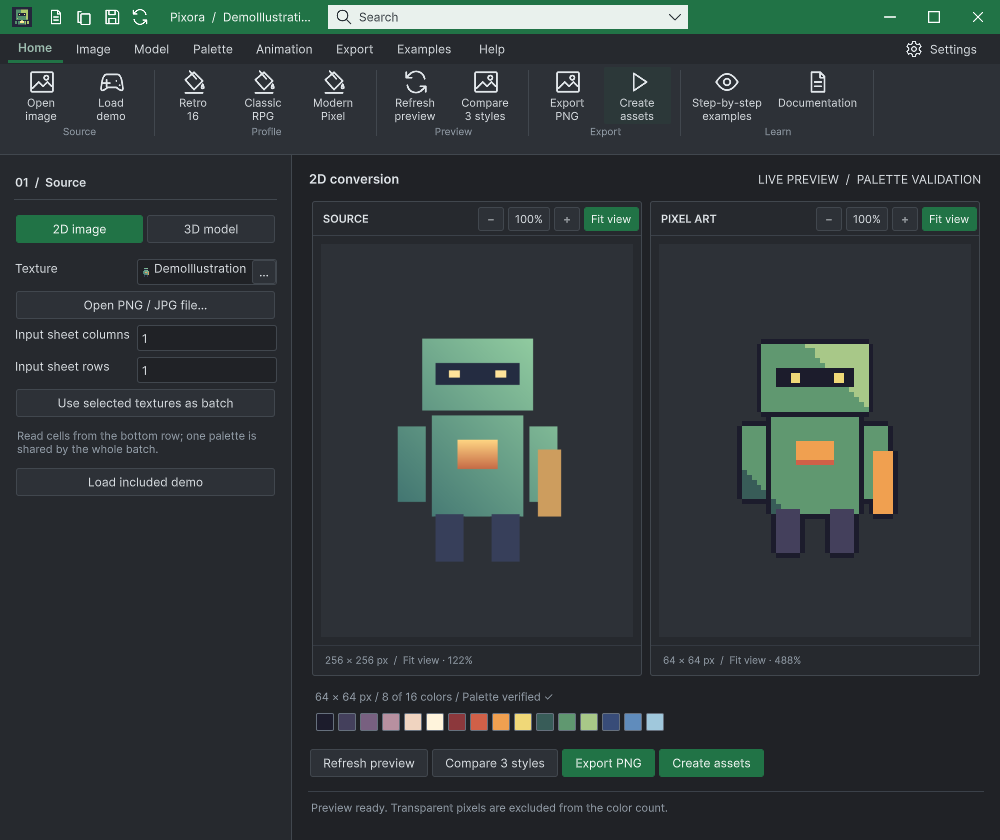
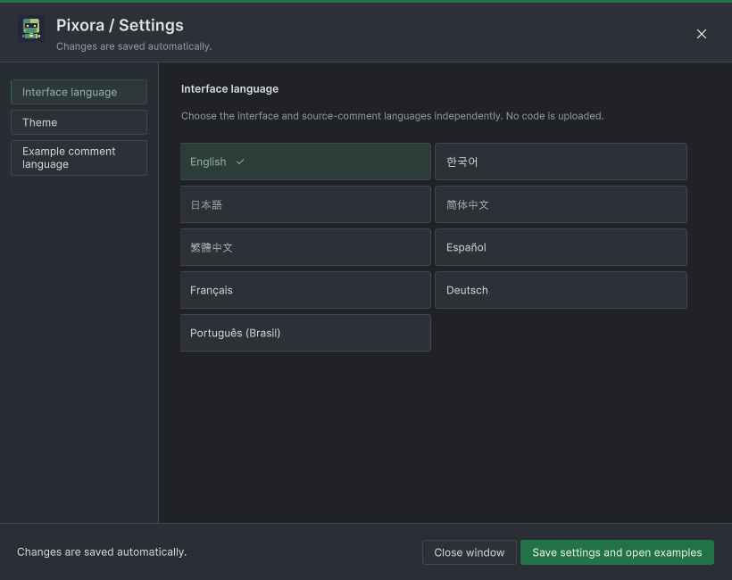

## 작업 결과

Pixora 리본·빠른 실행·설정·창 제어가 공통 원본 렌더러를 사용합니다.

## 변경 내용

### 적용 내용

PixoraIcon은 명령을 TemplateIcon의 기존 카탈로그 키에 연결하는 얇은 어댑터입니다. 설정 팝업 닫기도 WindowControls를 사용합니다. 이미지/재생은 원본 아틀라스의 실제 해당 셀을 사용합니다. 9개 언어 가이드 설명과 24개 편집기 화면을 갱신했습니다.

## 검증

108개 공통 배치 검사 및 실제 창 제어/복원 성공. 9개 UI 언어 화면 캡처; 모든 언어 번역의 독립 감수나 모든 배치의 육안 검토 완료로 확대하지 않습니다. 신규 24개 캡처의 소스 해시 현재 일치. 배포에 실제 샘플 씬 10개 포함, Development 미포함. 소비자 프로젝트의 샘플 분리 상태를 재설치로 복구하고 본체 컴파일 확인.

## 남은 사항

Windows / Unity 6000.0.83f1에서 검증했습니다. 다른 OS·배율·물리 모니터 연결 변경은 미확인입니다. DataTable 전체 가이드 검사 238건의 과거 화면/소스 불일치는 남아 있으며 통과로 변경하지 않았습니다. 이번에 다시 캡처한 26개 기록은 현재 소스와 일치합니다. Pixora Undo/Redo 기능을 새로 추가한 것은 아닙니다.

## 작업 시간

- 제안 시간: 40~80분
- 실제로 완료된 시간: 시작 2026-10-30 17:16:52 KST · 구현·실행 검증 및 프로젝트 푸시 완료. 보고 작성 시점 2026-10-30 18:37:25 KST, 경과 80.6분. 보고서 공개 배포 확인은 별도 단계입니다.
- XERJ: 사용 — Tools/Search/Xerj.ps1 Status 및 Search PreserveVisiblePeer 호출. 후보를 현재 WindowFocus/WindowFrame/WorkbookNativeWindow 소스와 네이티브 실행 기록으로 확인했습니다.
