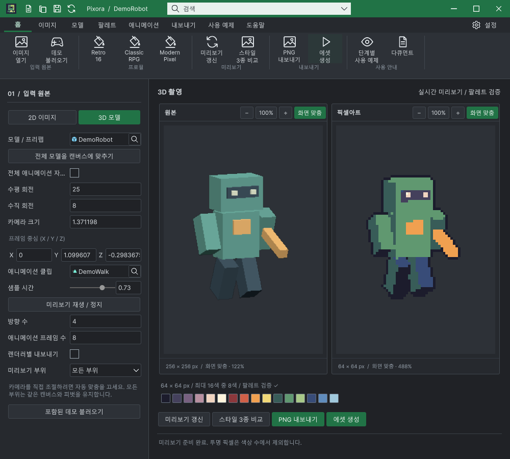

## 작업 결과

제품별 중복 크기 규칙을 제거하고 공통 필드·선택기 스타일을 적용했습니다. 9개 언어 가이드에 3D 실제 화면을 추가했습니다.

## 변경 내용

### 적용 내용

제품별 중복 크기 규칙을 제거하고 공통 필드·선택기 스타일을 적용했습니다. 9개 언어 가이드에 3D 실제 화면을 추가했습니다.

교훈 검토: 내부 컨트롤의 실제 입력·선택값과 로드된 빌드를 확인하는 프로젝트 QA를 AGENTS.md에 반영했습니다. 전역은 기존 실제 원본·실행 대조 및 증거 우선 규칙과 중복되므로 변경하지 않았습니다. 신규 비트맵 디자인 없이 DataTable 원본 아이콘·그리기 코드를 재사용했습니다.

## 검증

Unity 6000.0.83f1 격리 QA 프로젝트에서 현재 소스 해시를 대조했습니다. 9언어×2테마를 포함한 22상태 검사 통과. 카메라 X 0.25, 슬라이더 0.73 실제 입력 반영 확인. 배포 패키지에 예제 씬 10개, Development 제외 확인. 관련 실행 화면 총 35개 갱신.

## 남은 사항

기존 DataTable 문서 전체 검사 259건은 미해결입니다. 이번 갱신 화면 관련 오류는 0건입니다. 다른 Unity 버전은 미검증입니다.

## 작업 시간

- 제안 시간: 20~40분
- 실제로 완료된 시간: 121.2분 · 구현/실행 검증 시각 2026-10-30 20:46:21 KST. 공개 배포 확인은 후속 메뉴얼에 기록.
- XERJ: 사용 — XERJ Vector3Field 검색에서 해당 Pixora 소스 누락을 확인하여 rg와 현재 소스로 보완.
