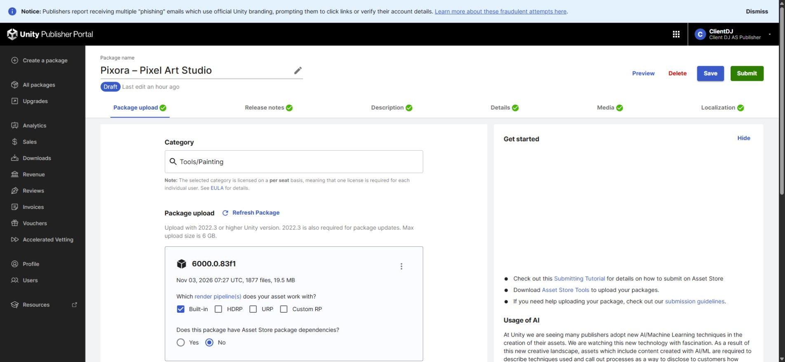
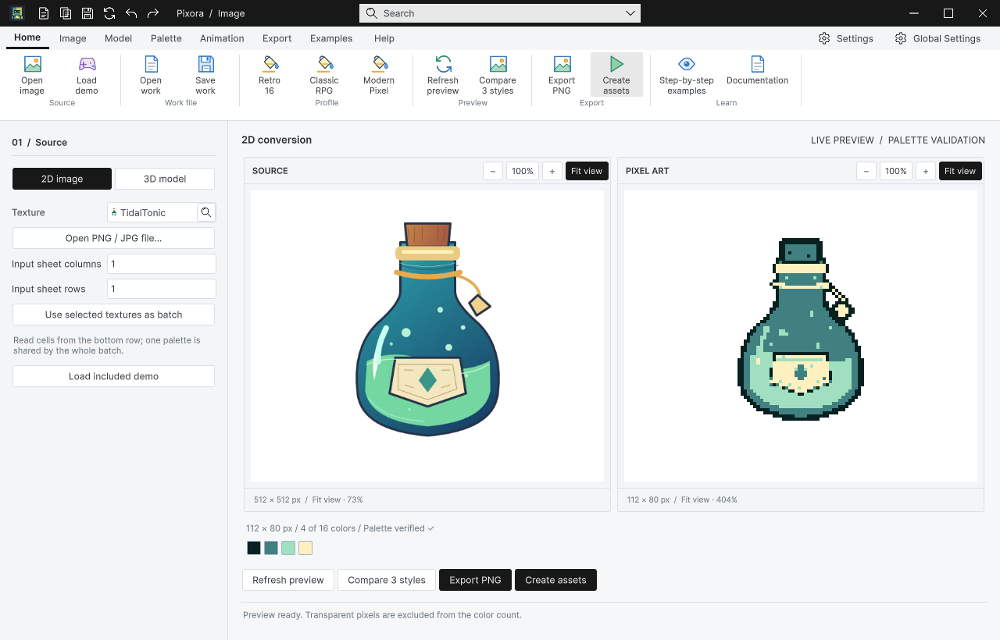

## 작업 결과

1.0.0 최종 패키지 업로드와 새 빈 프로젝트 재설치를 확인했습니다. 기존 판매 가격을 유지했습니다. Submit은 누르지 않았습니다.

최신 업로드의 날짜·용량·제품명을 실제 화면에서 대조했습니다. 이전 v1.0.0의 일부 캡처가 로딩 화면이었던 점을 바로잡아, 로딩 완료 후 직접 확인한 이미지로 새 버전을 작성했습니다. 이전 기록은 보존합니다.

## 변경 내용

### 적용 내용

제품당 영상 1개·갤러리 16장·키 이미지 3개를 유지했습니다. 네 제품 영상의 청취는 사용자가 직접 확인해 이상 없음으로 답변했습니다. AI가 직접 청취했다고 기록하지 않았습니다.

설치본의 2D·모델 작업 문서를 저장 → 닫기 → 재열기 → 편집 → 재출력하고, 별도 Unity 프로세스에서도 동일 PNG 픽셀을 재생성했습니다. 여러 창의 작업 상태도 분리해 확인했습니다.

## 검증

최종 고정본 네 개를 두 번째 새 빈 프로젝트에 ImportPackage로 직접 설치했습니다. 설치 assertion 12개를 통과했고, 공식 Asset Store Tools 11.3.1 결과는 이 제품 pass=27, warning=2, fail=0입니다. 경고는 보존했습니다.

샘플 폴더 네 개를 실제로 제거한 Unity 재컴파일도 통과한 뒤 복원했습니다. 마지막 변경 후 샘플·개발 참조를 금지한 본체 어셈블리 13개도 실제 컴파일했습니다.

실제 작업 문서 authoring 12개 검사와 새 프로세스 재열기 3개 검사를 통과했습니다. 네이티브 Ctrl+Z/Ctrl+Y는 독립 창의 실제 입력 대상과 포커스를 유지하지 못해 확정하지 못했습니다. 사용자에게 설명한 뒤 직접 검증을 이어갔으나 화면 제어 중단 요청으로 보류했습니다.

이미 열린 네 제품 창의 9개 언어 변경을 실제 UI 캡처와 표시 문자열로 대조했습니다. 이 검사는 해당 상단 화면 범위이며 모든 Inspector·툴팁·입력 상태를 포괄한다고 인증하지 않습니다.

최종 소스·메타데이터·고정 파일과 업로드 SHA-256 차이 0건. 포털 재열기 표시: - paragraph: Nov 03, 2026 07:27 UTC, 1877 files, 19.5 MB

[정제한 최종 검증 근거](../assets/final-package-reviewed-20261103/verification.json)

## 남은 사항

공통 네이티브 마우스·키보드 선택 회귀 전체와 Pixora Ctrl+Z/Ctrl+Y의 실제 입력 확인은 확정하지 못했습니다. 독립 문서의 입력 대상·포커스가 유지되지 않았고, 새 프로젝트의 설정 마법사가 지연 표시되는 소스도 확인했습니다. 단일 원인으로 단정하지 않으며 직접 메서드 호출이나 합성 이벤트로 통과 처리하지 않았습니다. 2026-11-03 18:21 KST 사용자가 컴퓨터 사용을 위해 제어 중단을 요청하여 추가 화면 조작·Unity/플레이어 실행을 중단했습니다. 다음 화면 검증 허용 전까지 실제 입력 QA는 보류입니다. 따라서 전체 제출 전 QA 완료로 표시하지 않습니다.

Submit은 실행하지 않았습니다.

교훈 검토: 프로젝트 체크리스트에 같은 메시·재질의 명시적/자동 렌더 혼합 사례와 실제 출력 검증을 추가했습니다. 전역은 기존 실행 근거·실제 화면 대조 규칙과 중복되어 변경하지 않았습니다.

## 작업 시간

- 제안 시간: 최초 30–60분. 화면 허락 후 추가 20–40분, 발견한 수정·재검증 때문에 예상 초과.
- 실제로 완료된 시간: 시작 2026-11-03 15:59:54 KST. 이 제품 최종 SDK 업로드 완료 2026-11-03T07:28:01.9756809Z (UTC). 2026-11-03 18:23:32 KST 기록 기준 실제 경과 2시간 23분. 전체 입력 QA는 미완료이며 전체 완료 시각으로 기록하지 않습니다.
- XERJ: 실패 — XERJ 노드 미실행 및 재시작 실패를 확인했습니다. rg·현재 소스·기존 성공 실행 기록과 실제 Unity/SDK 결과로 검증했습니다.
