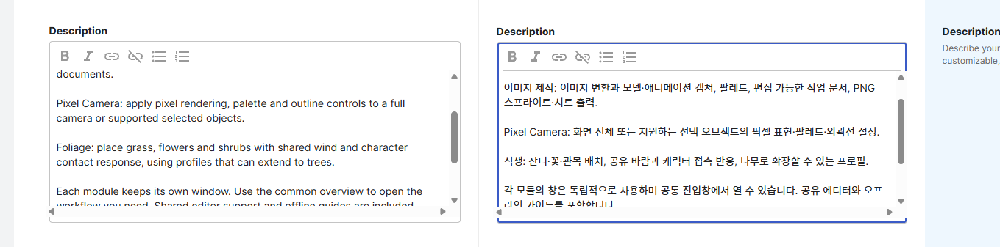
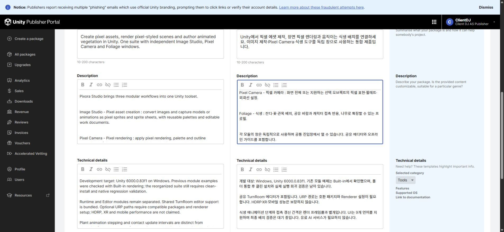

## 작업 결과

판매 설명의 실제 변경 위치를 다시 촬영했습니다. 저장값은 그대로이며 제품 원문 이름과 번역 기능 이름을 확인할 수 있습니다.

## 변경 내용

### 적용 내용

한국어 설명에서 `Pixel Camera - 픽셀 카메라 : 설명`, `Foliage - 식생 : 설명` 형식을 확인했습니다. 이전 보고서의 수정 후 캡처는 설명이 아닌 변경 이력 영역이 보여 이번 캡처로 근거를 보완합니다. 원본은 보존했습니다.

## 검증

실제 저장 설명의 영문 이름을 DOM으로 대조하고, Foliage 문구를 직접 선택해 해당 영역을 촬영·시각 확인했습니다. [로고·제품·셀러 적용 보고서](2026-11-03-result-20261103170221600-v1.0.0.html)의 로고 및 검증 제한은 유지합니다. 교훈 검토: 캡처 직후 실제 변경 위치가 보이는지 확인해야 하며 기존 지침과 동일하므로 전역 변경은 없습니다.

## 남은 사항

Affinity의 프로젝트 전용 허용 폴더 추가 및 실제 사용자 SID Modify ACL 적용 후 호스트 파일 생성·수정·삭제는 통과했으나, 실제 saveAs·export는 PERMISSION_DENIED입니다. 정확한 MCP 접근 거부 원인은 미확인입니다. 편집 가능한 .af 파일 저장·재열기, PNG/SVG 출력은 미완료이며 문서는 Affinity 메모리와 재생성용 작업 JSON으로 보존했습니다. 바탕화면이나 다른 임시 위치에는 저장하지 않았습니다.

[실제 저장 실패](../assets/studio-completion/evidence/save-after-acl.json) · [실제 출력 실패](../assets/studio-completion/evidence/export-native-result.json)

Unity 화면 실행·설치 검증, 새 비교 GIF, 대형 커버/갤러리 갱신 및 통합 패키지 업로드·최종 제출은 남아 있습니다. 포털에 업로드된 파일은 이전 Pixora 빌드입니다. 캡처는 실제 원본을 보존했으며 Affinity 저장 제한으로 별도 편집·최적화를 수행하지 않았습니다.

## 작업 시간

- 제안 시간: 로고 제작·제품/셀러 적용 20~40분; 권한 오류 확인 후 코드·문서·패키지 잔여 15~25분으로 수정 안내
- 실제로 완료된 시간: 01:07:07 KST 시작, 55분 경과. 이 시점은 구현·정적 검사 및 초안 저장 기록 시점이며 전체 요청 완료 시각이 아닙니다. Affinity 원본 저장·Unity 실행/GIF는 미완료.
- XERJ: 사용 — XERJ PackageExporter 검색 후보를 실제 현재 소스로 대조. 새 Runtime·shader 등 인덱스 밖은 rg 사용; 인덱스 갱신은 확인하지 않음.
