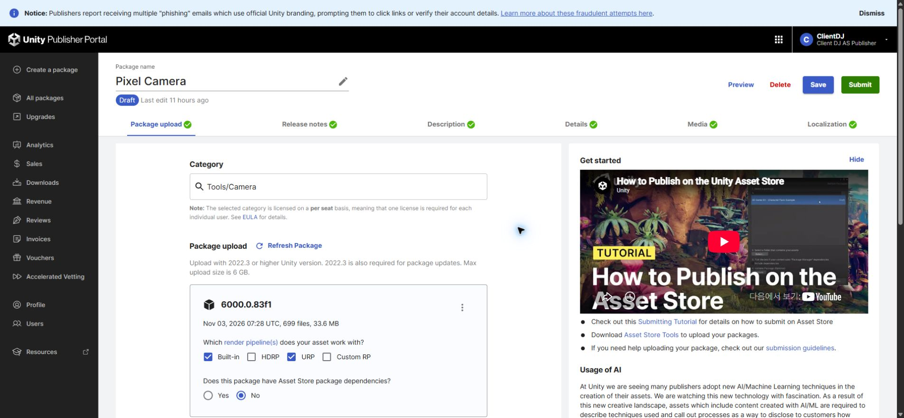
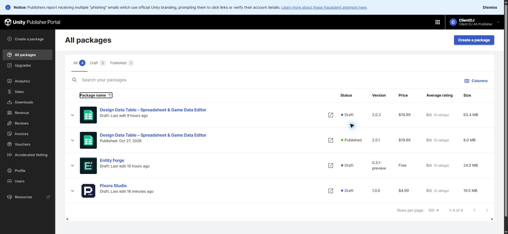

## 작업 결과

별도 Pixel Camera0.6.1-preview 판매 초안(상품424618 / 초안1541562)을 영구 삭제했습니다. 전체 새로고침 후 목록에서 사라졌으며 Pixora Studio 초안은 유지됩니다.

## 변경 내용

### 적용 내용

판매자 포털의 별도 초안만 삭제했습니다. 프로젝트 내부 Pixel Camera 모듈·기존 소스·통합 패키지와 Pixora Studio 판매 초안은 삭제하지 않았습니다.

삭제 전에는 Pixel Camera 초안 상세에699파일·33.6MB 업로드가 표시됐습니다.

삭제 후 전체4개, 초안3개, 공개1개입니다. 삭제 전 목록의 동일 구도 캡처는 확보하지 못했고 되돌릴 수 없는 작업이므로 재현하지 않았습니다. 상세→목록의 상태 확인이며 같은 화면의 전후 시각 비교를 완료했다고 주장하지 않습니다.

## 검증

영구 삭제 직전 사용자 확인을 받았습니다. 삭제 확인창에서 해당 초안의 Delete를 실행한 뒤 All packages로 이동한 결과를 확인하고, 다시 전체 새로고침했습니다. Pixel Camera 행이 없고 Design Data Table 초안/공개, Entity Forge 초안, Pixora Studio 초안이 남아 있습니다. [삭제 결과](../assets/camera-seller-removal/result.json).

[Unity 공식 삭제 안내](https://docs.unity.com/en-us/asset-store/publishing/asset-packages/create-package)는 확인창에서 초안을 영구 삭제한다고 명시합니다. 이번에는 별도 초안만 삭제했고 통합 제품 최종 제출은 실행하지 않았습니다.

교훈 검토: 판매 항목 통합 시 원본 모듈 삭제와 별도 판매 초안 삭제를 구분하고 정확한 초안 ID를 확인합니다. 기존 승인·정확한 범위 확인 원칙과 중복되어 전역 지침 변경은 없습니다. 프로젝트 문서에 삭제된 별도 초안 ID를 기록했습니다.

## 남은 사항

이번 별도 판매 초안 삭제는 완료했습니다. Pixora Studio 통합 제품의 기존 미완료 QA·미디어·패키지 업로드·최종 제출은 별도 작업으로 유지합니다.

## 작업 시간

- 제안 시간: 대상 확인·삭제·저장 상태 확인3~5분
- 실제로 완료된 시간: 승인 후 실행 계측 시작2026-11-04 03:42:25 KST, 삭제·전체 새로고침 검증 완료03:42:48 KST(23초). 이전 대상 확인·영구 삭제 승인 대기와 이후 보고서 공개 배포는 별도입니다.
- XERJ: 미사용 — 코드 검색 불필요 — 판매자 포털 초안 삭제와 실제 목록 재조회만 수행
