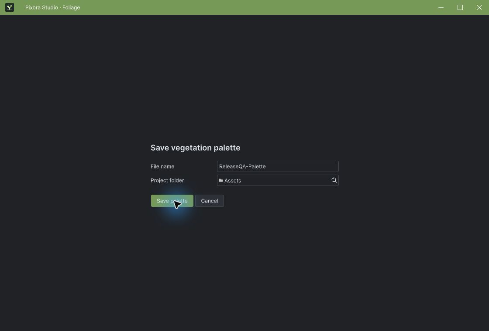
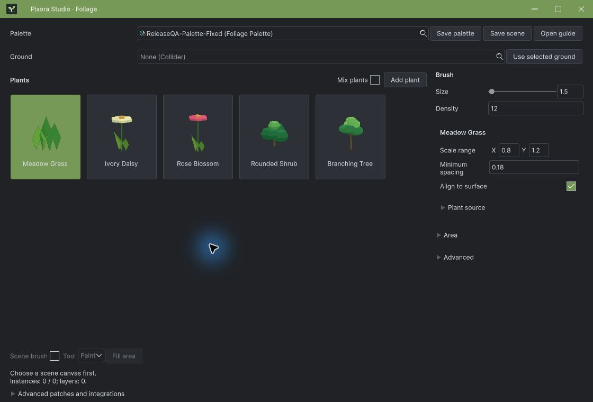
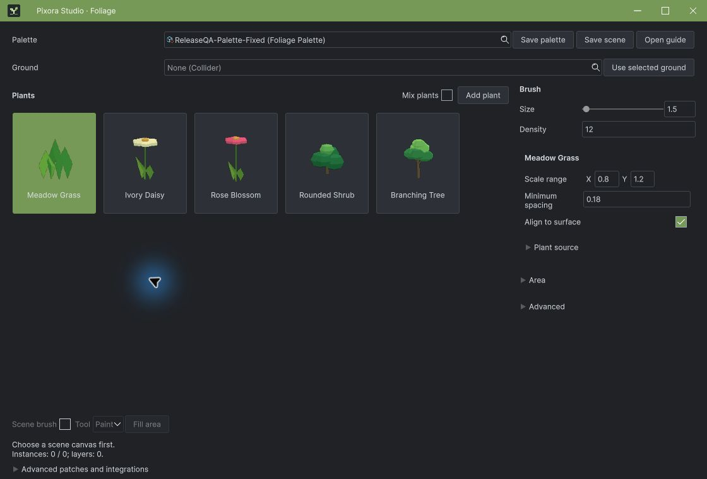

## 작업 결과

팔레트 저장 후 편집 카드가 나타나며, 저장한 팔레트를 닫았다 다시 열어 5개 항목을 확인했습니다.

## 변경 내용

### 재현 조건

Windows, Unity 6000.0.83f1, Pixora Studio Foliage

### 재현 순서

새 팔레트 생성 → 이름 입력 → 저장 → 팔레트 선택 변경 → 창 닫기 → 기존 팔레트 선택·열기

### 기대 동작

저장 후 편집 화면으로 전환되고 기존 팔레트를 재열기할 수 있어야 합니다.

### 실제 동작

수정 전 저장 파일은 생겼지만 저장 화면이 남았으며, 후속 선택 초기화에서 ChangeEvent 재귀가 깊이 491까지 기록됐습니다.

### 원인

화면 모드 플래그를 초기화하지 않았고, UI 재구성에서 선택값 초기화가 같은 변경 이벤트를 다시 발생시켰습니다.

### 적용 내용

FoliagePalettePanel.cs: 저장·열기 모드 초기화, SetValueWithoutNotify 초기화, 동일 값 콜백 조기 반환. ### 팔레트 저장

전: 저장 뒤에도 저장 패널에 머물렀습니다.

후: 편집 카드 5개가 표시됩니다.

## 검증

실제 마우스 조작으로 새 팔레트 생성·저장, Ivory Daisy 선택·값 표시 변경, 저장·닫기·재열기 통과. 재귀 재발 미관찰.

[최종 패키지]( ../assets/release-ready-20261105/frozen-artifact.json ) · [본체 컴파일](../assets/release-ready-20261105/native-core-only-r4.json)

## 남은 사항

이 수정 범위의 저장·재열기 QA는 통과했습니다. 제품 전체 기능의 모든 조합을 검증했다는 뜻은 아닙니다. 교훈은 기존 전역 Unity UI 규칙에 통합했습니다.

## 작업 시간

- 제안 시간: 15~25분
- 실제로 완료된 시간: 68분 경과. 2026-11-05 04:28:00 KST 기록. 포털 처리·전체 종료 검증은 별도 상태로 기록.
- XERJ: 실패 — Status 노드 미실행, Search 복구 시간 초과. 현재 소스는 rg와 실행 결과로 대조.
