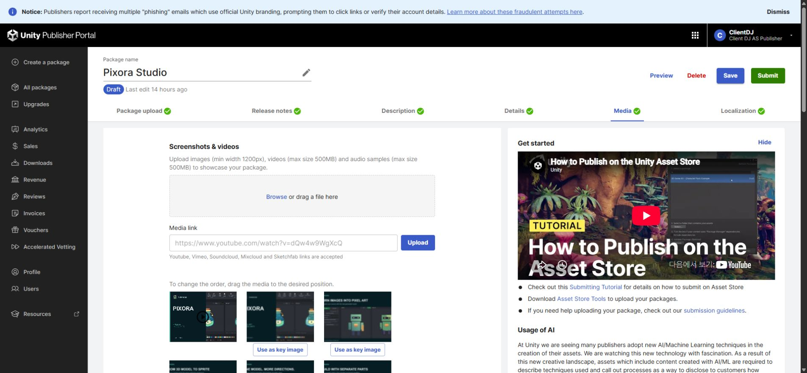
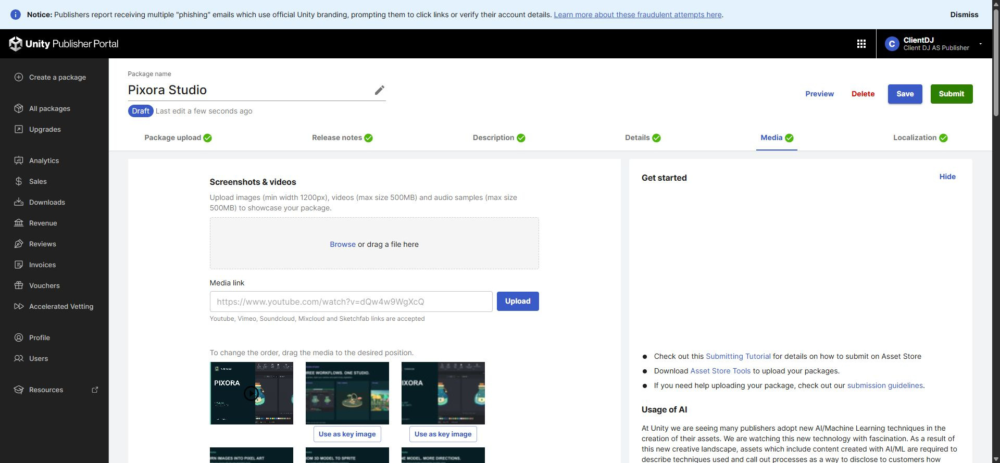
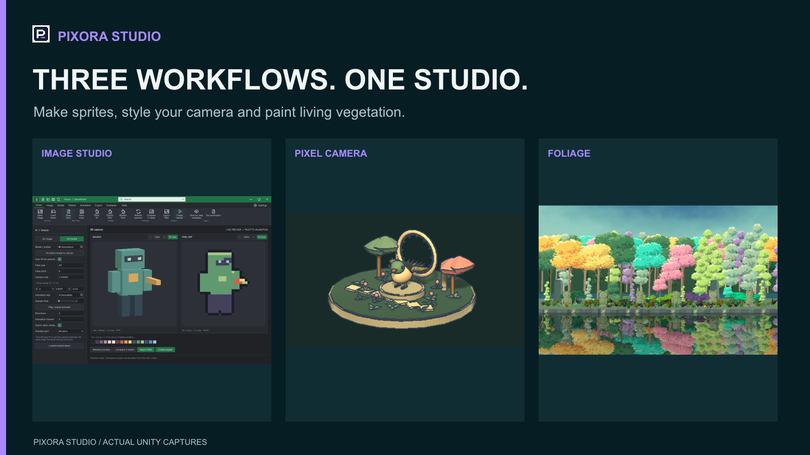

## 작업 결과

판매 초안에 Camera 5장과 통합·Foliage 6장을 추가했습니다. 새로고침 후 이미지 27장·기존 영상 1개와 첫 통합 소개 이미지가 유지됩니다. 최종 제출은 하지 않았습니다.

## 변경 내용

### 적용 내용

Image Studio만 보이던 갤러리에 세 모듈 통합 소개, Camera의 현재 예제 3종·에디터·프리셋, Foliage 팔레트·숲·혼합 식생·바람 리듬·Camera 전후를 추가했습니다.

변경 전에는 기존 Image Studio 이미지가 중심이었습니다.

새 첫 스크린샷에서 세 모듈을 확인할 수 있습니다.

## 검증

실제 Unity 캡처를 실제 Affinity 3.3.1.4940에서 편집·출력했습니다. 새 6장은 1600×900이며 시각 검사했습니다. Camera 5장은 이전 검증된 Affinity 출력물을 재사용했습니다. 삭제된 구형 Camera 예제 이미지는 업로드하지 않았습니다.

포털 저장 후 전체 새로고침으로 27장·영상 1개와 Unity CDN 주소를 확인했고, 새 통합 소개를 실제 미리보기에서 확인했습니다. 기존 16장·영상·키 이미지는 보존했습니다.

편집 가능한 원본은 프로젝트 Docs/StoreMedia/Studio-2026-11-04/PixoraStudio/Editable/PixoraStudio-Gallery.af에 저장했습니다(2,463,354바이트). 실제 닫기→재열기 후 dirty=false 확인, 통합 소개 재출력 PNG SHA-256 D85C134A78EF1286801102346AE8E4FB9DAA2ED2DE59FE63DAD4CB23F98BC29D로 기존 출력과 일치했습니다. 작업 문서와 임시 렌더 문서를 닫아 남은 문서 0개를 확인했고, 기존 Affinity 앱과 사용자 브라우저 탭은 보존했습니다.

호스트 ACL과 임시 파일 쓰기·수정·삭제는 정상이었으나 MCP saveAs는 프로젝트 경로에서 PERMISSION_DENIED였습니다. 설정을 광범위하게 변경하지 않고 이전에 승인된 저장·재열기 대화상자만 사용했습니다.

교훈 검토: 기존 지침이 권한 진단과 재승인 방지를 이미 규정하므로 전역 변경 없음. 팔레트 UI 캡처는 같은 날 기존 실제 검증 화면이며 새로 촬영했다고 주장하지 않습니다.

## 남은 사항

Asset Store 최종 제출·공개 판매본 반영은 미실행입니다. 기존 영상과 키 이미지는 이번 범위에서 수정하지 않았습니다. 자동 승인 검토가 기존 첫 이미지 삭제를 거부했으므로 삭제하지 않고 기존 16장을 보존했습니다. 새 통합 소개만 첫 스크린샷으로 이동하고 나머지 추가 기능 이미지는 기존 갤러리에 이어집니다. 시작 전 메뉴얼 등록을 놓쳐 실제 수행 근거를 사후 기록했습니다.

## 작업 시간

- 제안 시간: 10–15분
- 실제로 완료된 시간: 시작 2026-11-04 17:36:37 KST. 판매 초안·원본 검증까지 약 44분. 보고서 배포 확인은 별도 진행.
- XERJ: 미사용 — 코드·심볼 검색 불필요 — 판매 이미지·포털 작업
