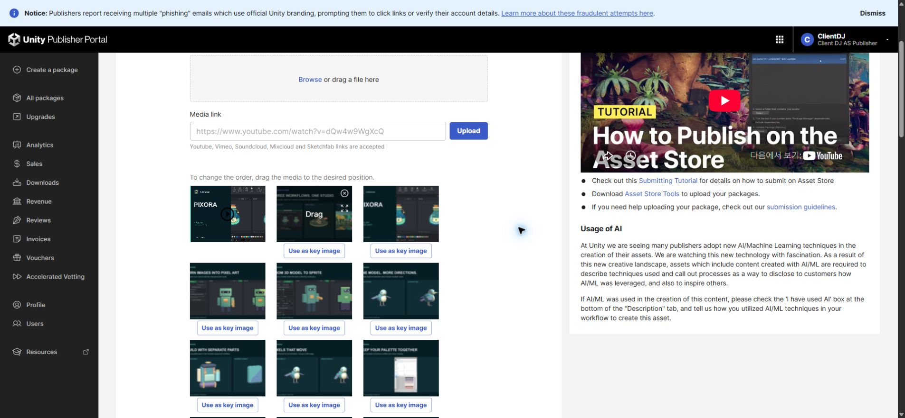
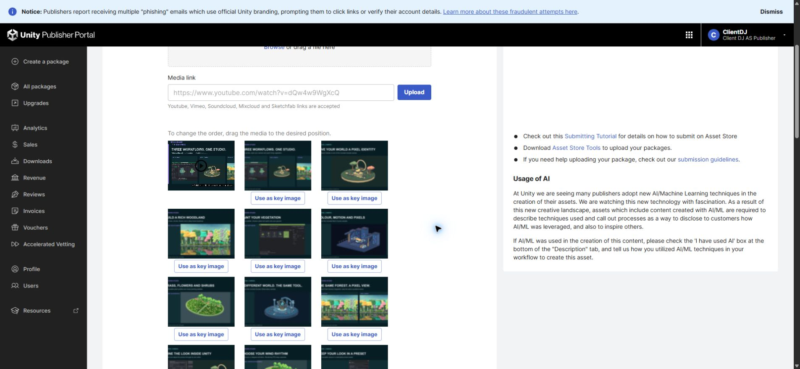
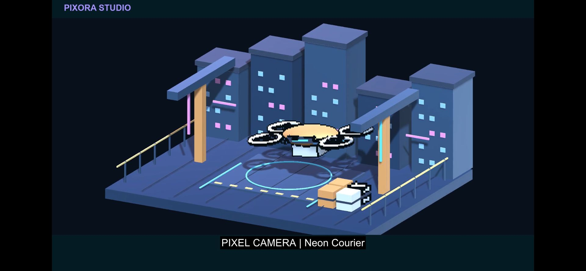
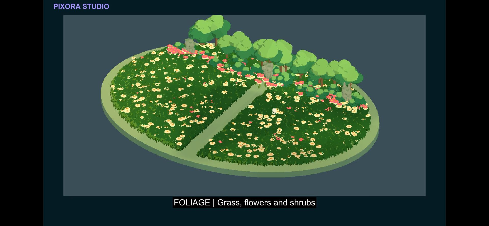
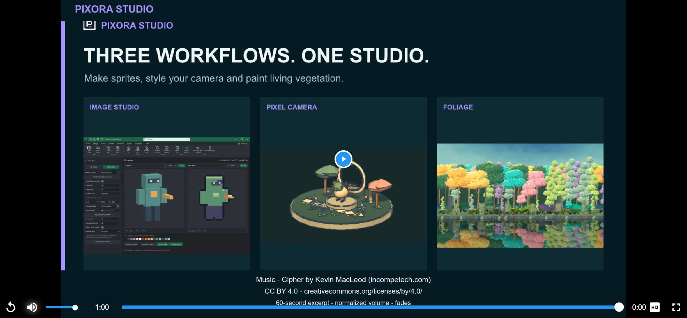

## 작업 결과

판매 초안은 이미지21장·통합 영상1개입니다. 통합 소개와 Camera·Foliage11장을 앞에 배치하고 Image Studio의 유효한 상세10장은 유지했습니다. 최종 제출은 하지 않았습니다.

## 변경 내용

### 적용 내용

삭제한6장은 실제 내용을 대조했고 로컬 원본을 보존했습니다.

- 01-Cover.png: 구형 단일 Pixora 표지, 새 통합 소개로 대체
- 07-Palette.png: 옛 기본 Inspector, 현재 커스텀 Profile 이미지와 중복
- 09-Tone.png: 두 결과 차이가 드러나지 않는 비교
- 14-Editable.png: 옛 Inspector, 현행 작업 문서 화면 13번과 중복
- 15-Workspace.png: 별도 DDT 워크북 창이 섞인 구형 창 목록
- 16-Examples.png: 기존 배치 프로필 예제, 현재 12번 배치 기능과 중복

정렬: 영상 → 통합 소개 → Clockwork Garden → Woodland → 식생 팔레트 → Neon Courier → 꽃·관목 → Observatory → 식생 Camera 비교 → Camera 편집기 → 바람 리듬 → Camera 프리셋 → Image Studio 상세 기능.

변경 전에는 기존 Image Studio 이미지가 앞에 길게 이어졌습니다.

신규 통합 영상과 Camera·식생 주요 기능이 앞쪽에 보입니다.

[최종 통합 영상 · 1080p / 24fps / 60초](../assets/media-curation-20261104/video.mp4)
Image Studio의 이미지 변환·애니메이션 3D 모델→2D 픽셀 스프라이트, Camera의 현행3개 예제, 최신 Woodland·Camera 연동·Blossom Walk를 담았습니다.

## 검증

Unity 6000.0.83f1 Linear에서 최신 식생3씬을 각72프레임(12fps)으로 실제 렌더링했습니다. 셰이더 오류0,216프레임 및 프레임 변화 확인. 12fps는 촬영·표현 주기이며 성능 개선 수치가 아닙니다. 기존 Image Studio·Camera 실제 녹화는 보존하여 재사용했습니다.

최종 파일12,618,525바이트, SHA-256 63a89821541c9aaa12d8ae82b30962806e5f50a632c772c979ba87867d7eb046. H.264 1920×1080/24fps, AAC48kHz stereo. 전체1440프레임·60.00초 디코드 통과. 음량 -19.73 LUFS, True Peak -4.14dBTP, -45dB 기준1초 이상 무음 없음.

공식 포털의 최종 플레이어를 음소거 해제해 끝까지 재생했고 오류 없이 종료됨을 확인했습니다. 사용자가 “소리 잘 나오네 방금 들어봄”으로 실제 청취를 확인했습니다. 에이전트 오디오 입력 도구는 지원되지 않아 직접 들었다고 주장하지 않습니다.

초안 저장·전체 새로고침 후21장·영상1개 및 순서를 대조했습니다. 기존 영상과 초기 자막 편집본은 로컬에 보존한 뒤 포털에서 제거했습니다. 네이티브 그림 원본은 기존 검증된 Affinity 갤러리 원본을 재사용했고, 영상 원본 프레임·Edit.json·필터·SRT·크레딧·해시는 프로젝트 안에 보관했습니다. 작업용 Unity는 종료됐고 씬 dirty=false, 검증용 브라우저 탭2개도 닫았습니다. 사용자 기존 판매 탭과 앱은 보존했습니다.

음원: [Cipher — Kevin MacLeod, 공식 출처](https://incompetech.com/music/royalty-free/index.html?Search=Search&isrc=USUAN1100844), [CC BY 4.0](https://creativecommons.org/licenses/by/4.0/). 60초 발췌·음량 조정·페이드를 적용했고 영상 끝·메타데이터·별도 크레딧에 표시했습니다. 홍보용이며 고객 Unity 패키지에는 포함하지 않습니다.

교훈 검토: 삭제 도중 Camera 한 장 누락을 ID 대조로 발견하여 원본 재업로드·재대조로 복구했습니다. 원인은 미확인입니다. 이후 각 삭제 대상의 사라짐을 확인한 뒤 다음 작업을 진행했습니다. 기존 실제 대조·검증 지침으로 포괄되어 전역 지침 변경 없음.

## 남은 사항

Asset Store 최종 제출·공개 판매본 반영은 미실행이며 현재는 저장된 판매 초안입니다. 키 이미지는 이번 요청에서 변경하지 않았습니다.

## 작업 시간

- 제안 시간: 이미지 5–10분, 영상·검증 20–30분
- 실제로 완료된 시간: 2026-11-04 18:25:36 KST 시작, 18:53 KST경 미디어·포털 검증 완료(약27분). 보고서 공개 확인은 최종 채팅에 기록.
- XERJ: 실패 — Status는 node not running, Search 재시도는 node.lock 점유로 실패. rg와 현재 소스로 격리 프로젝트 템플릿 참조를 확인.
