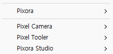

## 작업 결과

앞선 정리는 소스 변경과 별도 컴파일까지였으며 사용자 화면 반영은 확인하지 못했습니다. 현재 사용자 캡처를 실제 실패 근거로 보존합니다.

## 변경 내용

### 적용 내용

검증 도구가 예전 Pixora/Studio·Pixel Camera/Open 메뉴를 호출하던 누락을 새 세 모듈 경로로 수정했습니다. 식생 Version.json에 남은 Pixel Tooler 제품군도 Pixora Studio로 수정했습니다.

기존4개 메뉴가 그대로 보입니다. 새 메뉴 반영 성공 화면으로 처리하지 않습니다.

## 검증

현재 C:/Projects/TurnRoom 소스의 모듈 메뉴는 Pixora Studio/Image Maker·Pixel Camera·Foliage 세 개입니다. Library/ScriptAssemblies의 실제 DLL 문자열도 이 경로이며 구형 메뉴 속성 소스는 발견되지 않았습니다. Pixora.Editor.dll 갱신은21:16:33 KST로 앞선20:56 보고 이후입니다.

실행 중 TurnRoom PID23120의 프로젝트 경로와 실제 제목을 읽기 전용으로 확인했습니다. 기존 개발 호스트의 snapshot도21:19:27 KST 응답했고 씬 보존=true였습니다. 이는 메뉴가 새로 표시된 증거가 아닙니다. 새 도메인의 전체 MenuItem 메타데이터를 기록하는 읽기 전용 개발 진단을 추가했으나 자동 컴파일/로드가 아직 확인되지 않아 미실행입니다. 창 열기·포커스 전환·재시작·강제 Refresh는 하지 않았습니다.

정적 VerifyStudio 검사는 통과했습니다. 재발 교훈은 기존 전역의 설치·실행·검증 구분 규칙에 이미 있으므로 전역 변경 없음.

## 남은 사항

실제 메뉴 등록 목록과 사용자 화면의 일치 검증이 남아 있습니다. 원인은 미확인입니다. 새 진단 요청은 종료 전 제거하여 나중에 자동 실행되지 않게 합니다. 재시작이나 캐시 삭제로 추측성 복구하지 않았습니다.

## 작업 시간

- 제안 시간: 5–10분
- 실제로 완료된 시간: 2026-11-04 21:16:45 KST 시작。21:22:43 KST까지 약6분간 소스·생성 DLL·실행 호스트 대조 및 누락 수정. 실제 메뉴 표시 해결 완료 시각은 없음. 공개 배포 확인은 채팅에 기록.
- XERJ: 실패 — Status: XERJ node is not running. rg 및 실제 DLL 문자열과 실행 호스트 응답으로 대조.
