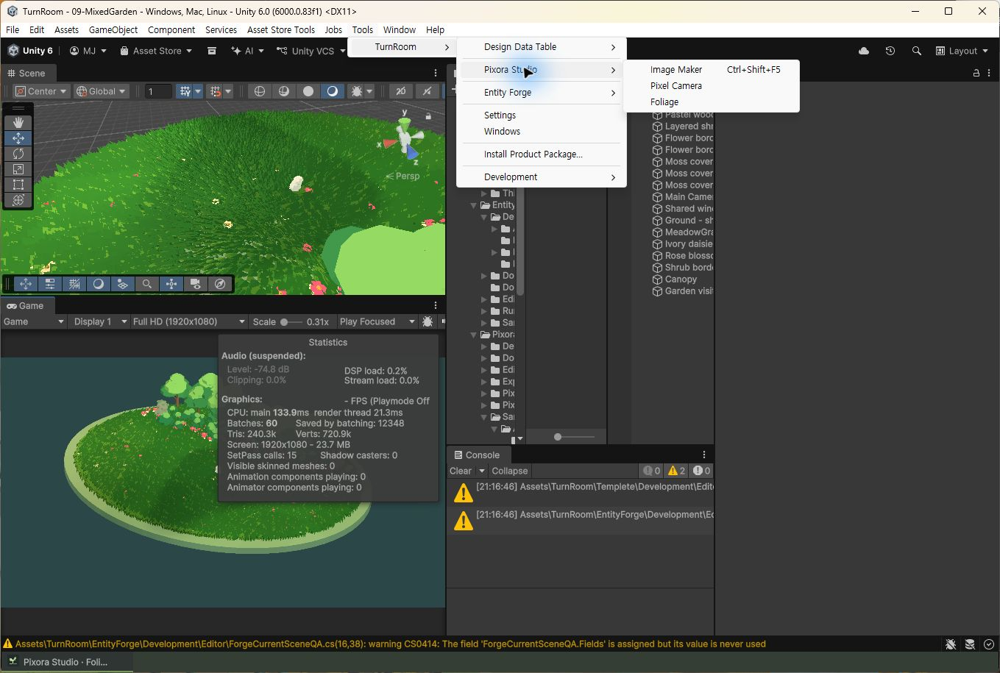

## 작업 결과

실제 Unity6000.0.83f1 TurnRoom 프로젝트에서 Pixora Studio 하위 세 모듈 표시를 직접 확인하고 촬영했습니다.

## 변경 내용

### 적용 내용

사용자가 촬영을 요청해 기존 Unity를 활성화하고 Tools → TurnRoom → Pixora Studio 메뉴를 직접 펼쳤습니다. 소스 수정이나 강제 Refresh·재시작 없이 현재 표시를 촬영했습니다.

상단 제목은 TurnRoom - 09-MixedGarden입니다. Pixora Studio 아래 Image Maker·Pixel Camera·Foliage 세 메뉴가 보이고, TurnRoom 아래 기존 Pixora·Pixel Camera·Pixel Tooler 독립 루트는 없습니다.

## 검증

2026-11-04 21:50 KST 실제 화면을 직접 확인했습니다. 원본1359×915 PNG161,928바이트를 무편집 보존했습니다. 메뉴 접근성에도 동일한3항목이 반환됐습니다. 다른 제품 창·팔레트·렌더 검증을 대신하는 결과가 아닙니다. 촬영을 위해 앱을 새로 실행하지 않았고 사용자 기존 창·씬은 보존했습니다.

앞선 사용자 캡처가 기존 메뉴였던 원인은 이번 촬영만으로 소급 확정하지 않습니다. 교훈은 기존 실행 검증 구분 규칙에 포함되어 전역 지침 변경 없음.

## 남은 사항

이 촬영 범위는 메뉴 표시입니다. 제품 창 기본 제목줄·예제 렌더·팔레트 동작 검증은 별도 남아 있습니다.

## 작업 시간

- 제안 시간: 2–5분
- 실제로 완료된 시간: 2026-11-04 21:49:47 KST 시작.21:51 KST까지 실제 메뉴 촬영 완료. 공개 보고서 확인 시각은 최종 채팅에 기록.
- XERJ: 미사용 — 코드 검색 불필요—실제 Unity 화면과 접근성 메뉴를 직접 확인
