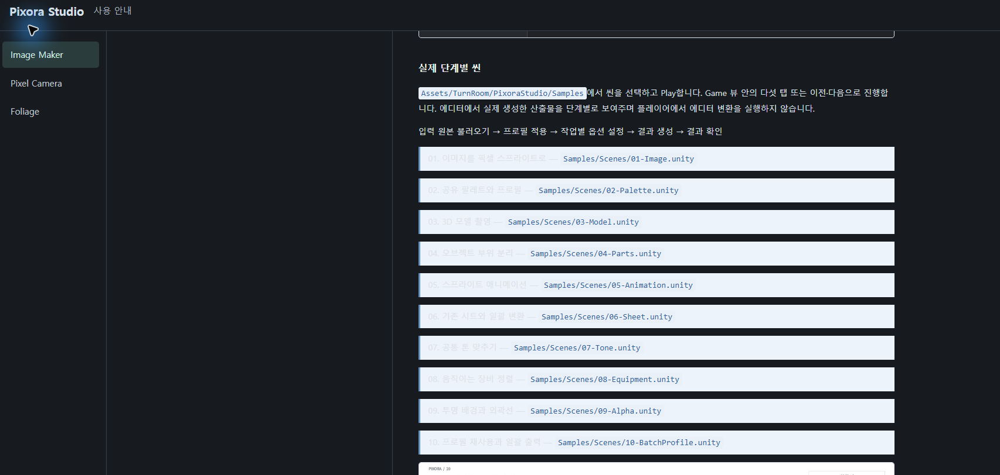

## 작업 결과

단일 Documentation의 DDT 스타일·로고·9언어 공통 항목 구현과 스크립트 검사를 완료했습니다.

## 변경 내용

### 적용 내용

DDT의 실제 guide.css와 배포 글꼴·라이선스를 사용하고 밝은 배경·서체·목차230px·제목·표 스타일을 공유합니다. iframe과 이전 어두운 CSS 덮어쓰기 구조는 제거했습니다. 세 제품은 상단 제품 탭과 선택 제품 목차로 전환합니다. Studio 헤더와 탭은 확인된각전용로고를 쓰고, Studio 전용 파비콘도 연결했습니다.

세 모듈 모두 개요 → 빠른 시작으로 시작하며 개요는 짧은 설명과 실제 예제 이미지1장·캡션을 표시합니다. 빠른 시작은4단계이고 기존 자세한 문서는 삭제하지 않았습니다. Image Maker는 기존 모델/픽셀 결과 캡처, Camera는 Clockwork Garden, Foliage는 Blossom 예제를 재사용했습니다. 기존 이미지의 내부UI를 최신 촬영이라고 바꾸지 않습니다.

기존 저대비 카드와 빈 중간 영역입니다. 새 DDT 디자인의 실제 후 화면은 확보하지 못했습니다.

## 검증

Pixora Studio9개·Entity Forge9개·템플릿 예제9개, 총27개 HTML의 실제 생성 JS를 최소 DOM 어댑터에서 실행했습니다. 전체 장/제품 이동·활성 목차·언어 변경과 로고/파비콘/예제 이미지 경로를 검사했습니다. 각 패키지 guide.css는 DDT 원본과 바이트가 같고 Inter/Pretendard 글꼴·라이선스도 동일 해시입니다. 이는 브라우저 시각 검증이 아닙니다.

Pixora9언어의 개요/빠른 시작 제목 일치·개요 이미지1장·4단계 시작·잘못된 주소 복귀도 검사했습니다. 선언한 DDT 주요 텍스트 색 조합의 최소 계산 대비는5.46:1입니다. 개별 설치의 기존 가이드 폴백은 유지합니다.

실제 브라우저 화면·작은 화면·마우스/키보드·탭 파비콘 표시와 후 캡처는 미실행입니다. 기존 화면 조작 중단 및 file URL 브라우저 보안 정책 거부를 유지했고 우회·다른 브라우저·서버 실행을 하지 않았습니다. 열린 문서의 실제 표시를 갱신했다고 보고하지 않습니다. 확인하려면 기존 문서 탭 새로고침이 필요합니다. ScreenshotManifest의 촬영 시각·소스 해시는 바꾸지 않았습니다.

## 남은 사항

실제 브라우저 및 로고/파비콘 작은 크기 검증이 남습니다. 기존 가이드 본문의 모든 링크·오래된 UI 캡처까지 새로 검증한 결과는 아닙니다. 교훈은 공통 문서 기준과 프로젝트 AGENTS에 반영했습니다. 전역은 최신 사용자 로고/파비콘·실제 검증 규칙과 중복돼 변경하지 않았습니다.

## 작업 시간

- 제안 시간: 최초6–10분, 개요 정리 추가2–4분, DDT 파비콘 추가1–2분. DDT 스타일·Entity Forge·템플릿 확대 시 추가6–10분으로 재산정; 범위 추가 후 검증/게시3–5분 안내.
- 실제로 완료된 시간: 2026-11-04 23:38:07 KST 최초 시작.23:54:01 KST DDT 기준 전체 통일 범위 추가.2026-11-05 00:07:39 KST까지 생성·검사 완료. 실제 브라우저 화면/탭 검증은 미완료. 공개 확인은 최종 채팅에 기록.
- XERJ: 실패 — Status: node not running. rg·현재 원문·생성 JS·CSS/글꼴 해시를 대조했습니다.
