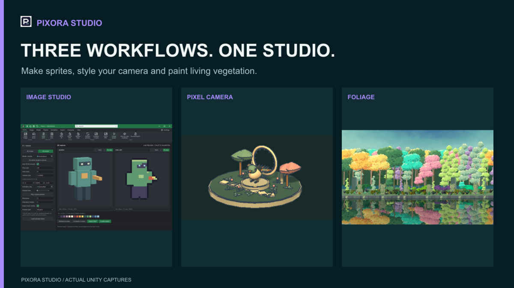

## 작업 결과

읽기전용제출전점검을마쳤습니다. 현재초안1541558(1.0.0,$10)은통합제품을설명하지만업로드1039404는11월3일의구형Assets/TurnRoom/Pixora패키지입니다. 현재상태로제출을권하지않습니다. 제품완료·심사통과판정이아니며실제Preview와신규설치·실행은미검증입니다.

## 변경 내용

### 적용 내용

이번에는제품소스·문서생성물·포털저장값을수정하지않았습니다. 점검도구와재발방지검증기준만추가했습니다.

| 우선순위 | 확인한문제 | 제출전조치 |
| --- | --- | --- |
| 차단 | 포털업로드:20,470,743bytes·1,877files·11월3일07:27UTC·Assets/TurnRoom/Pixora. 현재통합후보는43,665,034bytes·2,600assets로서로다릅니다. 원격파일전체바이트는다운로드하지않아동일해시라고단정하지않습니다. | 최신통합본고정·실제Unity내보내기·새프로젝트설치검증후업로드 |
| 차단 | 통합후보는최신StudioGuide가없고현재소스와182개변경·4개삭제파일차이가있습니다. | 최신문서·브랜드·메뉴로재포장후파일해시고정 |
| 높음 | 36문서·594장실행대조에서깨진로컬참조306건. 예:/Images/Studio.en.webp,/Templete/Documentation/GlobalSettings.en.html,../PixelFoliage/PaletteGuide.en.html. 장이동만검사한기존검사는이를놓칩니다. | BuildStudioGuide.mjs:12의경로조립및모듈간상대경로수정후전체본문링크재검사 |
| 높음 | START-HERE.md:3은Tools>TurnRoom>Pixora>Studio를안내하지만현재등록은Pixora Studio/Image Maker입니다. | 첫시작안내와실제세모듈메뉴일치 |
| 높음 | 판매4언어설명·변경이력에통합패키지업로드·최종검증대기문구가남고제거된공통overview진입창을안내합니다. 영어key_features도기능목록대신개발진척상태입니다. | 검증된최종범위로간결하게정리후저장값재대조 |
| 높음 | 패키지에는폰트Third-Party Notices가있지만판매설명4언어에는해당라이선스안내가없습니다. AI고지는코드·문서만언급하고동봉샘플아트·Blender모델의AI지원제작을구체적으로나열하지않습니다. | 공식1.2.a·1.6.a에맞춰실제사용도구와콘텐츠·라이선스고지대조 |
| 높음 | 현재공유Editor의WindowFrame.Popup.cs:32–34는비공개m_Parent/window/showMode를reflection으로읽습니다. 현재문서를재포장할경우포함될코드이며공식2.5.g와충돌합니다. 구형원격업로드에이코드가있다고단정하지않습니다. | 공개UnityAPI기반구현으로교체하거나판매범위에서제외후회귀검증 |
| 확인필요 | 11월3일공식Validator의Pixora27pass·2warning·0fail은통합후보의새설치검증이아닙니다. Camera스크린샷매니페스트에도native recapture대기가명시돼있습니다. | 최신고정패키지의공식Validator·클린설치·저장재열기·9언어실제UI검증 |
| 정리 | 현재160px스토어아이콘은네귀퉁이가불투명흰색이고여백이남습니다. 표지는구형PIXORA/로봇형Image Maker소개입니다. 로컬최신대표PNG와같은브랜드반영이필요합니다. | 실제Affinity에서슬롯별출력후아이콘·표지저장값확인 |

두이미지는현재CDN에저장된실제미디어의원본복사이며새프로그램실행화면으로위장하지않습니다.

## 검증

통과한범위: 현재asmdef소속소스137개·9어셈블리의Unity6000.0.83f1 C#정적컴파일(런타임실행아님), 세직접모듈메뉴정적검사,9언어36문서594장라우팅·언어전환,포털4언어미디어순서일치,키이미지3개·갤러리21장전부시각검토.

실제서버영상:공개player/HLS를읽어1080p H.264/24fps·AAC48kHz stereo·60.02초·1440프레임전체디코드통과.오디오mean -20.2dB,max -5.6dB로신호있음.이번직접청음은미실행입니다.이전기록의동일video ID와사용자청취확인(소리잘나옴)을구분해참조했습니다.음원Cipher/Kevin MacLeod·CC BY4.0크레딧기록있음,홍보전용이며패키지동봉오디오가아닙니다.

새통합후보는Development/Verification포함0·150자이상경로0·모듈별Third-Party Notices·Source ZIP보유.최신구현·최신문서·정상실행을증명하지않으므로통합배포합격으로처리하지않습니다. 최초컴파일시도는낡은응답파일이새Palette소스를누락하고삭제된Suite를참조해실패했습니다.기록을보존한뒤현재asmdef소속소스를재수집하자9어셈블리통과했고삭제된Family대상은건너뛰었습니다.

[점검요약](../assets/presubmission-20261105/audit-summary.json) · [깨진본문참조전체](../assets/presubmission-20261105/document-audit.json) · [캡처근거대조](../assets/presubmission-20261105/capture-audit.json) · [서버영상디코드](../assets/presubmission-20261105/store-video-decode.log)

판정기준:[Unity공식제출지침](https://assetstore.unity.com/publishing/submission-guidelines),[공식제출절차](https://docs.unity.com/en-us/asset-store/publishing/asset-packages/submit).

## 남은 사항

제품수정·재패키징·업로드·최종Submit은수행하지않았습니다. 현재검토요청의결론은제출보류입니다. 화면조작금지때문에실제PortalPreview·Submit모달의필수입력검사·새Unity설치/실행·실제9언어레이아웃을확인하지않았습니다. support_links는SDK에서빈배열이지만판매자프로필웹사이트가없다고단정하지않습니다. 최신로고.af저장·재열기제한도아직남습니다.

교훈검토:동적문서의장전환검사와실제본문URL해석검사를분리하는규칙을기존전역대조의무에통합했습니다.설치본·설정저장소동일성을확인하고Sync.ps1 Push를실행했습니다.제품문서QA기준에도반영했습니다.이미열린다른대화의자동적용을주장하지않습니다.

## 작업 시간

- 제안 시간: 15~25분
- 실제로 완료된 시간: 2026-11-05 00:59:21 KST 시작. 읽기전용점검결과정리01:16 KST경. 공개배포대기는별도이며최종시각은채팅에실제기록.
- XERJ: 실패 — Status:XERJ node is not running.직전Search의시작실패기록을확인하고현재소스와rg로대조했습니다.
