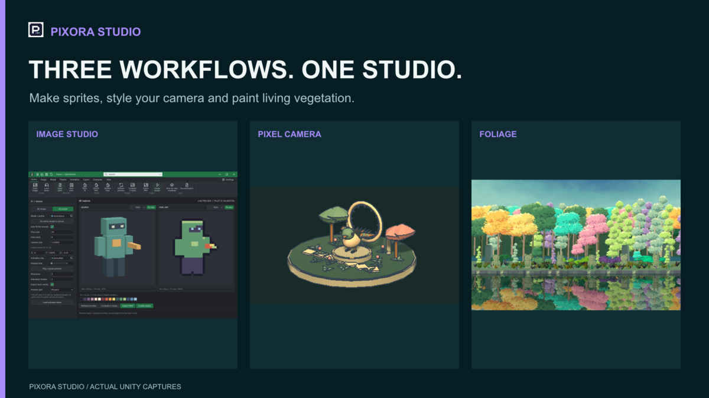

## 작업 결과

사용자지적이맞습니다. 이전제출용2.5.g수정은해결돼있습니다. 20,470,743바이트보관파일의SHA-256이당시실제업로드영수증과정확히일치합니다. 제가개발작업트리의별도파일을제출본문제와섞어잘못판정했습니다.

## 변경 내용

### 적용 내용

**정정: 이전보고서의2.5.g위반·미해결지적을철회합니다.**

- 11월1일제출기록에내부컨테이너reflection·비공개스포이트후킹제거가명시돼있습니다.
- 실제업로드영수증의해시와동일한Frozen/2026-11-03-final/TurnRoom-Pixora.unitypackage를확인했습니다.
- 이패키지와통합검토패키지모두WindowFrame.Popup.cs를포함하지않습니다.
- 제가근거로든파일은현재개발작업트리의미추적파일이며,위두실제패키지의포함파일이아닙니다.개발파일의존재를기존제출본의미해결판정으로연결한것이잘못입니다.
- 기존수정을취소하거나제품동작을임의로변경하지않았습니다.

아래는이전점검내용에서잘못된2.5.g행을제외한기록입니다.다른항목은이전실행근거를유지한것이며이번에전부재실행했다고주장하지않습니다.

이번에는제품소스·문서생성물·포털저장값을수정하지않았습니다. 점검도구와재발방지검증기준만추가했습니다.

| 우선순위 | 확인한문제 | 제출전조치 |
| --- | --- | --- |
| 차단 | 포털업로드:20,470,743bytes·1,877files·11월3일07:27UTC·Assets/TurnRoom/Pixora. 현재통합후보는43,665,034bytes·2,600assets로서로다릅니다. 원격파일전체바이트는다운로드하지않아동일해시라고단정하지않습니다. | 최신통합본고정·실제Unity내보내기·새프로젝트설치검증후업로드 |
| 차단 | 통합후보는최신StudioGuide가없고현재소스와182개변경·4개삭제파일차이가있습니다. | 최신문서·브랜드·메뉴로재포장후파일해시고정 |
| 높음 | 36문서·594장실행대조에서깨진로컬참조306건. 예:/Images/Studio.en.webp,/Templete/Documentation/GlobalSettings.en.html,../PixelFoliage/PaletteGuide.en.html. 장이동만검사한기존검사는이를놓칩니다. | BuildStudioGuide.mjs:12의경로조립및모듈간상대경로수정후전체본문링크재검사 |
| 높음 | START-HERE.md:3은Tools>TurnRoom>Pixora>Studio를안내하지만현재등록은Pixora Studio/Image Maker입니다. | 첫시작안내와실제세모듈메뉴일치 |
| 높음 | 판매4언어설명·변경이력에통합패키지업로드·최종검증대기문구가남고제거된공통overview진입창을안내합니다. 영어key_features도기능목록대신개발진척상태입니다. | 검증된최종범위로간결하게정리후저장값재대조 |
| 높음 | 패키지에는폰트Third-Party Notices가있지만판매설명4언어에는해당라이선스안내가없습니다. AI고지는코드·문서만언급하고동봉샘플아트·Blender모델의AI지원제작을구체적으로나열하지않습니다. | 공식1.2.a·1.6.a에맞춰실제사용도구와콘텐츠·라이선스고지대조 |
| 확인필요 | 11월3일공식Validator의Pixora27pass·2warning·0fail은통합후보의새설치검증이아닙니다. Camera스크린샷매니페스트에도native recapture대기가명시돼있습니다. | 최신고정패키지의공식Validator·클린설치·저장재열기·9언어실제UI검증 |
| 정리 | 현재160px스토어아이콘은네귀퉁이가불투명흰색이고여백이남습니다. 표지는구형PIXORA/로봇형Image Maker소개입니다. 로컬최신대표PNG와같은브랜드반영이필요합니다. | 실제Affinity에서슬롯별출력후아이콘·표지저장값확인 |

두이미지는현재CDN에저장된실제미디어의원본복사이며새프로그램실행화면으로위장하지않습니다.

## 검증

이번재검증: Frozen패키지SHA-256 **35ebbb385de19f9209eea0ce9ce6a634b3d34e8bd6e6deda5b9a21b9ec7f4f22** = Pixora-upload-receipt.json의packageSha256 = Pixora-upload-request.json의expectedSha256. 파일크기20,470,743바이트도포털기록과일치합니다.

두실제아카이브의C#파일을단일스트림으로읽어문제파일포함여부와reflection호출을대조했습니다. 튜토리얼의공개Run메서드호출과사용자직렬화필드탐색은Unity비공개컨테이너호출과구분했습니다. m_Parent·UnityEditor내부타입문자열·showMode·비공개EyeDropper후킹후보는두패키지에서검출되지않았습니다.

[재검증파일·해시·실제코드위치](../assets/presubmission-20261105/recheck-25g.json)

[정정대상인이전보고서](./2026-11-04-result-20261104161631134-v1.0.0.html)는이력으로보존하며2.5.g행은현재판정으로사용하지않습니다.이번수정은검토기록정정이므로제품실행화면변경은없고,화면조작·GUI실행은하지않았습니다.

## 남은 사항

기존제출본의2.5.g미해결판정은철회합니다. 현재작업트리의새파일과과거해결본을혼합하지않습니다. 최신통합패키지의전면심사적합성까지자동으로합격시키는정정은아닙니다. 나머지문서링크·통합패키지현재성·판매필드문제는기존근거를유지합니다.

교훈검토: 기존전역의해결이력확인·실제배포파일대조규칙을지키지않은오류입니다. 중복규칙을추가하지않고이사건의근거와정정범위를보고서에보존합니다. 전역지침변경없음.

## 작업 시간

- 제안 시간: 3~5분
- 실제로 완료된 시간: 2026-11-05 02:44:41 KST 시작.02:47경동일업로드해시·두아카이브대조.보고서공개배포확인은별도진행.
- XERJ: 실패 — Status:XERJ node is not running.직전Search의시작실패기록을확인하고현재소스와rg로대조했습니다.
