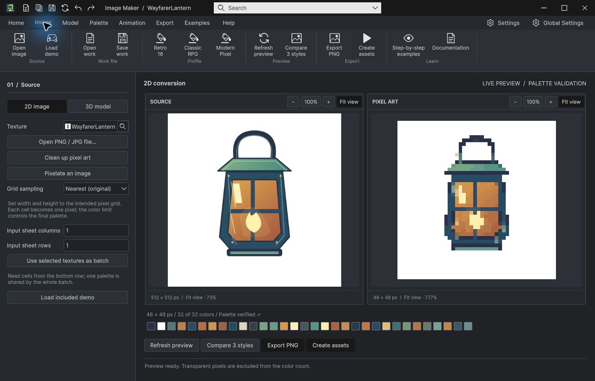
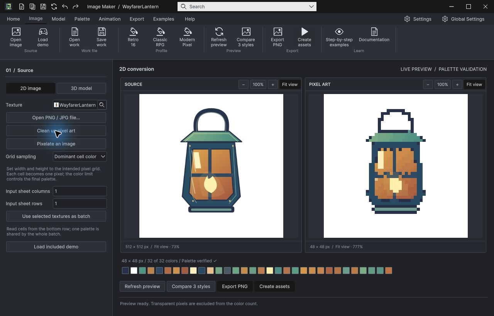
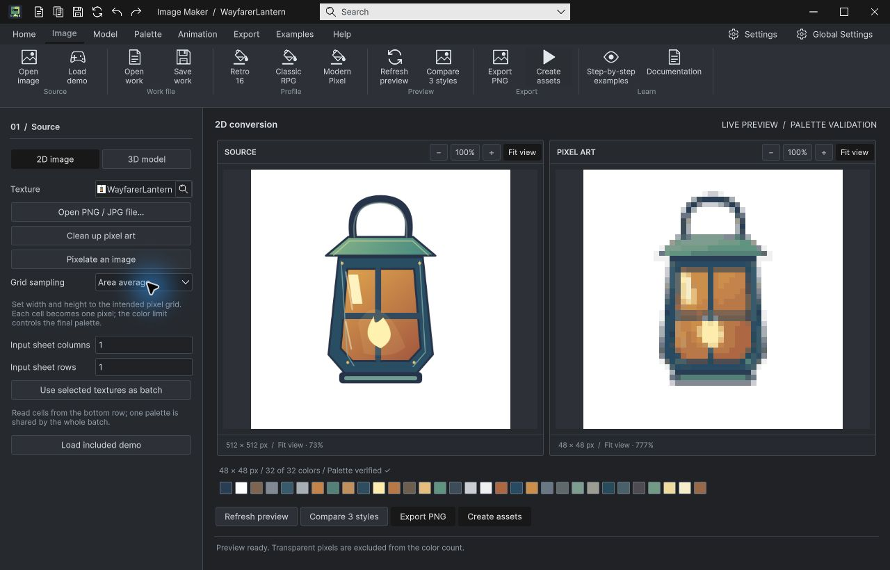
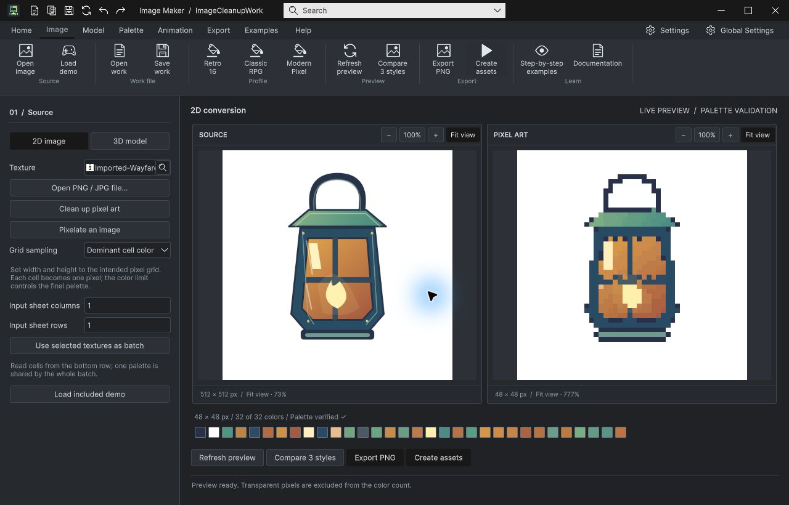
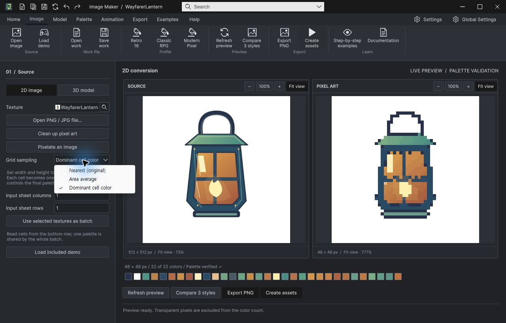
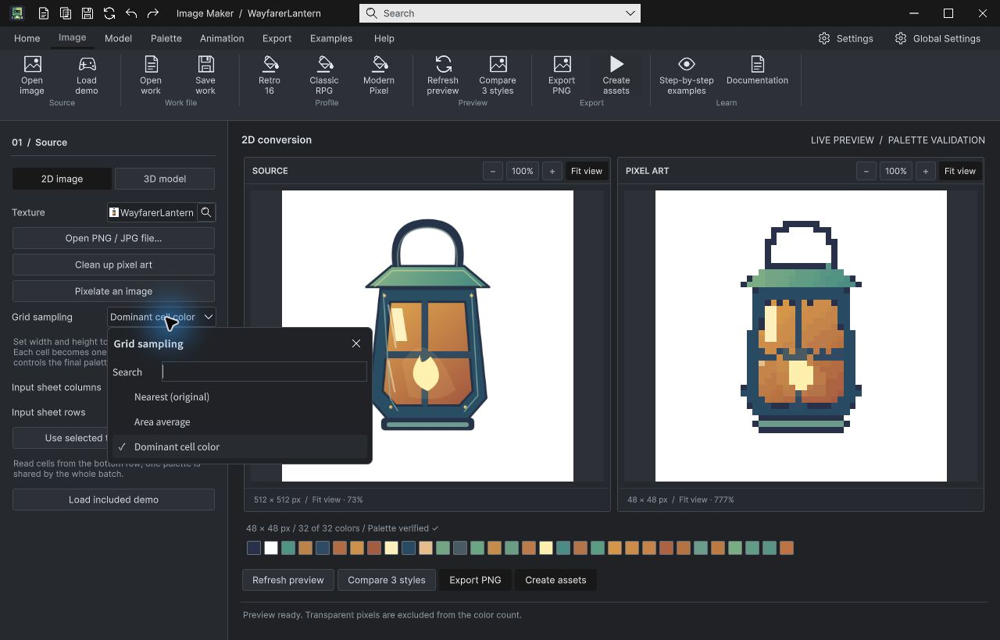
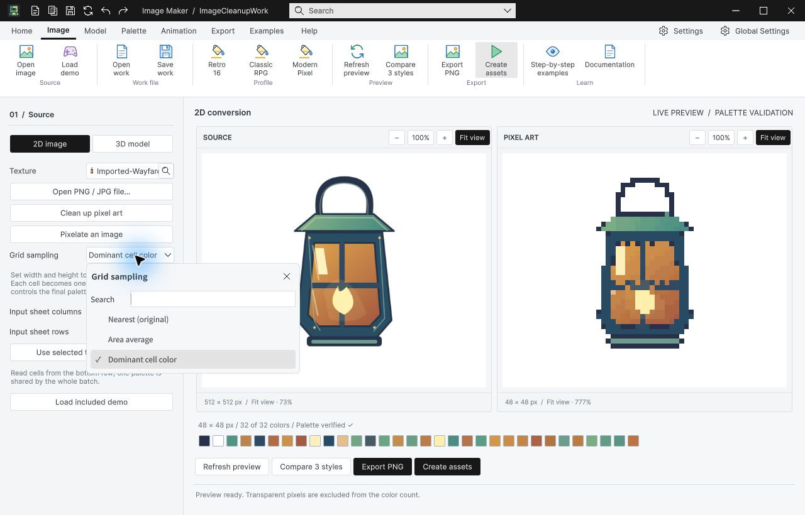
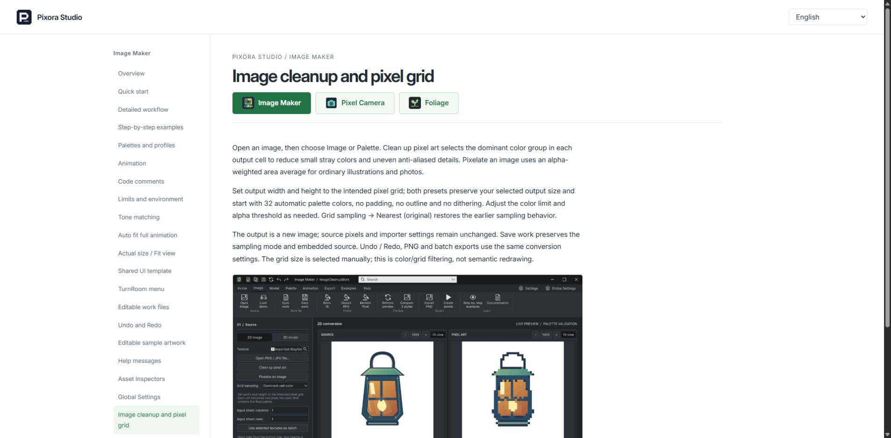

## 작업 결과

기존 Image Maker의 이미지/팔레트 탭에서 도트 정돈 또는 일반 이미지 픽셀화를 선택할 수 있습니다. 출력 격자 크기와 최대 색상 수를 조절하며 원본을 보존합니다.

## 변경 내용

### 적용 내용

- 도트 정돈: 셀의 면적·알파를 반영한 대표 색상 군집으로 작은 잡색·경계색을 줄입니다.
- 일반 이미지 픽셀화: 알파 가중 영역 평균을 사용합니다.
- 기존 최근접 모드를 유지하고 프로필·작업 파일·히스토리·PNG·일괄 변환에서 같은 설정을 사용합니다.
- 9언어 UI/사용 문서와 실제 영문 캡처를 추가했습니다.

### 동일 원본·48×48 출력 비교

전: 기존 최근접 샘플링.

후: 셀 대표색으로 도트 정돈.

일반 이미지용 영역 평균 결과.

## 검증

Unity6000.0.83f1의 실제 변환·직렬화 검사 **21개 통과**. 셀 중앙 잡색 제거, 영역 평균, 투명 RGB 번짐 방지, 알파 피복률, 종횡비·패딩, 팔레트 포함·색 수, 기존 설정 호환, 원본 보존 및 재출력 픽셀 일치를 확인했습니다. [실행 결과](../assets/image-cleanup-20261105/algorithm-qa.json).

실제 파일 대화상자로 PNG 입력 → 정돈 → 작업 저장 → 닫기·재열기 → PNG 내보내기를 수행했습니다. 내보낸 픽셀이 저장된 작업의 재변환과 일치했습니다. 네이티브 Ctrl+Z/Ctrl+Y와 선택창의 키보드·마우스 선택 및 Escape 취소를 확인했습니다.

### 선택창 QA 중 발견·수정

초기 일반 PopupField가 Unity 기본 메뉴를 열어 실패했습니다. 공통 자동 연결 대상인 DropdownField로 교체하고 재검증했습니다.

라이트 테마에서도 소유 테마와 마우스 선택값 반영을 확인했습니다. 긴 번역 레이블에는 공통 readable-field를 적용했습니다.

### 언어·문서

[en 실제 화면](../assets/image-cleanup-20261105/ui-en.png) · [ko 실제 화면](../assets/image-cleanup-20261105/ui-ko.png) · [ja 실제 화면](../assets/image-cleanup-20261105/ui-ja.png) · [zh-Hans 실제 화면](../assets/image-cleanup-20261105/ui-zh-Hans.png) · [zh-Hant 실제 화면](../assets/image-cleanup-20261105/ui-zh-Hant.png) · [es 실제 화면](../assets/image-cleanup-20261105/ui-es.png) · [fr 실제 화면](../assets/image-cleanup-20261105/ui-fr.png) · [de 실제 화면](../assets/image-cleanup-20261105/ui-de.png) · [pt-BR 실제 화면](../assets/image-cleanup-20261105/ui-pt-BR.png)

36문서612장 경로·링크·이미지 참조 검사에서 누락0. 새 장의 실제 브라우저 본문과 캡처 로드를 확인했습니다. [참조 검사](../assets/image-cleanup-20261105/document-audit.json) · [실행 소스 일치](../assets/image-cleanup-20261105/final-source-hashes.json).

## 남은 사항

격자 크기는 사용자가 정합니다. 원본 도트 크기 자동 추정이나 AI의 형태 재생성은 포함하지 않습니다. 실제 AI 출력 원본은 제공되지 않아 합성 잡색 입력과 포함된 일러스트로 검증했습니다. 새 기능은 현재 개발 트리에 적용했으며 기존 Asset Store 업로드본에는 아직 포함되지 않습니다. 기존 제출 대기 패키지는 보존했습니다. 교훈 검토: 공통 선택 패널·긴 레이블·실제 출력 검증에 관한 기존 지침을 재적용했으며 중복 전역 규칙은 추가하지 않았습니다. 전후 캡처는 실제 원본 PNG이며 이미지당 대부분200KB미만입니다. 별도 GIF·장식 이미지는 제작하지 않았습니다.

## 작업 시간

- 제안 시간: 15~25분
- 실제로 완료된 시간: 기능 구현·QA 25분, 2026-11-05 05:28:43 KST. 최초 예상15~25분. 보고서 푸시·공개 배포 확인은 별도로 수행합니다.
- XERJ: 실패 — Status: node is not running. 이전 복구 실패 근거와 현재 상태를 확인하고 rg로 현 소스 대조.
