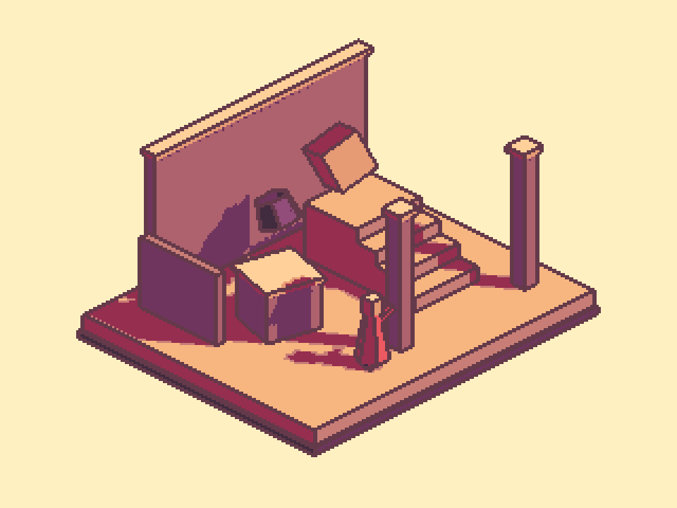
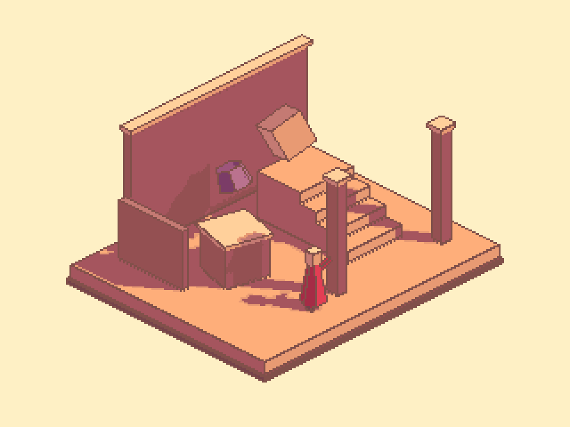

## 작업 결과

선 배치를 수정해 실제 원본 1픽셀 폭을 측정했고, 참고에 맞춰 선과 면·그림자의 색을 부드럽게 조정했습니다. 예제와 9언어 UI/문서도 갱신했습니다. 실제 GUI 입력은 사용자 요청대로 보류합니다.

## 변경 내용

### 적용 내용

- [이전 결과 원문](2026-11-05-result-20261105081959355-v1.0.0.html)의 “균일 격자·정확 팔레트” 검사는 유효했지만 실제 선 폭과 참고 색감의 충족을 증명하지 못했습니다. outlineWidth=1은 샘플링 반경이었으며 양쪽 경계 검출로 직선 경계가 원본 2픽셀이 되는 것을 새 GPU 검사로 확인했습니다.
- Full Camera에 Camera outline placement → Single side를 추가했습니다. 가까운 면에 경계를 배정하고 같은 깊이의 면 경계는 고정 방향으로 배정해 양쪽이 중복으로 그려지지 않습니다. 반경 1에서는 원본 1픽셀입니다. Both sides는 기존 동작이며 기존 프리셋 기본값을 보존합니다.
- 예제는 Single side + 반경 1을 사용합니다. 선은 짙은 보라색 #643A4A에서 따뜻한 갈색 #81504A로 조정하고, 바닥 #FEAE7A·크림 배경 #FEF0C5·벽 계열 #A5555E와 밝아진 따뜻한 그림자로 색 대비를 낮췄습니다. 보라색은 소품에서 구분되도록 조정했습니다.
- Inspector/창 옵션·선택·툴팁을 9언어에 추가하고 기능/제품/Studio 문서를 새 실제 렌더로 갱신했습니다.

수정 전 — 같은 장면·시점·배율의 두꺼운 선과 강한 보라색 대비.

수정 후 — 한쪽 배치의 원본 1픽셀 선과 따뜻하고 부드러운 색상.

## 검증

- 실제 Unity 6000.0.83f1 Linear/Built-in GPU 출력에서 동일한 큐브 직선 경계를 검사했습니다. 양쪽 배치의 양 끝 선은 각각 6출력px, 한쪽 배치는 각각 3출력px입니다. 3배 확대이므로 실제 원본 폭은 각각 2px와 1px입니다. 모서리/교차점 전체의 두께가 이 직선 측정만으로 검증됐다는 뜻은 아닙니다. [측정 근거](../assets/soft-outline-20261105/atelier-qa.json)
- 최종 사용 색 15개가 16색 팔레트에 정확히 포함: 팔레트 밖 0픽셀, 960×720의 3×3 블록 불일치 0개.
- 씬 저장·재열기 후 실제 픽셀 동일, 카메라 수학/추적/복원 회귀 12개 통과. 기존 씬·더티·선택·루트 보존과 preview/렌더 자원 정리 확인.
- 7개 어셈블리 컴파일, 9언어 신규 키와 27개 실제 생성 본문/이미지/링크 검증 통과. [문서 검증](../assets/soft-outline-20261105/verification.json)
- 참고 PNG의 샘플 픽셀에서 배경 약 (254,240,197), 바닥 약 (254,174,122), 벽 약 (165,85,94)을 읽어 새 색 조정 기준으로 사용했습니다. 압축된 참고 이미지의 일부 샘플이며 원본 제품 팔레트를 추출했다는 뜻은 아닙니다.
- 직선 GPU 측정 이미지는 [기존 양쪽 배치](../assets/soft-outline-20261105/LineFixture-BothSides.png), [수정 한쪽 배치](../assets/soft-outline-20261105/LineFixture-SingleSide.png)에 보존했습니다. 주 결과 이미지는 재가공하지 않은 실제 새 장면 렌더입니다.
- 교훈 검토: 선 두께를 설정값만으로 판단하지 않고 실제 경계에서 측정하며 원본/확대 픽셀을 구분하도록 PixoraAuthoring.md에 통합했습니다. 적용 범위는 프로젝트 렌더 QA이며 설치 전역 지침 변경은 없습니다.

## 남은 사항

사용자의 화면 조작 보류에 따라 실제 Inspector 선택/취소·라이트/다크/9언어 표시·Play 물리 키와 브라우저 화면/탭 아이콘은 미실행입니다. 새 한쪽 배치의 이번 실제 렌더 범위는 Windows Unity 6000.0.83f1 Linear/Built-in이며 URP/Gamma 실제 렌더를 새로 통과 처리하지 않습니다. 전체 final QA/complete는 보류합니다.

## 작업 시간

- 제안 시간: 15~25분
- 실제로 완료된 시간: 시작 2026-11-05 17:30:42 KST. 구현·비화면 검증 완료 2026-11-05 17:44:53 KST(14분11초). 공개 확인은 별도이며 전체 GUI QA는 보류.
- XERJ: 미사용 — 노드 미실행 및 PixelCamera 인덱스 범위 밖으로 rg를 사용해 현재 셰이더/설정/호출을 대조했습니다.
