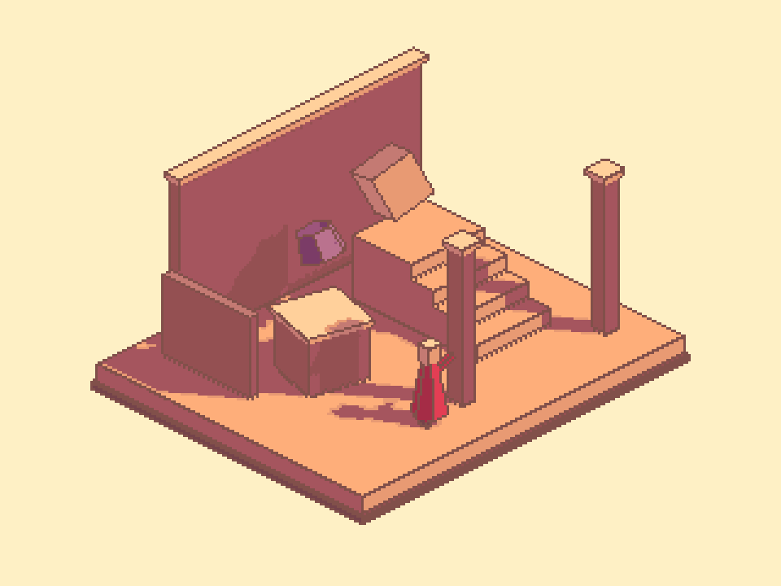

## 작업 결과

기둥의 내부 세로 모서리에서 사용자께서 지적한 차이를 확인했습니다. 현재 구현에는 바깥 실루엣과 내부 면 경계를 별도의 강도·색으로 처리하는 구분이 없습니다. 이번에는 비교만 수행했고 제품은 수정하지 않았습니다.

## 변경 내용

### 적용 내용

비교 기준은 채팅에 첨부된 Image 3입니다.

| 구분 | 참고에서 관찰한 표현 | 현재 구현 |
| --- | --- | --- |
| 바깥 실루엣 | 짙은 선으로 형상 구분 | 갈색 불투명 선 |
| 같은 물체의 내부 면 모서리 | 기둥 세로선처럼 밝고 낮은 대비의 선/하이라이트 | 같은 갈색 선 |
| 물체 사이 겹침 경계 | 내부 화면에 있어도 형상을 구분하는 짙은 경계가 보임 | 깊이/노멀 결과와 합쳐 처리 |

단순히 화면 안쪽의 모든 선을 밝히는 것으로 해석하면 겹침 경계까지 약해질 수 있습니다. 물체의 외곽/가림과 같은 물체의 면 모서리를 구분해서 비교해야 합니다.

현재 결과의 기존 실제 Unity 렌더입니다. 이번 비교를 위해 재생성하거나 수정한 이미지가 아닙니다.

## 검증

- 참고 Image 3의 y=340에서 바깥 경계 부근 (544,340)은 RGB 약 (93,40,43), 내부 밝은 모서리 (560,340)는 (199,102,115), 옆 면 (576,340)는 (165,85,94)입니다. 압축 이미지의 단일 픽셀 표본이며 참고 제품의 공식 팔레트나 모든 내부 경계의 규칙을 뜻하지 않습니다.
- PixelCameraProcess.cginc에서 깊이 불연속과 노멀 불연속을 max로 합쳐 단일 edge에 누적한 뒤 PCOutlineLighting(_OutlineColor, edgeDirection)으로 색을 적용합니다.
- 현재 프리셋은 outlineStyle=Flat, outlineColor=#81504A, alpha=1입니다. PCOutlineLighting은 Flat에서 원래 선색을 그대로 반환하므로 검출 종류별로 색/강도를 달리하지 않습니다.
- 선택 가능한 DirectionalBevel도 화면상 선 방향에 따른 색 변화이며, 외부/내부 경계를 별도로 분류하는 기능은 아닙니다.
- 제품·소스·설정·화면 포커스는 변경하지 않았습니다. [표본 및 확인 범위](../assets/edge-comparison-20261105/comparison.json)
- 교훈 검토: 기존의 참고 대조·실제 픽셀 검증 규칙을 적용했습니다. 새 전역 지침은 추가하지 않았습니다.

## 남은 사항

참고의 밝은 선이 화면 후처리인지, 실제 베벨 형상·재질·조명 결과인지는 원본 구현이 없어 미확인입니다. 모든 내부 경계를 밝게 처리해야 한다고 단정하지 않습니다. 이번 비교 결과를 새 기능 구현 완료로 보고하지 않습니다.

## 작업 시간

- 제안 시간: 2~4분
- 실제로 완료된 시간: 비교 시작 2026-11-05 20:30:05 KST. 이미지·소스 대조 후 기록하며 공개 확인 시각은 별도로 기록합니다.
- XERJ: 미사용 — PixelCamera 범위 밖으로 기존 확인된 소스·설정과 실제 이미지 픽셀을 직접 대조했습니다.
