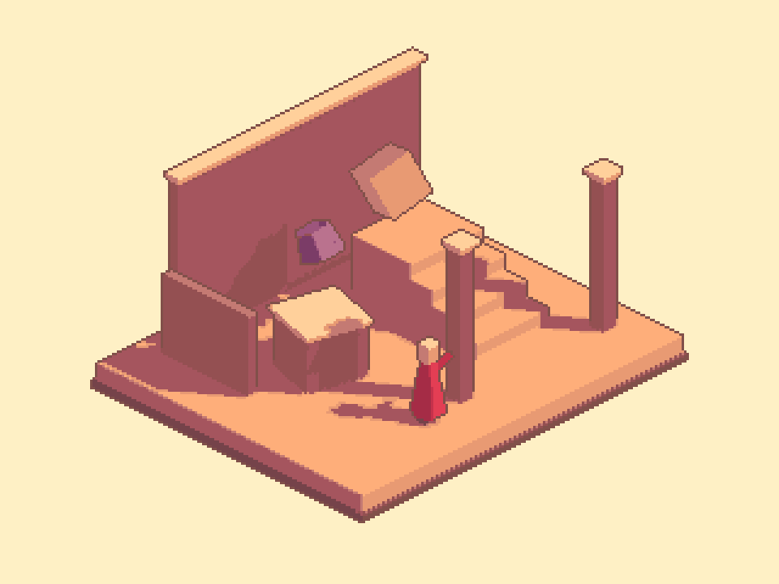
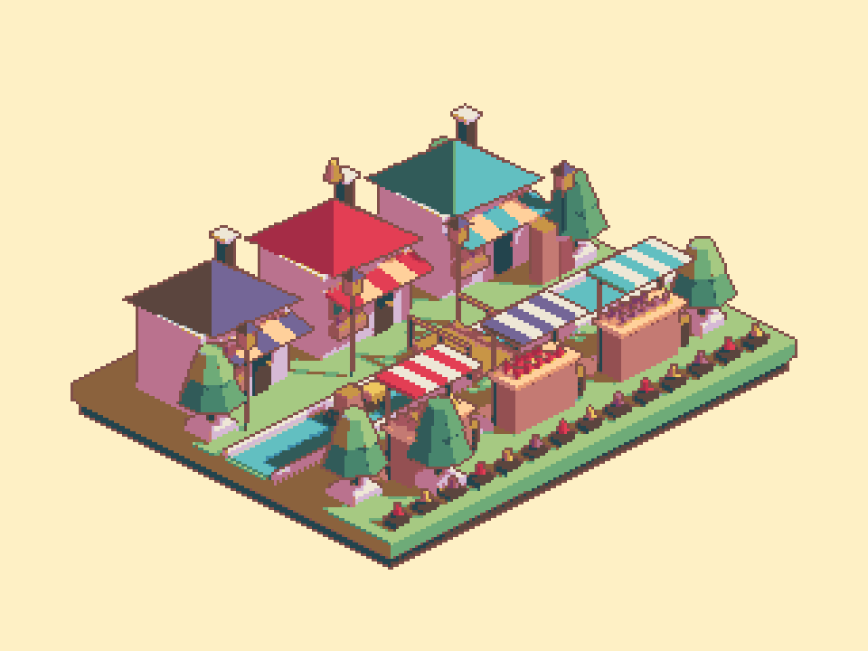

## 작업 결과

새 예제 구성·저장·재열기와 실제 Unity 렌더 검증을 완료했습니다. 9개 언어 문서와 예제 진입 메뉴도 Skygarden Market으로 갱신했습니다.

## 변경 내용

### 적용 내용

- 23개 → 240개 메시 오브젝트: 색이 다른 상점 3채, 줄무늬 가판대 3개, 층층 나무 6그루, 운하·나무다리·화물선, 꽃밭·등불·창문·차양·과일·통·포장 화물.
- 옥색·청록·보라·산호·꿀색의 36색 팔레트, 실제 출력에는 32색 사용. 기존의 어두운 외곽선/광원 반응 내부선과 원본 1픽셀 폭은 유지했습니다.
- Tools > TurnRoom > Pixel Camera > Samples > Skygarden Market. 기존 04-IsometricAtelier 씬 경로/GUID와 프리팹 진입 연결은 유지했습니다. 새 장면 크기에 맞게 줌 범위와 초기화값을 수정하고 장식 필드명을 갱신했습니다.

같은 960×720 출력과 동일한 픽셀 격자·투영 방향의 실제 Unity 렌더입니다. 새 장면의 넓이에 맞춰 카메라 크기는 4.5에서 6.1로 변경했습니다.

## 검증

- Unity 6000.0.83f1 Linear/Built-in: 실제 GPU/스타일 검사 22개·카메라 회귀 12개 통과.
- 저장된 씬을 새 preview로 재열기한 출력 픽셀 동일. 팔레트 밖 색 0개·3×3격자 불일치 0개.
- 1픽셀 선 폭과 외곽/겹침 경계 보존·광원 off 내부선 반응 회귀 통과.
- 7개 어셈블리 컴파일 성공 및 최종 소스 해시 일치. 9언어 키/설명, 27개 생성 문서의 본문·탭/장 이동·이미지·링크 검사 통과.
- 기존 Garden 원본 518개 오브젝트 보존. 활성 씬·더티·선택·원래 루트 보존, 작업 preview 종료. 신규 GUI 실행·마우스·키보드 조작 없음.
- [실제 GPU/씬 검증](../assets/skygarden-20261105/atelier-qa.json) · [문서 검증](../assets/skygarden-20261105/verification.json) · [컴파일](../assets/skygarden-20261105/compile.json)
- 교훈 검토: 참고의 렌더 표현과 예제 구성 모방을 구분하라는 사용자 정정을 기존 Pixora 프로젝트 지침에 통합했습니다. 프로젝트 선호이므로 새 전역 지침은 추가하지 않았습니다.

## 남은 사항

실제 Play 상태에서의 네이티브 키보드 조작·Inspector 테마/언어 레이아웃·브라우저 탭 표시는 사용자 화면 조작 보류로 미실행입니다. 실제 URP 렌더는 이번 범위에서 미검증입니다. 입력 QA를 통과 처리하지 않았습니다.

## 작업 시간

- 제안 시간: 15~25분
- 실제로 완료된 시간: 시작 2026-11-05 21:12:35 KST. 구현·비화면 검증 종료 2026-11-05 21:19:11 KST (396초). 이후 공개 배포 확인을 수행하며 최종 채팅에 전체 소요 시간을 기록합니다.
- XERJ: 미사용 — Status에서 XERJ node is not running 확인. PixelCamera는 기존 인덱스 범위 밖이며 현재 소스는 직접 읽기와 rg로 검색했습니다.
