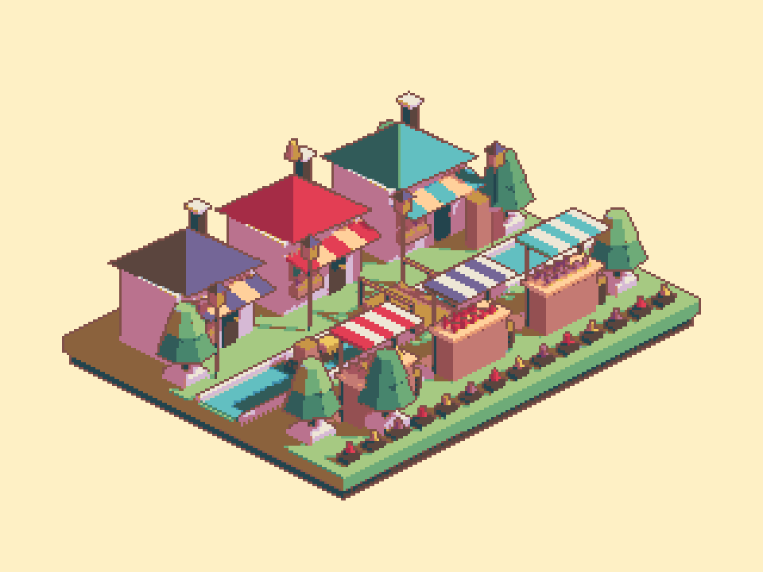
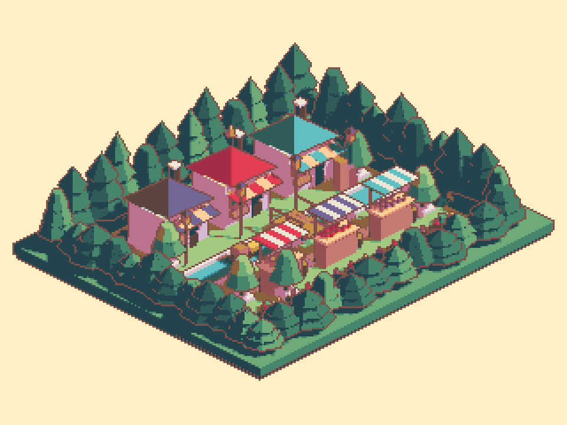

## 작업 결과

숲 지형·수목·관목을 편집 가능한 씬/프리팹에 반영했습니다. 실제 Unity 렌더·저장 재열기와 9개 언어 문서 검증을 완료했습니다.

## 변경 내용

### 적용 내용

- 기존 시장 오브젝트를 유지하고 외곽에 숲 지형, 3단 나무 43그루, 관목 24개, 바위 12개를 추가했습니다. 총 메시 오브젝트는 240개에서 450개로 증가했습니다.
- 새 숲 재질은 녹색/청록색 그림자를 사용합니다. 기존 픽셀 격자·짙은 외곽선/광원 반응 내부선과 36색 팔레트를 유지했습니다.
- 숲 전체가 들어오도록 같은 투영 방향에서 카메라 크기를 6.1에서 7.65로 조정했습니다.

모두 실제 Unity 960×720 렌더입니다. 카메라 크기는 숲 확장에 맞춰 변경됐으며, 이미지를 편집해 나무를 합성하지 않았습니다.

## 검증

- Unity 6000.0.83f1 Linear/Built-in: 실제 GPU/스타일 검사 23개와 카메라 회귀 12개 통과.
- 숲 나무43/관목24/총450메시 확인. 새 씬 재열기 출력 픽셀 동일.
- 팔레트 밖 픽셀 0개, 3×3격자 불일치 0개. 1원본픽셀 선·깊이 경계 보존·광원 반응 회귀 통과.
- 7개 어셈블리 컴파일 성공 및 최종 소스 해시 대조. 9언어 문서 27개 본문·탭/장 이동·이미지/링크 검사 통과.
- 기존 Garden 518개 오브젝트, 원래 활성 씬·더티·선택·루트 보존. 작업 preview 종료·명령 파일 소비 확인. 신규 GUI 프로세스 실행/실제 입력 없음.
- [GPU/씬 근거](../assets/forest-20261105/atelier-qa.json) · [문서 검증](../assets/forest-20261105/verification.json) · [컴파일](../assets/forest-20261105/compile.json)
- 교훈 검토: 기존의 실제 렌더 대조·원본 보존·화면 조작 보류 규칙을 적용했습니다. 새 공통 교훈이 없어 전역 지침 변경 없음.

## 남은 사항

실제 Play의 네이티브 키보드/Inspector 테마·언어 레이아웃/브라우저 표시 검증은 사용자 화면 조작 보류로 미실행입니다. 실제 URP 렌더는 미검증입니다.

## 작업 시간

- 제안 시간: 8~15분
- 실제로 완료된 시간: 시작 2026-11-05 21:35:40 KST. 구현·비화면 검증 종료 2026-11-05 21:38:59 KST (199초). 이후 공개 확인을 진행하며 전체 소요 시간을 최종 채팅에 기록합니다.
- XERJ: 미사용 — Status에서 XERJ node is not running 확인. PixelCamera가 기존 인덱스 범위 밖으로 rg와 현재 소스 직접 읽기를 사용했습니다.
