## 작업 결과

정원 렌더를 먼저 대조해 방향과 프레이밍을 수정한 뒤 배송·천문대에 적용했습니다. 9단계 모두 저장/재열기 픽셀이 같고, 세 축의 투영 길이 비율1 및 전체3×3격자 불일치0을 확인했습니다.

## 변경 내용

### 적용 내용

이전 결과는 선만 바꾸고 혼합 해상도와 자유 시점을 유지했으므로 세 예제 전체의 아이소매트릭 적용으로 볼 수 없었습니다. 이번에는3개카메라에 PixelCameraIsometric을 연결하고9프리셋을 Full Camera로 변경했습니다. 기존 각 장면의 정면에 가까운45°+90° 방향과 실제 메시 정점의 화면 범위를 사용했습니다.

원본1픽셀 선은240p 격자에서1셀이고960×720 출력에서3픽셀입니다. 몸체와 배경도 같은3×3블록을 사용합니다. 이전의 출력1픽셀 선/4픽셀 물체/고해상도 배경 혼합과 구분합니다.

표면색 기반 외곽선·깊이 가림 경계와 광원반응 내부선, 기존 재질색/조명·형상·애니메이션클립은 유지합니다. UI는 별도로 선명하게 렌더됩니다. C·Q/E는90도 전환, S는전체격자스냅, X는180/240/360p, 휠은줌, R은원래아이소메트릭방향 복원입니다. 사용하지 않는 M 버튼은 비활성입니다.

### 최초 아웃라인 수정 전 기준 캡처

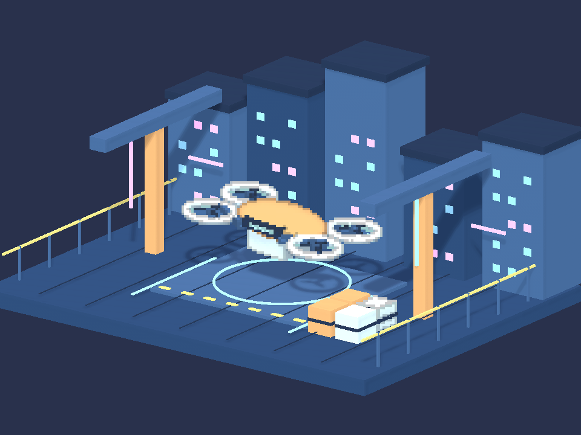

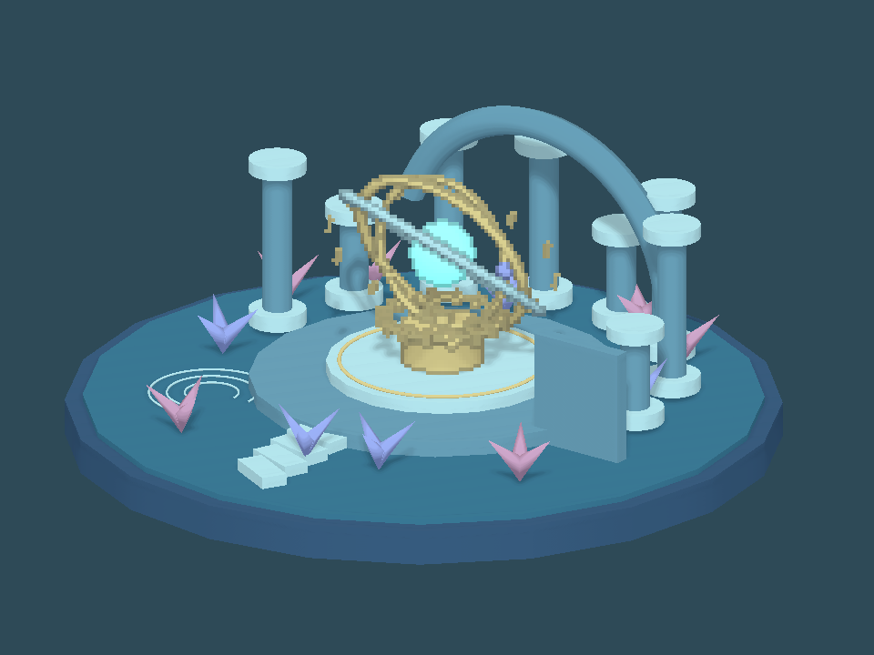

### 01-ClockworkGarden · 1

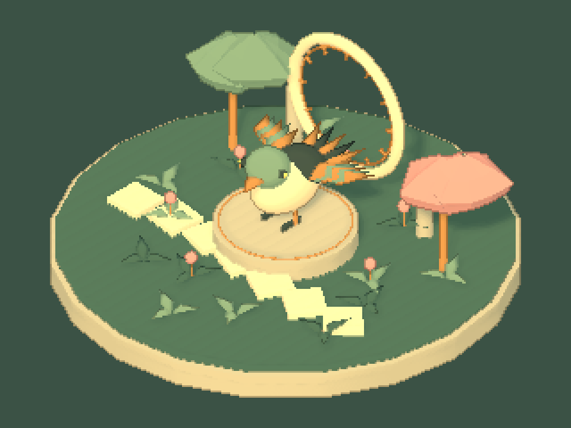

### 01-ClockworkGarden · 2

### 01-ClockworkGarden · 3

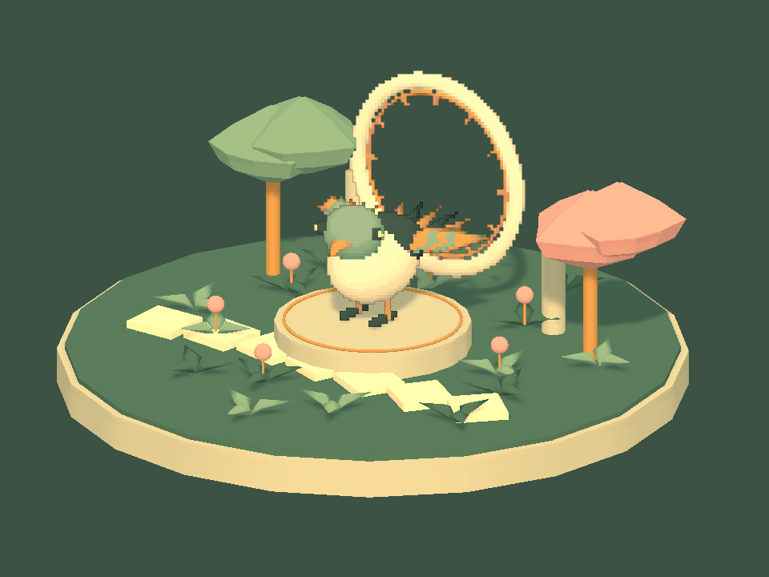

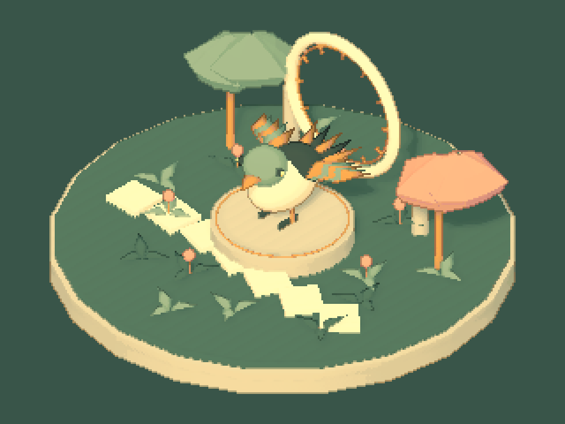

### 02-NeonCourier · 1

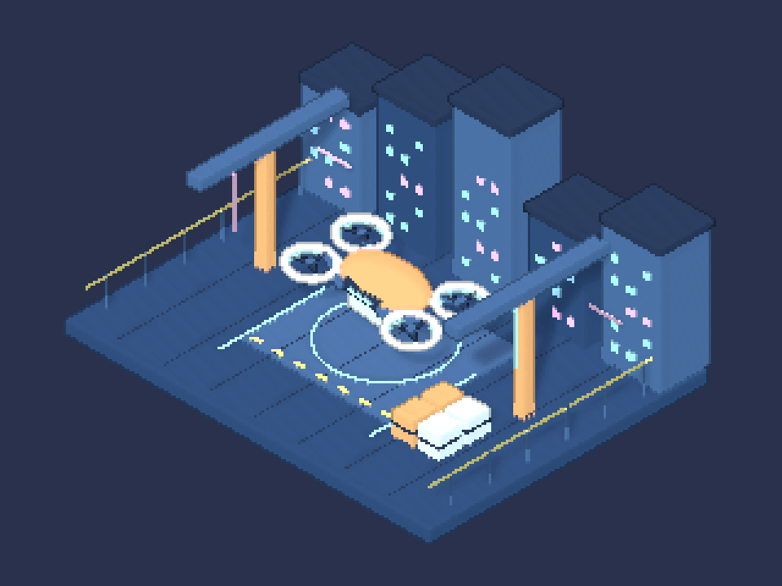

### 02-NeonCourier · 2

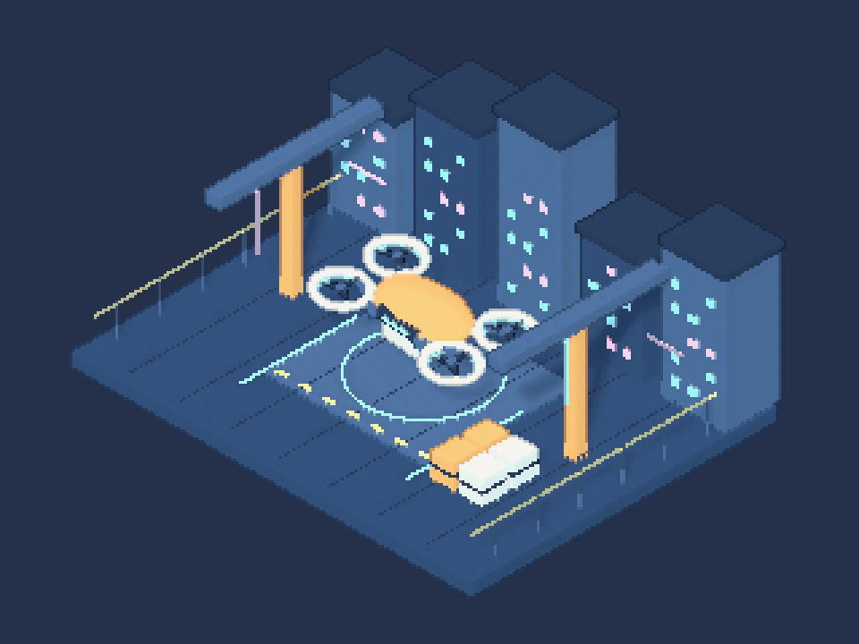

### 02-NeonCourier · 3

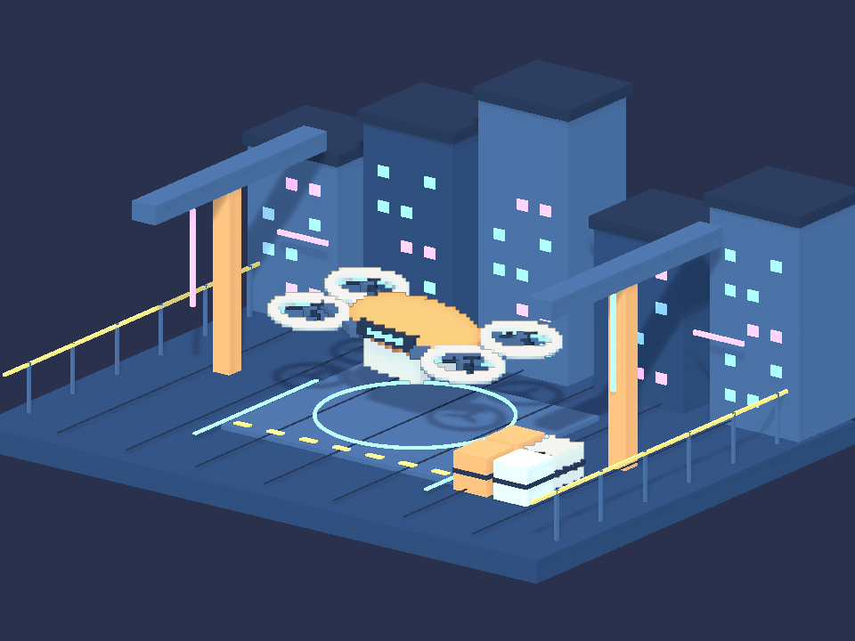

### 03-SunkenObservatory · 1

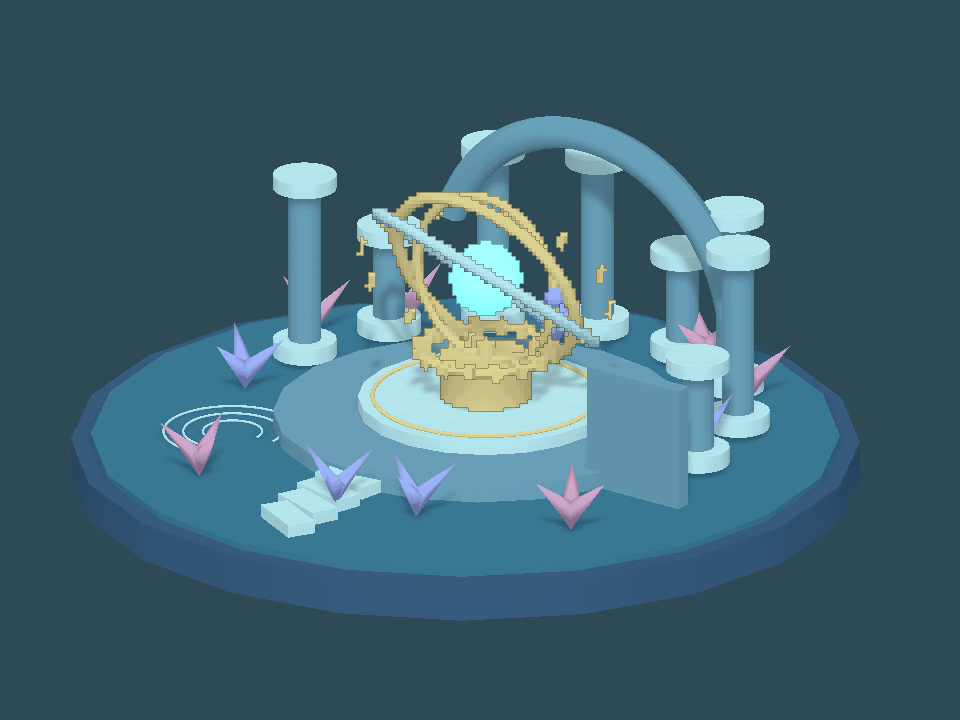

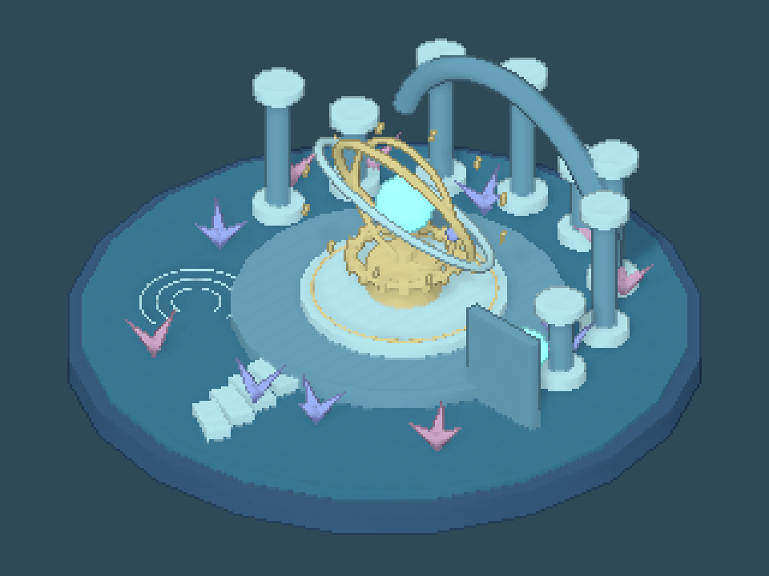

### 03-SunkenObservatory · 2

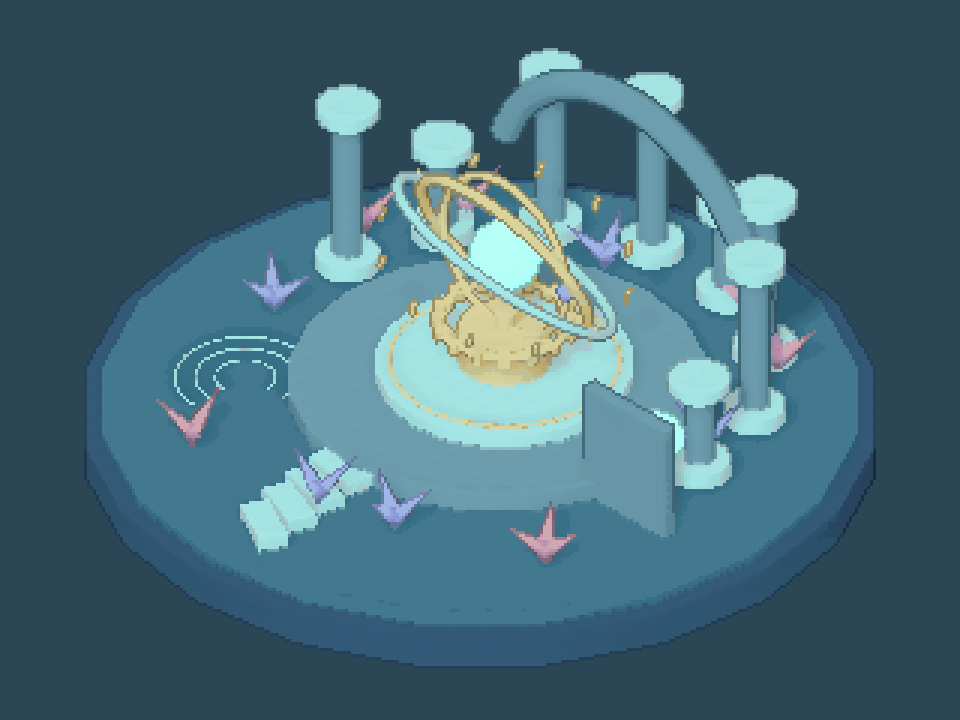

### 03-SunkenObservatory · 3

### 실제 안내 UI

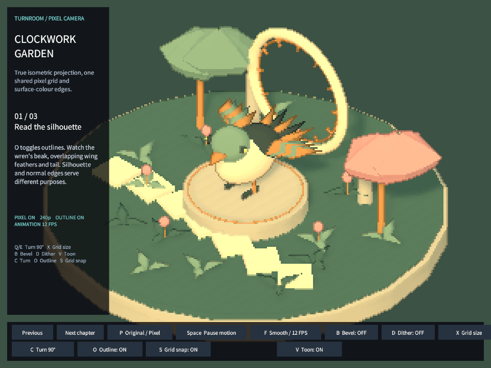

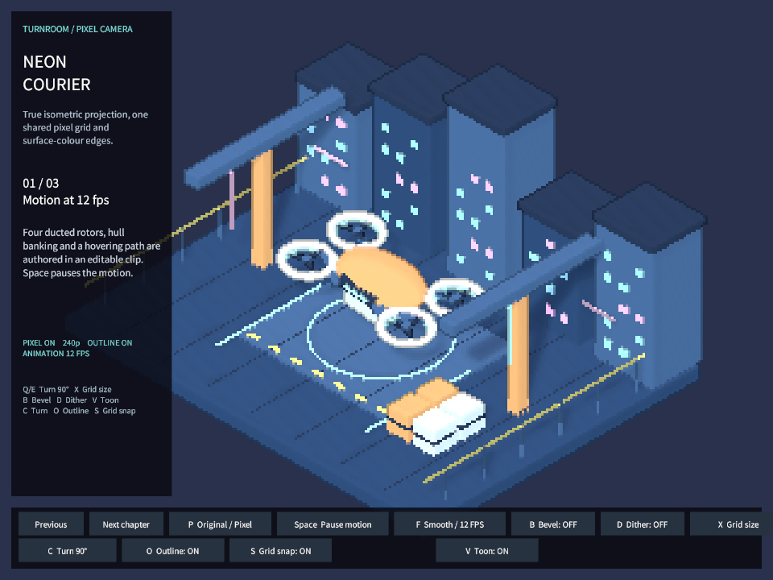

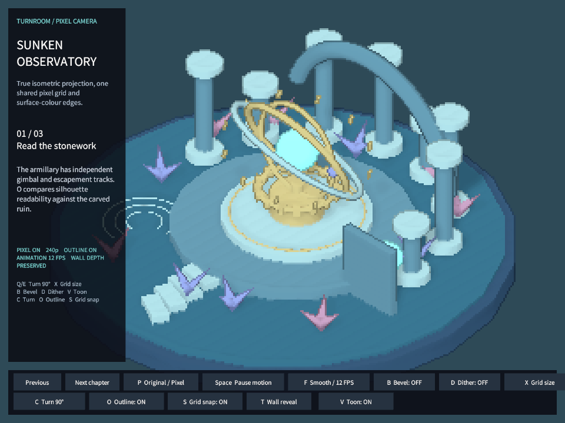

## 검증

- 실제 Unity6000.0.83f1 Linear/Built-in. 3장면×3단계 렌더·저장 후 새preview 재열기에서 동일 픽셀. 투영각35.264389°, 투영축 최대/최소 길이비<1.000001.
- 9단계 모두 전체3×3블록 불일치0. 아웃라인 on/off 실제픽셀차이 확인. 90도4회후 원위치·자유회전방지·격자스냅 및180/240/360p 순환·실제클립1.1초 포즈변화 확인. 이는 실제키보드조작 증거가 아닙니다.
- 원래 씬의 기존 데이터 중 카메라GO/카메라Transform/Camera/ShowcaseTour 4블록만 변경되고 rig1개만 추가됐습니다. 나머지 모든기존블록이 동일해 형상/배치/클립연결을 보존했습니다. [형상 보존](../assets/isometric-rebuild-20261105/preservation.json)
- 실제UGUI 캡처는 영어이며 이미지용으로OverlayCanvas를임시UI카메라에연결한후복원했습니다. 네이티브Play/키보드/마우스 캡처로 보고하지 않습니다. 버튼문구·격자상태·안내문구를실제캡처에서대조했습니다.
- 7개어셈블리컴파일과최종C#소스해시일치,9언어27문서본문/장이동/이미지/링크검사 통과. [실제렌더](../assets/isometric-rebuild-20261105/isometric-qa.json) · [문서](../assets/isometric-rebuild-20261105/verification.json) · [UI캡처](../assets/isometric-rebuild-20261105/guide-qa.json) · [컴파일](../assets/isometric-rebuild-20261105/compile.json)
- 활성씬·더티·선택·루트·preview수 보존,명령파일소비 확인. 신규GUI실행·실제입력 없음.
- 첫프로토타입의 뒤쪽시점/과도한여백은 실제이미지로 확인해 수정했고, preview객체의파일ID를직접조회하지못한저장실패는원본YAML의기존컴포넌트ID로해결했습니다. 실패·초기캡처는로컬이력으로보존했습니다.
- 교훈검토: 선택물체효과와전체아이소매트릭을혼동하지않고 원본격자/출력배율을구분하도록 기존Pixora지침을정정했습니다. 전역의기존실행/실제대조규칙으로적용가능하여 새전역규칙은추가하지않았습니다.

## 남은 사항

네이티브Play 마우스/키보드와Inspector/9언어UI레이아웃·실제브라우저탭 표시·URP실제렌더는미검증입니다. 실제안내UI캡처는영어이며9언어레이아웃검증으로간주하지않습니다. Full Camera 경계검출은깊이/노멀기반이므로동일평면접촉등의경계구분에는한계가있습니다. 수치통과를사용자의시각적승인으로간주하지않습니다.

## 작업 시간

- 제안 시간: 20~30분
- 실제로 완료된 시간: 시작 2026-11-05 23:08:48 KST. 구현·저장/재열기·비화면 검증 종료 2026-11-06 00:02:25 KST (3217초). 최초20~30분 예상을 초과했습니다. 공개 배포 확인은 이후 수행하며 전체 소요 시간을 최종 채팅에 기록합니다.
- XERJ: 미사용 — Status에서XERJ노드미실행확인. 대상PixelCamera는기존인덱스범위밖이며현재소스직접읽기와rg를사용했습니다.
