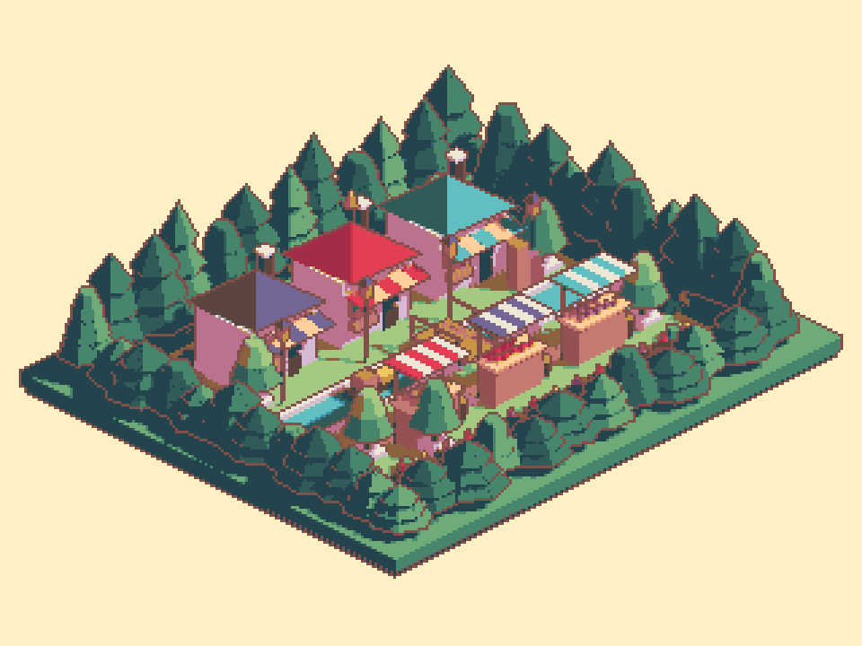
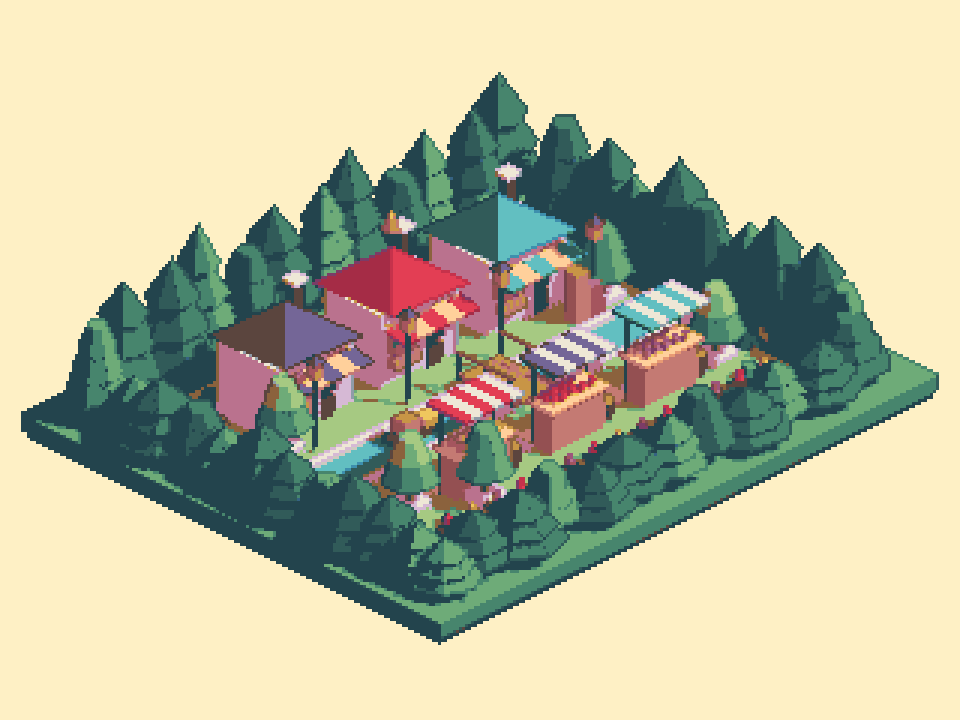

## 작업 결과

수정과 실제 Unity 렌더 검증을 완료했습니다. 공통갈색을 제거하고 나무·지붕·차양의 표면색을 따르게 했습니다.

## 변경 내용

### 적용 내용

변경은 기존옵션 켬(objectColorOutline=true)과 경계 표면색 샘플 고정입니다. 선색계산은 현재표면 RGB×0.6이며 배경이나 밝은 이웃면의 색으로 대체하지 않습니다. 법선은 경계 검출에만 사용합니다.

## 검증

- 실제 Unity6000.0.83f1 Built-in 시장렌더·저장재열기 출력동일. 팔레트밖0개,3×3격자불일치0개,32출력색 유지.
- 하나의빨강/초록 텍스처를쓴실제Quad의양끝선은RGB(203,0,0)/(0,203,0). 같은물체에서도텍스처위치의색을따름. [실제텍스처검사](../assets/surface-edge-20261106/texture-qa.json) · [렌더검사](../assets/surface-edge-20261106/atelier-qa.json)
- 기존카메라·배치·450메시오브젝트·예제진입은 유지. 문서9언어와현재실제이미지 갱신.
- 원래활성씬·더티·선택·preview수보존. 새GUI실행/입력없음.
- 기존표면색검증원칙을적용했으며 새전역지침추가없음.

## 남은 사항

실제네이티브입력·EditorUI언어레이아웃·URP렌더는미검증이며화면조작보류유지. 법선 기반 경계검출의 기존한계는유지합니다.

## 작업 시간

- 제안 시간: 3~5분
- 실제로 완료된 시간: 시작 2026-11-06 00:27:23 KST. 수정·렌더/다색텍스처 검증 종료 2026-11-06 00:34:55 KST. 최초3~5분 예상은 초과했습니다. 공개확인은 이후 수행합니다.
- XERJ: 미사용 — Status에서노드미실행확인. 현재소스직접읽기와rg사용.
