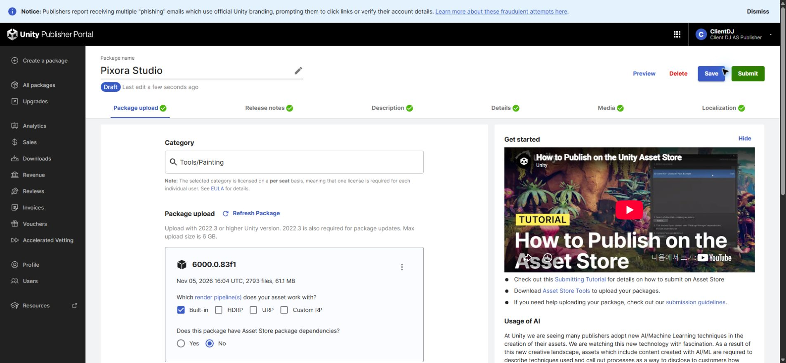
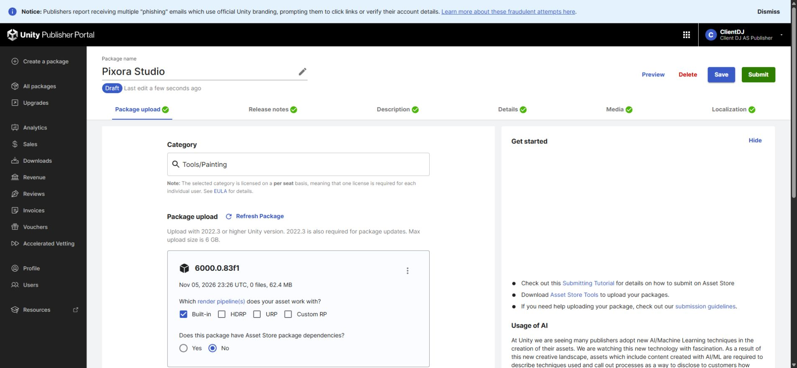
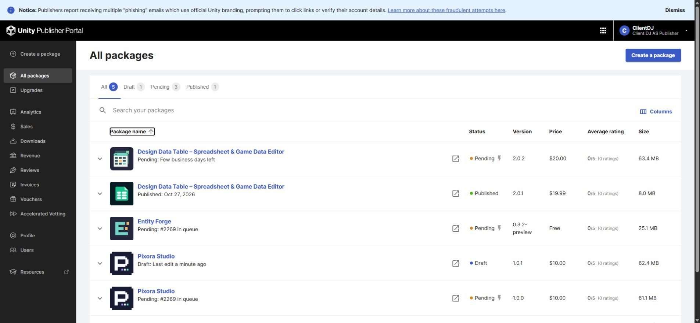
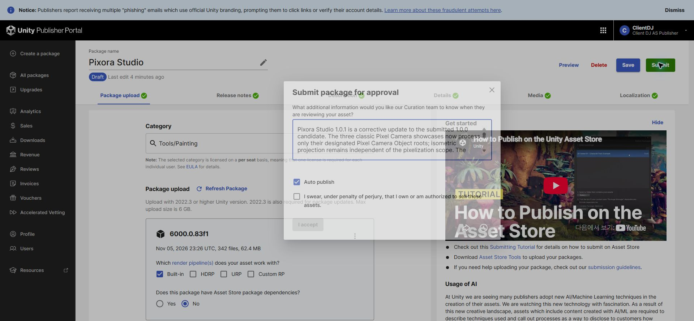

## 작업 결과

사용자 승인으로 새 초안을 생성했습니다. 기존1.0.0 Pending(#2269)과1.0.1 Draft가 함께 존재합니다. 고정된1.0.1 파일 전송이 성공했고 심사 사유가 입력된 최종 확인 창을 열어 두었습니다.

## 변경 내용

### 적용 내용

Release version1.0.1 저장. 영어·한국어·일본어·중국어 변경 이력에1.0.1 내용을 추가하고1.0.0 이력은 보존했습니다. 모든 지원 판매 언어를 재열어 저장값을 확인했습니다. 새 초안의 가격·기존 설명·미디어·호환성 선택은 유지했습니다.

## 검증

실제 포털 안내: Updating and resubmitting this asset will not change its position in the queue. 순번#2269 확인 후 새 초안 생성. 공식 SDK는 제품424614·초안1547466·draft 상태를 확인하고 고정 SHA256 fa1fc9ae512068d1c9cfce1f85a5caa594e991d81002d4d6063fef9d59a0dd88 파일을 전송했습니다. SDK Success 완료2026-11-06 08:29:25 KST. 포털 새 업로드 시각23:26 UTC와62.4MB 확인. 파일 목록은0→342개로 처리 진행 중입니다. 최종 확인 창의 전체 영문 사유와 소유권 선서 미선택·I accept 비활성을 확인했습니다. 작업용 Unity24496은 정상 종료했습니다.    

## 남은 사항

서버의 전체 파일 목록 인덱싱은 아직 완료되지 않았습니다. 로컬 고정 패키지는2,794개 에셋이며 서버 처리 완료 후 대조해야 합니다. 최종 제출·소유권 선서는 실행하지 않았습니다. 심사 사유는 열린 제출 창의 입력 상태이며 서버 저장 확인은 최종 제출 전에는 불가능했습니다. 창을 닫거나 새로고침하면 사라질 수 있습니다. 교훈 검토: 실제 포털에서 재제출 시 순번 유지 안내를 직접 확인했고 과거의 미확인 상태와 구분해 기록했습니다. 기존 검증 지침 적용, 전역 추가 없음.

## 작업 시간

- 제안 시간: 5~10분
- 실제로 완료된 시간: 최초 계측2026-11-06 08:24:30 KST(초기 탭 열기 포함 시작 시각은 별도 미기록). 공식 SDK 업로드08:29:25, 버전·문구·초안 설정 기록08:30:48 KST. 이후 서버 인덱싱 진행 확인과 기록 공개를 계속합니다.
- XERJ: 미사용 — 기존 SDK 보조 코드·고정 패키지·포털 UI 대조. SDK 폴더는 기존 XERJ 등록 범위 밖입니다.
