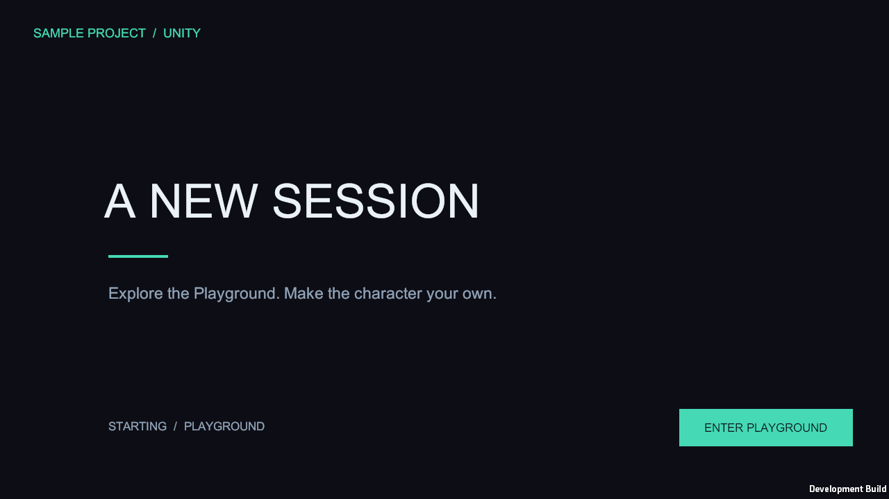
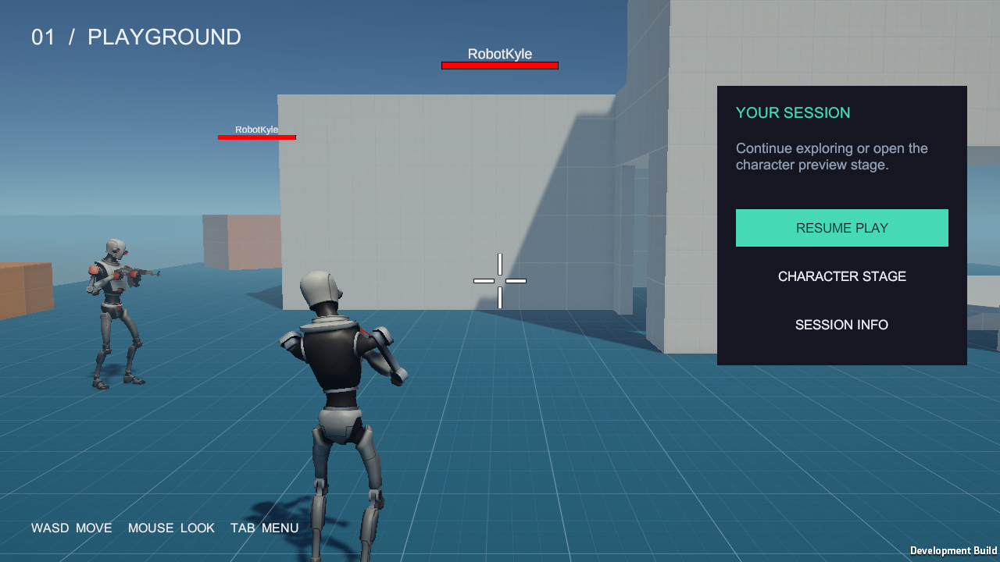
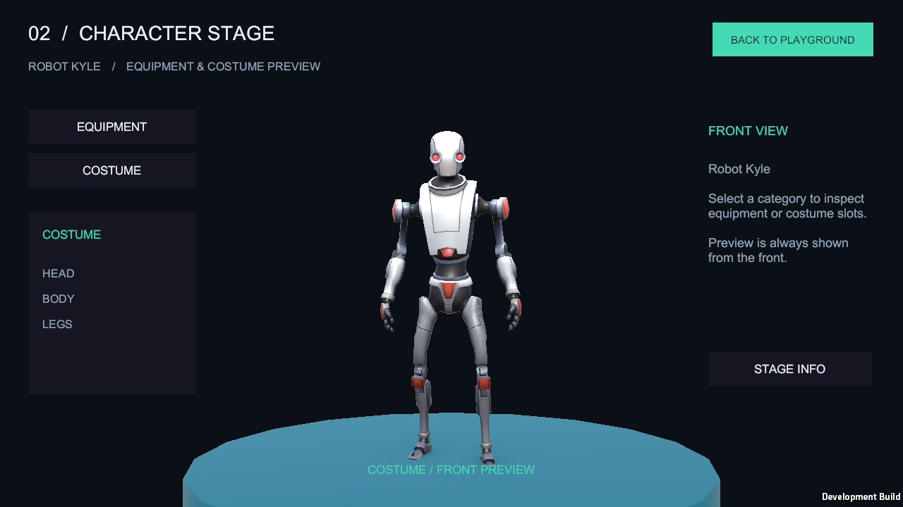
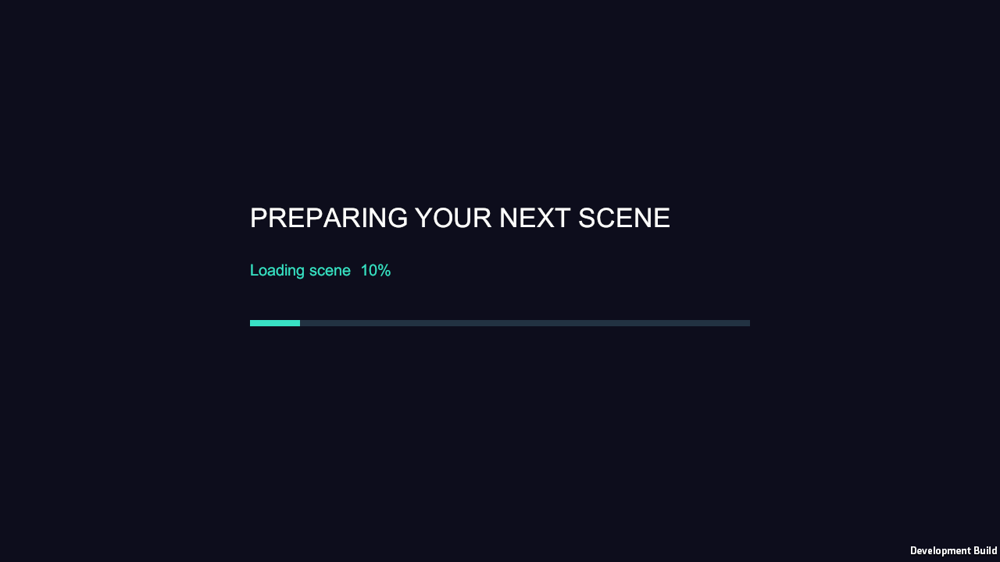

## 작업 결과

Splash를 Play하면 스플래시 표시 뒤 기존 Playground로 진입합니다. 메뉴에서 Character Stage로 이동하면 Robot Kyle이 카메라 정면을 바라보며, 장비·코스튬 패널을 전환하고 Playground로 돌아갈 수 있습니다. 세 씬 모두 직접 Play할 수 있습니다.

## 변경 내용

### 적용 내용

기존 SceneControlManager·UIManager·Addressable 공통 초기화 프리팹을 재사용했습니다. 기본 화면은 씬에 저장된 Canvas·RectTransform·Text·Button 프리팹 인스턴스입니다. UIManager.RegisterSceneView는 배치된 동일 화면을 등록하며 재생성하지 않습니다. 팝업과 로딩은 Addressables 프리팹 인스턴스로 관리합니다.

화면의 배치·색상·정적 문구와 버튼 9개의 UnityEvent는 직렬화된 에셋으로 편집했습니다. Unity에서 임포트·빌드·실행 검증했으며, 기존 UI 생성 메뉴와 생성 코드·A/B 전용 예제는 제거했습니다. 화면은 Play 전에도 Hierarchy 또는 Prefab Mode에서 편집할 수 있습니다.

Playground의 기존 오브젝트 151개 중 중복 EventSystem의 4개만 제거했고 기존 캐릭터·환경·카메라·HUD는 보존했습니다. 기존 GameMode는 전환 확정 뒤 빙의합니다. Tab·메뉴·모달은 실제 PlayerInput·플레이어 컨트롤러·마우스 카메라 입력을 제어합니다. 로딩 중 이전 카메라를 유지하고 전환 확정 때 씬의 카메라·오디오 소유권을 교체합니다.

CharacterStage는 기존 Robot Kyle 모델과 별도의 유휴 애니메이션 컨트롤러를 사용합니다. 장비·코스튬 패널은 이미 배치된 오브젝트의 표시 상태만 변경합니다.

## 검증

Unity 6000.0.83f1 / Addressables 2.9.1. 최종 Editor 직접 Play: Splash 106개, Playground 104개, CharacterStage 117개 통과, Play 종료까지 오류 0개입니다. 그래픽 Windows 플레이어 114개 통과·오류 0개입니다.

자동 Splash 진입, 기존 Pawn 빙의, Inspector의 실제 버튼 이벤트와 EventSystem 레이캐스트, 메뉴·모달·Tab·Escape 입력, 정면 방향·카메라 구도·휴머노이드 Animator, 장비/코스튬 패널, 잘못된 목적지 UI 복구, 반복 6회 전환과 동시 요청 거부를 실제로 검사했습니다. 씬 로드 직후와 전환 뒤 루트·SceneControlManager·UIManager·EventSystem 각각 1개, 루트 누적 생성 1회와 동일 객체 재사용을 확인했습니다. 화면이 각 씬에 이미 배치된 동일 인스턴스인지 대조했습니다.

[Editor Splash](../assets/scene-flow-20261101/editor-Splash.json) · [Editor Playground](../assets/scene-flow-20261101/editor-Playground.json) · [Editor Stage](../assets/scene-flow-20261101/editor-CharacterStage.json) · [Editor 종료 검사](../assets/scene-flow-20261101/editor-results.json) · [플레이어 검사](../assets/scene-flow-20261101/player-results.json) · [에셋과 기존 씬 대조](../assets/scene-flow-20261101/asset-audit.json) · [최종 소스 대조](../assets/scene-flow-20261101/source-check.json)

실제 플레이어가 렌더한 PNG 원본입니다. 실제 크기에서 문구·배치·캐릭터 정면을 직접 확인했으며 이미지를 편집하거나 합성하지 않았습니다. 세부 크기와 검사 근거는 [화면 검사](../assets/scene-flow-20261101/visual-check.json)에 있습니다.

[팝업 화면](../assets/scene-flow-20261101/popup.png) · [실패 복구 화면](../assets/scene-flow-20261101/recovery.png)

## 남은 사항

장비·코스튬 데이터의 실제 착용 적용은 후속 기능이며 이번 요청에서는 정면 미리보기 씬과 편집 가능한 패널을 구성했습니다. 원본 에디터를 종료하지 않고 소스·에셋이 일치하는 격리 복사본으로 검증했습니다. 게임 저장소는 자동 커밋·푸시하지 않았습니다. 원본 Unity 창의 캡처가 다른 앱 화면을 반환하여 해당 창에 입력 조작을 하지 않았으며 원본 에디터의 새로고침 상태는 미확인입니다.

교훈 검토: 명시적인 사용자 정정에 따라 Unity UI는 편집 가능한 씬·프리팹과 Inspector 이벤트로 작성한다는 규칙을 기존 지침과 대조해 1개 추가했습니다. 설치본·설정 저장소·격리 체크아웃의 해시 일치를 확인하고 Sync.ps1 -Direction Push로 커밋·푸시했습니다. 다른 실행 중 대화에 자동 반영됐다고 간주하지 않습니다.

## 작업 시간

- 제안 시간: 25~40분
- 실제로 완료된 시간: 2026-11-01 17:57:36 KST 시작 → 2026-11-01 18:39:55 KST 구현·실행 QA 및 정리 기록. 실제 경과 2539초. 첫 셰이더 컴파일과 실제 실패한 헤드리스 입력·버튼 검사 보완 후 재빌드로 최초 예상을 초과했습니다. 공개 배포 확인 시간은 최종 메뉴얼과 채팅에 별도 기록합니다.
- XERJ: 미사용 — XERJ MCP와 프로젝트 검색 스크립트가 제공되지 않아 rg로 현재 소스·참조·에셋을 대조했습니다.
