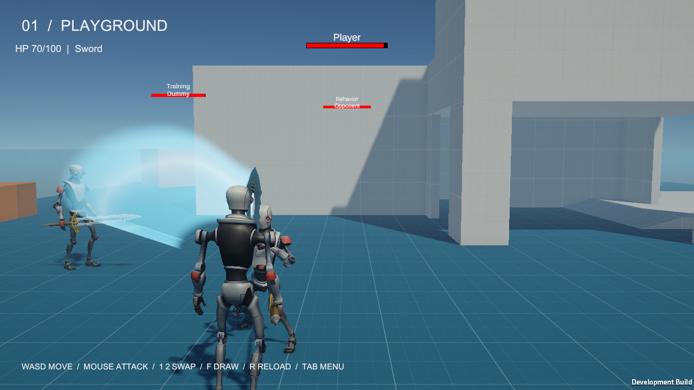
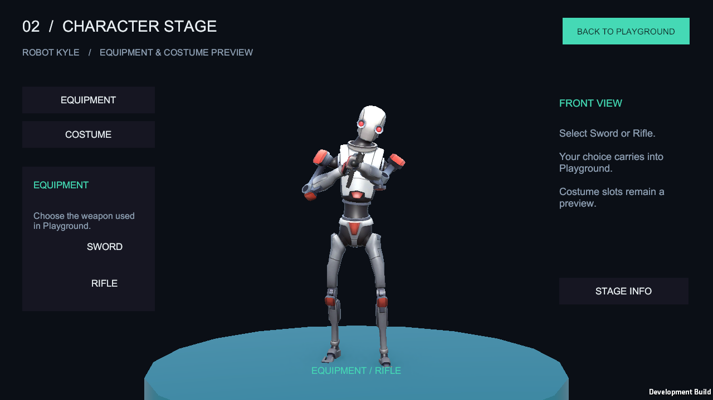
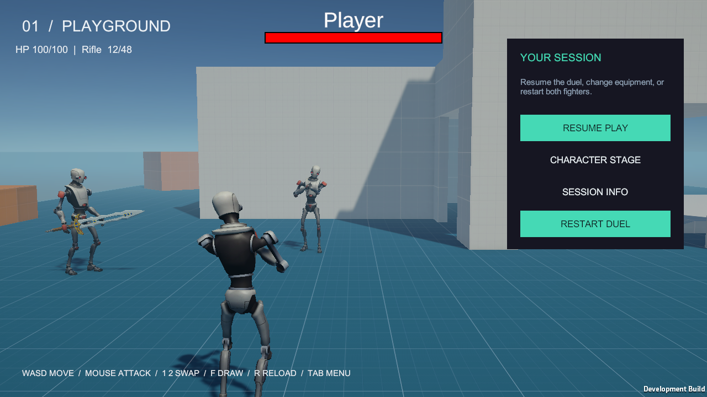

## 작업 결과

검·총 교체, 검 뽑기/수납 애니메이션, 근접·원거리 공통 공격, 체력·사망·재시작, 실제 Unity Behavior 교전과 CharacterStage 장비 선택을 구현했습니다. 기존 SceneControlManager와 UIManager, 기존 Scenes·SampleScene 분류를 재사용했습니다. 새 전투 매니저는 추가하지 않았습니다. 자체 C#은95→93개, Runtime은87→84개로 줄었고 새 매니저는0개입니다.

## 변경 내용

### 적용 내용

### 사용 흐름과 조작

Splash를 열고 Play하면 Playground로 전환합니다. RESUME PLAY로 두 캐릭터의 전투를 시작합니다. CHARACTER STAGE에서 SWORD/RIFLE을 선택하면 정면 미리보기의 실제 장비와 복귀 후 플레이어 무기가 함께 바뀝니다. 사망 후 RESTART DUEL로 체력·물리·탄약·빙의를 복원합니다. 세 씬은 각각 직접 Play할 수 있습니다.

| 입력 | 동작 |
| --- | --- |
| WASD / Shift / Space | 이동 / 달리기 / 점프 |
| 마우스 좌클릭 | 검 공격 또는 총 발사·유지 사격 |
| 1 / 2 / Q | 검 / 총 / 다음 무기 |
| F / R | 뽑기·수납 / 장전 |
| Tab / F8(Editor) | 메뉴 / 빙의 해제·재빙의 |

### 공통 API와 최소 구성

Pawn이 소유권·팀·장비 선택·공격 차단·피해·사망을 담당합니다. 플레이어와 AI가 같은 SelectWeapon, SetWeaponDrawn, TryAttack, ResetCombat을 사용합니다. Movement는 컨트롤러가 전달한 방향으로 회전하며 AI가 Camera.main에 의존하지 않습니다. PawnController의 플레이어 카메라/입력 의존을 분리하고 PlayerController에만 플레이어 싱글톤을 유지했습니다.

MeleeWeapon은 실제 애니메이션 피해 구간과 HitBox를 사용하며 같은 공격에서 중복 피해를 막습니다. Gun은 몸→총구 차폐와 총구→조준점 레이를 검사하고 자기 몸·공격 트리거를 제외합니다. 장애물과 아군 몸은 탄을 막습니다. 기본 탄창12·예비탄48·장전1.2초이며 교체·수납·피격·메뉴는 공격과 장전을 취소합니다. 자동 사격은 InputAction.IsPressed를 읽어 별도 누름 상태를 없앴습니다.

검은 기존 Unsheathe/SheatheBack01_R 클립(각0.733333초)을 재사용하고45% 시점에 손/등 소켓을 교체합니다. 동작 중 이동·공격을 차단합니다. 총의 수납은 즉시 소켓을 전환합니다. 별도 애니메이션 다운로드나 새 에셋 팩은 사용하지 않았습니다.

### 실제 Unity Behavior 그래프

설치된 Behavior1.0.16의 authoring/runtime 그래프 CombatBehavior.asset을 작성했습니다. Start의 반복 아래 Find→Approach→Attack을 연결하고 Target 블랙보드를 공유합니다. 하나의 CombatAction이 단계별 요청을 AIController에 전달하며 순서와 재시도는 그래프가 제어합니다. NavMeshAgent의 경로를 기존 Rigidbody Movement 입력으로 변환합니다. 표적 소실과 불완전 경로를 실패 처리하고,3초간 이동 진전이 없으면 접근을 종료해 재탐색합니다. AI의 근접/총기 피해와 두 에이전트의 그래프·Target 격리를 실제 실행으로 확인했습니다.

### 편집 가능한 UI와 선택 데이터

UI 배치·문구·버튼은 기존 씬/프리팹 오브젝트와 Inspector 이벤트로 저장했습니다. 실행 중 UI를 생성하는 코드는 추가하지 않았습니다. 기존 조준점을 재사용하고 HP·무기·탄약·장전 상태만 코드로 갱신합니다. PlayerLoadout을 기존 Prefabs Addressables 그룹의 공유 에셋으로 등록했으며, 선택은 selectionId별 Play 세션 상태로 보관합니다. 번들 복제/해제에도 선택이 이어지고 다른 ID는 독립적입니다.

### 간소화와 어셈블리

빈 TestSword/TestAK74 파생 타입을 구체 MeleeWeapon/Gun으로 통합했고 Socket은 Transform으로 바꿨습니다. 미사용 EquipmentInfo/Armor와 별도 EditorPossessInput을 제거했습니다. F8 처리는 기존 플레이어 컨트롤러에 통합했습니다. 기존 무기 프리팹의 경로·GUID와 애니메이션 이벤트 이름은 유지했습니다.

| 어셈블리 | 역할 |
| --- | --- |
| Game.Runtime / Game.Editor | 공통 본체 / 전용 에디터·드로어 |
| Game.Behavior | 선택 가능한 Behavior 연결 |
| Game.Samples.Runtime / Game.Samples.Editor | 기존 SampleScene의 예제 / 씬 열기·빌드 메뉴 |
| Game.Verification / Game.Verification.Editor | 명시적 실행 QA |
| RandomDistribution | 기존 독립 어셈블리 유지 |

본체는 샘플·QA·Behavior 연결을 참조하지 않습니다. 기존 프로젝트 설정·패키지·빌드 시작 씬을 보존했습니다. Addressables 변경은 기존 Prefabs 그룹의 PlayerLoadout 항목1개 추가입니다.

### 발견한 문제와 수정

- 원본 체력 소스를 실행해 최대100에서1100까지 회복, 음수 체력과 음수 피해 회복을 확인했습니다. 체력 경계와 이벤트 경로를 일원화했습니다.
- 버프가 종료 콜백에서 순회 목록을 제거해 Collection was modified 예외가 발생했습니다. 역순 갱신과 한 번의 종료 알림, 시간 기반 회복으로 수정했습니다.
- 실제 번들에서는 에디터와 달리 선택 데이터가 분리되어 Stage 장비 선택이 사라졌습니다. 공유 Addressable과 선택ID별 세션으로 수정했습니다.
- Stage 받침대의 납작한 원통 CapsuleCollider가 Additive 로딩 중 캐릭터를 위로 밀었습니다. 렌더 전용 Stage의 받침대·미리보기 콜라이더를 비활성화했습니다. 왕복 후 root=(0,0,0), grounded=true를 대조했습니다.
- 전체 편집 로그에서 GameMode가 없는 Stage의 SpringArm.OnValidate 예외를 확인해 null·파괴·빙의 해제 가드를 추가했습니다.
- 반복 번들 전환 후 활성·알파·폰트·글자 버텍스가 정상인데 검은 패널만 보였습니다. 엔진 내부 캐시 원인은 미확인입니다. 실제 픽셀과 렌더 갱신 전후 복구를 대조한 뒤 전환 완료 다음 프레임의 Graphic 갱신을 추가했습니다. 화면은 같은 씬의 Content를 조회합니다.

교훈 검토: 예산은 최대 한도이며 완료 후 시간을 채우지 않는다는 기존 실행 원칙을 유지했습니다. 실제 번들 검증·공유 세션·렌더 전용 Scene 물리는 프로젝트 문서와 이 보고서에 기록했습니다. 기존 검증·폴더 재사용 규칙과 중복되는 전역 규칙은 추가하지 않았습니다. 전역 지침 변경 없음.

총 소스 줄 수는8117→9370줄로 증가했습니다. 새 기능과 선택적으로 제거할 수 있는 실행 QA가 포함된 수치입니다. 파일 수와 중복 상태·빈 클래스를 줄이며 기존 Pawn·컨트롤러를 확장했습니다.

## 검증

### 실제 실행 결과

| 검증 | 결과 |
| --- | --- |
| 최종 그래픽 번들 전투·장비·입력·물리·UI 픽셀 |52개 통과, 오류0 |
| 최종 그래픽 번들 씬·로딩·팝업·입력·실패 복구 |114개 통과, 오류0 |
| Editor 세 씬 각각 직접 Play | Splash106 / Playground104 / CharacterStage117 통과 |
| 종료·다음 씬 준비를 포함한 전체 Editor 로그 | 최종 예외0 |
| 순수 체력/버프 실제 소스 실행 |8개 통과, 최소 Pawn stub 사용 |
| 샘플·Behavior 연결·QA 제거한 본체 | Unity Roslyn으로 Runtime/Editor 각각 단독 컴파일 통과 |
| 기존 검기 회귀 | 실제 RenderTexture 픽셀·메시·수명·셰이더 검사 통과 |
| 자체 프리팹 누락 스크립트 |0 |
| 프로젝트 문서 |28페이지·971링크, 최종 snapshotChanges0 |
| 최종 소스 대조 | 검증 복제본과 C# 차이0 |

실제 PlayerInput의 마우스 누름과 해제를 주입해 발사 및 해제 후 사격 중단을 관찰했습니다.30회 무기 교체, 실제 근접·총기 AI 교전, 두 그래프·Target 격리, 표적 소실·막힌 이동 제한, Stage 왕복과 동일ID/다른ID 선택 상태를 검사했습니다. 버튼·제목의 실제 픽셀도 확인했습니다. 매니저·초기화 루트·EventSystem은 반복 전환 후 각각1개이며 생성 횟수1을 유지했습니다.

### 실제 게임 화면

Unity Behavior가 실제 NavMesh로 접근하고 기존 검기·피해 처리로 HP를 감소시킨 화면입니다.

버튼은 실제 오브젝트·Inspector 이벤트입니다. 선택한 무기가 Playground에 반영됩니다.

받침대 물리 간섭과 메뉴 렌더 문제 수정 후 실제 최종 화면입니다. root=(0,0,0), grounded=true이며 메뉴 버튼·제목 픽셀 검사를 통과했습니다.

[52개 전투 결과](../assets/combat-20261102/combat-results.json) · [114개 씬 결과](../assets/combat-20261102/scene-player-results.json) · [Editor 직접 Play](../assets/combat-20261102/editor-results.json) · [본체 단독 컴파일](../assets/combat-20261102/core-only.json) · [순수 소스8개](../assets/combat-20261102/pure-results.json) · [전체 로그 대조](../assets/combat-20261102/editor-log-audit.json) · [코드 수·소스 대조](../assets/combat-20261102/source-comparison.json) · [설정 보존](../assets/combat-20261102/settings-preservation.json)

캡처는1280×720 Unity PNG 원본입니다. Affinity3.3.1.4940의 doctor/status·SDK·프리셋 조회는 성공했으나 실제 파일 열기가 PERMISSION_DENIED로 실패해 재인코딩을 수행하지 못했습니다. 출력 파일과 문서 상태를 확인했으며 다른 이미지 도구로 대체하지 않았습니다. 판독 가능한 원본을 사용하여 전투828799B·스테이지160985B·메뉴727234B를 첨부했습니다.200KB 목표 초과 이미지는 실제 검증 화면 보존을 우선했습니다. [실행 근거](../assets/combat-20261102/image-export.json)

## 남은 사항

요청한 구현·필수 실행 검증은 완료했습니다. 임시 에셋 작성·설정 도구와 격리 검증 프로젝트는 삭제했고 실제 빌드는 프로젝트 Builds/SceneFlow에 반영했습니다. 프로젝트 소스는 로컬 변경으로 보존했으며 자동 커밋·푸시하지 않았습니다. 중앙 보고서와 메뉴얼만 공개합니다. Windows64 Development/Mono와 설치 버전을 검증했으며 다른 플랫폼·IL2CPP는 미확인입니다. 네트워크·발사체·디스크 저장·실제 코스튬 교체는 이번 전투 예제 범위에 포함하지 않습니다. 이미지 재인코딩만 Affinity 파일 권한 오류로 미실행이며 원본 PNG를 제공합니다.

## 작업 시간

- 제안 시간: 초기60~100분 예상. 사용자 지정10시간은 최대 예산이며 완료 즉시 종료.
- 실제로 완료된 시간: 시작2026-11-02 01:46:15 KST. 구현·실행 검증은03:36:19 KST(1시간50분04초), 임시 도구 정리·문서 최종 검증은03:41:56 KST(1시간55분41초)에 마쳤습니다. 이후 보고서 공개·외부 접근 확인의 최종 시각은 완료 메뉴얼과 채팅에 기록합니다. 초기 예상 상한100분보다 실제 번들·편집 로그·물리·UI 픽셀 실패의 수정과 재QA로 증가했습니다.10시간 최대 예산을 채우기 위한 추가 작업은 수행하지 않았습니다.
- XERJ: 미사용 — XERJ MCP와 프로젝트 검색 스크립트가 제공되지 않아 rg로 검색하고 현재 소스·설정·Unity 실행 결과와 대조했습니다.
