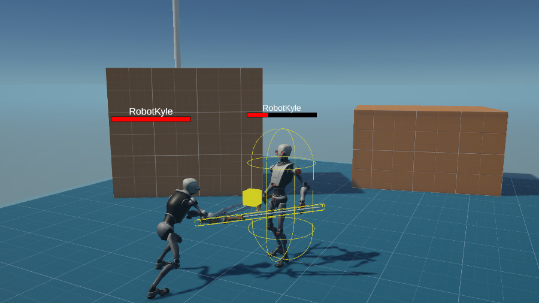

## 작업 결과

Game.AgentModels 독립 어셈블리에 설정·호환 JSON 통신·설정별 동시 호출 제한을 반영했습니다. 기존 Pawn·AIController·씬 동작은 변경하지 않았습니다.

## 변경 내용

### 적용 내용

공용 모듈은 UnityWebRequest·JsonUtility만 사용합니다. 호출자가 systemPrompt와 관측을 전달하고 ParseContent의 JSON 텍스트를 게임별로 해석합니다. 키는 GAME_AGENT_API_KEY 등 설정한 환경변수에서 읽습니다.

~~~mermaid
flowchart TD
A[호출자: 공유 설정과 관측] --> B{TryAcquire}
B -->|성공| C[CreateRequest: 비동기 전송]
B -->|대기| A
C --> D[ParseContent: 응답 JSON 텍스트]
D --> E[게임별 행동 검사]
C --> F[오류 또는 취소]
E --> G[Dispose와 Release]
F --> G
~~~

### 슬롯 반환 전체 메서드

~~~csharp
public static void Release(AgentModelSettings settings)
{
    if (!ReferenceEquals(settings, null) && _active.TryGetValue(settings, out int count))
    {
        if (count <= 1)
        {
            _active.Remove(settings);
        }
        else
        {
            _active[settings] = count - 1;
        }
    }
}
~~~

[공용 통신 전체 소스](../assets/ai-companions-20261111/AgentModelClient.cs) · [설정 전체 소스](../assets/ai-companions-20261111/AgentModelSettings.cs)

README와 28-agent-models 원본 문서, 기존 문서 목차·생성 HTML을 갱신했습니다. 호출자는 자체 asmdef에서 Game.AgentModels 참조를 추가해야 합니다.

### 대화 기록

사용자가 “공용화해서 모체에도 반영”을 선택한 이후에 모체를 수정했습니다. 발언 시각은 미기록입니다.

## 검증

Unity 6000.0.83f1 참조로 새 공용 모듈을 컴파일했습니다. 기존 모체 작업 트리는 시작 시 깨끗했으며 추가 파일과 문서 영향만 반영했습니다. 문서 빌드 29페이지·49개 원본 링크, 문서 검사 1033개 링크·내비게이션·스크립트 구문·summary 형식 통과. 갱신 이력에 이번 검토 범위와 미확인을 기록했습니다. 게임별 의존성이 제거된 통신 구현은 같은 코드의 Fantasya 최종 실제 Ollama 플레이와 대조했습니다. 이 모듈은 화면을 바꾸지 않는 코드·문서 작업이므로 새 모체 게임 화면은 없습니다. 대표 이미지는 기존 프로젝트 문서 이미지이며 실행 증거로 사용하지 않았습니다. 테스트 스위트는 추가·실행하지 않았습니다.

## 남은 사항

모체 전체 씬 플레이·원격 유료 API·예제 코루틴의 씬 실행은 미확인입니다. 공용 모듈 자체가 기존 AIController를 LLM 동료로 바꾸지는 않습니다. 호출자는 코루틴 외부 중단 시에도 요청과 슬롯을 정리해야 합니다. 기존 갱신 기준 이후 전체 게임 기능의 문서 검토는 이번 추가 모듈 범위 밖입니다. 공개 푸시·배포 상태는 최종 채팅에서 구분합니다.

## 작업 시간

- 제안 시간: Fantasya 35~50분 + 승인된 모체 공용화 10~15분
- 실제로 완료된 시간: 17:37:11 시작 → 2026-11-11 18:15:13 KST, 보고 원본 작성까지 실측 38.0분. 공개 배포 확인 시간은 최종 채팅에 별도 기록합니다.
- XERJ: 미사용 — 사용자 전역 지침에 따라 XERJ 미사용. rg·현재 소스·Unity 로그·실제 Ollama 응답으로 확인했습니다.
