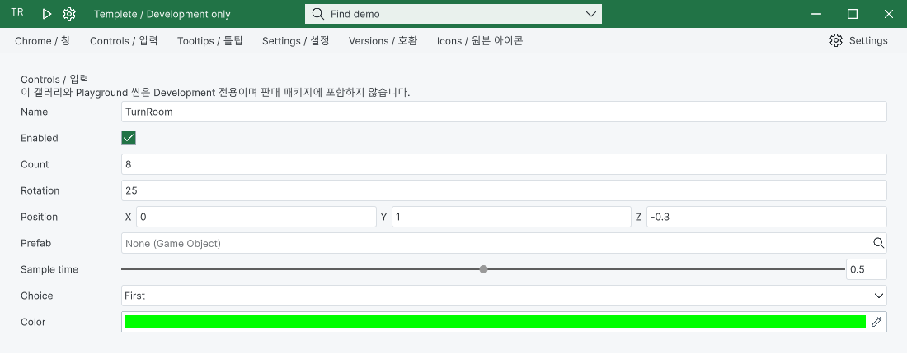

## 작업 결과

26px 행과 라벨 중심을 모체에서 맞추고 체크박스·자산 선택기·스포이트를 공통 디자인으로 연결했습니다.

## 변경 내용

### 재현 조건

Windows · Unity 6000.0.83f1 · Templete 1.2.1

### 재현 순서

Pixora 3D 모델 패널 또는 Templete 갤러리 Controls를 열고 라이트/다크에서 행과 내부 버튼을 대조합니다.

### 기대 동작

동일 행의 입력 중심 일치와 테마 일관성, 선택값 반영.

### 실제 동작

기존 긴 라벨이 입력을 25px 밀고 벡터/슬라이더 내부가 1px 벗어났으며 라이트에서도 내부 네이티브 검은 면이 남았습니다.

### 원인

외곽 행 높이만 지정하고 자동 라벨 폭 및 중첩 기본 필드 여백을 남긴 소스를 실제 bounds로 확인했습니다. 기본 네이티브 내부 페이스도 공통 스타일 적용 대상에서 빠져 있었습니다. 팝업 색상 추출은 선택 클릭 후 picker가 열린 채 값 반영이 되지 않는 상태를 재현했고 공통 완료 경로를 연결했습니다.

### 적용 내용

26px 행과 라벨 중심을 모체에서 맞추고 체크박스·자산 선택기·스포이트를 공통 디자인으로 연결했습니다.

교훈 검토: 내부 컨트롤의 실제 입력·선택값과 로드된 빌드를 확인하는 프로젝트 QA를 AGENTS.md에 반영했습니다. 전역은 기존 실제 원본·실행 대조 및 증거 우선 규칙과 중복되므로 변경하지 않았습니다. 신규 비트맵 디자인 없이 DataTable 원본 아이콘·그리기 코드를 재사용했습니다.

## 검증

22개 실제 화면 상태 1,192개 정렬 검사, 헤드리스 410개 및 공통 108개 검사 통과. 마우스·Space·숫자 입력·자산 선택·색상 선택값 반영 통과. 최대화/복원·최소화 목록 복원 확인. 최종 1.2.1 패키지 별도 Unity 가져오기 통과.

## 남은 사항

기존 DataTable 문서 전체 검사 259건은 미해결입니다. 이번 갱신 화면 관련 오류는 0건입니다. 다른 Unity 버전은 미검증입니다.

## 작업 시간

- 제안 시간: 20~40분
- 실제로 완료된 시간: 121.2분 · 구현/실행 검증 시각 2026-10-30 20:46:21 KST. 공개 배포 확인은 후속 메뉴얼에 기록.
- XERJ: 사용 — XERJ Vector3Field 검색에서 해당 Pixora 소스 누락을 확인하여 rg와 현재 소스로 보완.
