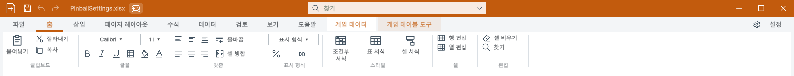

## 작업 결과

Common의 문서 제목줄 조립·아이콘 중앙 배치·검색/설정 요소를 마련하고 Pixora에 연결했습니다. DataTable의 기본 배치·스타일을 원본과 대조했으며 양쪽 단독 설치 컴파일도 통과했습니다.

## 변경 내용

### 적용 내용

공통 UITemplateChrome에 DocumentChrome, 제목 아이콘·빠른 명령·검색·창 제어·설정의 Rect 계산, 명령 검색과 설정/테마 버튼을 두었습니다. UI Toolkit 제품은 ToolWindow.CreateDocumentChrome으로 공통 조립을 상속합니다. DataTable IMGUI는 같은 Rect 계산을 호출하고 기존 렌더링·저장·실행 취소·다시 실행은 유지합니다.

기본 제목줄 34, 탭 30, 리본 91, 빠른 아이콘 18, 창 제어 폭 44를 공유합니다. Pixora의 네 빠른 명령과 DataTable의 세 명령 개수·기능은 제품별로 유지합니다. 좁은 창 검색은 남은 공간 안으로 폭을 제한합니다. 공통 템플릿 변경은 양쪽 배치 계산과 스타일에 반영됩니다.

## 검증

실제 Unity editor panel 및 IMGUI 원본 스타일 대조 108개를 통과했습니다. 라이트/다크, 아이콘 중앙, 960·1280·1600 너비, 검색 위치, 설정 가시성, 기본 grid/formula 위치, 모든 GUI 상태 색상·패딩·배경 픽셀, 템플릿 수정과 원복을 확인했습니다.

Pixora의 실제 입력 10개 시나리오도 별도로 통과했습니다. 양쪽 단독 설치 Unity 컴파일은 각각 종료 코드 0입니다. DataTable 제품 기본 스타일과 문서 데이터·닫기 정책을 새 UI Toolkit 엔진으로 교체하지 않았습니다. 실제 원본 DataTable 화면과 Pixora 화면을 각각 캡처했으며 재구성한 시안이 아닙니다.

[패널 검사 결과](../assets/20261030-chrome-TemplateChecks.json) · [108개 검사 항목](../assets/20261030-chrome-TemplateCases.json) · [실제 화면/클릭 검증 범위](../assets/20261030-chrome-Results.json) · [단독 설치 검증](../assets/20261030-chrome-StandaloneBuilds.json)

## 남은 사항

Windows / Unity 6000.0.83f1에서 검증했습니다. 다른 운영체제·고DPI는 미확인입니다. DataTable 전체 문서의 기존 과거 캡처/소스 해시 불일치 206건은 남아 실패합니다. 이번 새 제목줄·복원 캡처의 소스·이미지 검사는 오류 0건이며 과거 해시를 임의로 갱신하지 않았습니다. main 병합·Asset Store 출시는 수행하지 않았습니다.

## 작업 시간

- 제안 시간: 최초 대화에서 15–25분으로 제안했습니다. 14:07 작업 인수 때 남은 20–35분으로 재산정했고, 14:18에 독립 설치 검증·문서 재캡처 때문에 추가 10–15분을 안내했습니다. 최초 예상 25분은 초과했습니다.
- 실제로 완료된 시간: 이전 대화에서 전달된 최초 시작 2026-10-30 13:54:43 KST부터 구현·검증·최종 프로젝트 푸시 14:26:50 KST까지 32분 7초입니다. 현재 대화의 인수 시각 14:07:17 KST부터는 19분 33초입니다. 중앙 HTML 생성·배포는 이후 진행하며 최종 채팅에 전체 종료 시각을 기록합니다.
- XERJ: 사용 — 실제 XERJ Status와 DocumentChrome SettingsButton 검색으로 기존 제목줄·리본 후보를 확인하고 현재 소스를 읽었습니다. 신설 공통 파일의 인덱스 갱신 후 DocumentChrome 재검색을 별도로 실행했습니다. 자동 watcher 활성화는 주장하지 않습니다.
