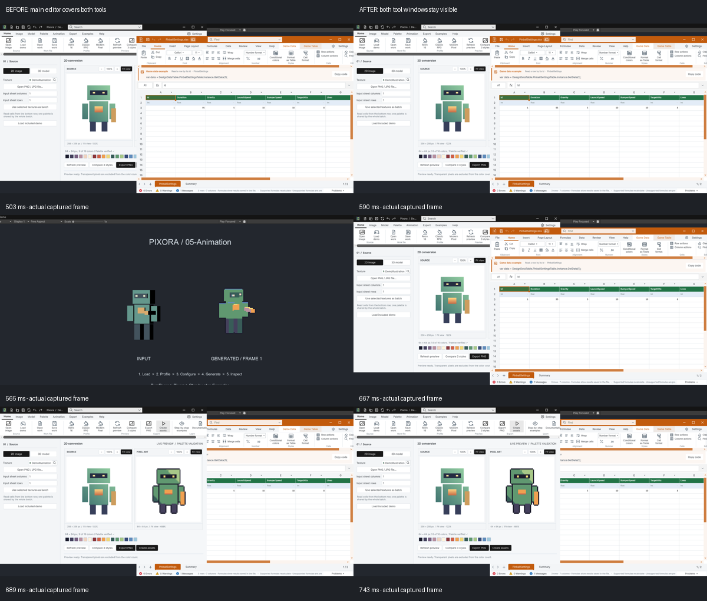

## 작업 결과

Templete1.2.5 수정 및868f9ecd 푸시 완료. 최종 무창198개, 실제 목록 교차 클릭12회, 최소화·복원4회와 peek·오버플로·공통 창 목록 복원 통과.

## 변경 내용

### 재현 조건

Windows · Unity6000.0.83f1 · Templete1.2.5/API1 · 분리된 TempleteQA 에디터

### 재현 순서

사용자가 이번 QA 동안 화면 제어를 허용한 뒤 실제 마우스로 하단 목록을12회 교차 선택했습니다. 누르기를80ms 유지해 버튼을 놓기 전 화면까지 기록했습니다.

### 기대 동작

목록을 누르는 동안에도 메인 창이 두 도구를 덮지 않고 선택 창이 복원됩니다.

### 실제 동작

수정 전 최종 포커스·창 순서는12회 모두 통과했지만192개 실제 프레임 중15개에서 메인 창이 두 도구 영역을 덮었습니다. 문서 SHOW/HIDE는0개였습니다.

### 원인

클릭 누르기→Unity 메인 창 foreground→버튼 놓기→선택 도구 foreground 순서와 중간 화면을 대조해 메인 Z 순서 덮임을 확인했습니다. MA_NOACTIVATE만 적용한 두 초기 시도는 실패했습니다. Unity 자체 마우스 처리의 후속 Z 순서 변경도 제한해야 했습니다.

### 적용 내용

공통 Templete의 WindowMouseActivationGuard를 추가했습니다. DataTable 공유 목록이 실제 항목 영역을 전달하고 Pixora도 같은 경로를 사용합니다. 클릭 메시지를 전달하면서 목록 클릭 구간의 메인 WINDOWPOS 순서 변경을 제한합니다. 다른 에디터 영역은 일반 활성화를 유지하고, 리로드·종료 전에 네이티브 서브클래스를 제거합니다. API1 유지, 양 제품 최소 모체1.2.5.

[수정과 근거 커밋868f9ecd](https://github.com/MDJ0126/TurnRoom/commit/868f9ecd). 메인 foreground 이벤트는 최종에서도12회 남습니다. 이를 제거했다고 주장하지 않으며, 도구를 덮는 화면 순서를 보존하는 수정입니다. 교훈 검토: 누르기 구간의 메인 덮임 검증을 프로젝트 AGENTS에 추가했습니다. 전역은 기존 증거·실행 검증 규칙과 중복되어 변경 없음입니다.

## 검증

실제 캡처 프레임을 배치한 비교 이미지입니다. 합성 UI가 아닙니다. 무손실 WebP1200×1020,133746바이트.

최종198개 무창 회귀와 실제 목록 교차 클릭12/12 통과. 최종175개 프레임에서 두 도구 영역의 동시 덮임0개, 문서 SHOW/HIDE0개였습니다. 표본 간격은 최대124ms이며 모든 영상 프레임을 검사한 것은 아닙니다.

제품별2회씩 최소화·복원4회에서 선택 창의 필요한 HIDE/SHOW 각2회만 발생했고 같은 핸들·복원 상태·두 도구의 메인 앞 순서를 확인했습니다. 실제 peek=true를 관찰한 뒤 복원했습니다. 700ms 길게 누르기, 목록 밖의 일반 에디터 클릭,7개 창 오버플로에서 DataTable 선택, 공통 창 목록에서 원래 Pixora 선택도 통과했습니다.

[프레임 분석](../assets/flicker-qa-20261031/FrameAnalysis.json) · [최종198개](../assets/flicker-qa-20261031/FinalRegression198.json) · [소스 대조](../assets/flicker-qa-20261031/SourceBuild.json). 런타임 소스·버전은 QA 복사본과 일치합니다. README qaCopyMatches=false는 실행 코드가 아닌 문서 사본이 오래됐다는 뜻입니다.

다른 ExcelKeyboardQA·ChatGPT 창이 클릭점을 가린 시도는 입력 가드가 중단했습니다. 다른 앱을 닫지 않고 QA 배치를 조정했습니다. QA 요청 파일의 동시 접근 오류와 실패한 초기 수정도 보존했고 제품 성공으로 바꾸지 않았습니다. [Microsoft 활성화 계약](https://learn.microsoft.com/en-us/windows/win32/inputdev/wm-mouseactivate)을 대조했습니다.

## 남은 사항

해결 범위는 위 Windows/Unity 버전에서 재현한 목록 클릭 중 메인 창 덮임입니다. 다른 운영체제·DPI 배율·장시간 스트레스·모든 미저장 문서 내용의 전체 회귀는 미실행입니다. 드래그·닫기 입력 코드는 유지했지만 이번 실제 재검증은 별도입니다. 판매용 패키지를 새로 만들지 않았습니다. 사용 중인 원래 에디터의 소스 리로드 여부는 별도이며 실행 증거는 분리 QA 에디터입니다.

## 작업 시간

- 제안 시간: 10~20분. 추가 원인 수정 후 게시 검증에5~10분 추가 예상 보고.
- 실제로 완료된 시간: 시작2026-10-31 11:50:19 KST. 구현·실행QA·코드 푸시 확인 후 보고서 생성까지25.4분 · 2026-10-31 12:15:44 KST. 외부 배포는 생성 후 별도 확인합니다.
- XERJ: 사용 — XERJ RestorePeekFromAnchor 검색 후 현재 소스·Win32 이벤트·실제 프레임 대조. 최초 노드 중단은 검색 재실행으로 복구했습니다.
