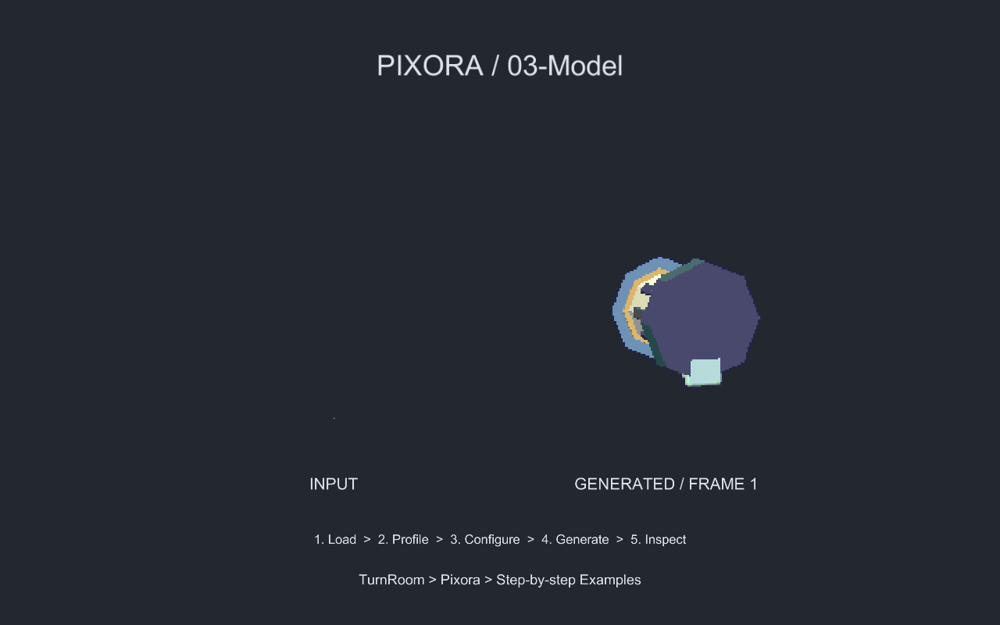
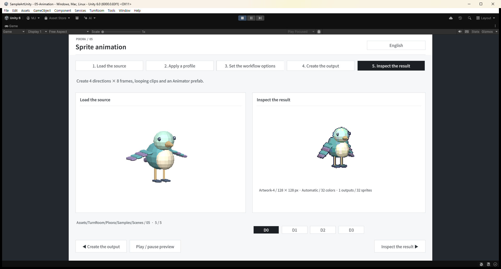

## 작업 결과

템플릿 스타일과 무관한 신규 FBX 예제 조립 오류 수정. 실제 씬·픽셀·네이티브 단계 QA 완료.

## 변경 내용

### 재현 조건

Unity 6000.0.83f1 / Blender 5.2.3 LTS / 신규 Pixora 샘플

### 재현 순서

새 Blender FBX를 prefab으로 만든 뒤 ModelCapture와 예제 씬의 배치 회전을 적용한다.

### 기대 동작

모델의 축·단위와 전체 부위 프레임을 유지한 상태로 정면을 촬영하고 입력도 표시한다.

### 실제 동작

초기 실제 카메라 렌더에서 전망대가 위에서 본 모습이 되고 입력 모델이 제대로 표시되지 않았다.

### 원인

FBX 최상위 Transform에 들어 있던 -90도 축 변환과100배 단위 변환이 촬영 복제/씬 배치의 최상위 초기화에 의해 소실됨. prefab Transform과 실제 렌더로 대조.

### 적용 내용

TutorialArtwork에서 identity 외부 루트 아래 Geometry에 FBX 변환을 보존하고 앞 방향을 정규화했습니다. ModelCapture와 기존 판매 제품 기능은 수정하지 않았습니다.

## 검증

최종 Unity396개 검사 통과. 모델별 상하 기준점·미터 단위·128×128 셀·모든 Full 프레임의 가장자리 여유를 확인했습니다. 실제 Play 모드50번 단계 클릭도 통과했습니다.

## 남은 사항

신규 제작 예제의 내부 검증 중 발견한 오류입니다. 외부 고객 환경의 모든 FBX 형식을 검증했다는 의미는 아닙니다. 교훈 검토: 전역 실제 화면 검증 규칙과 중복되어 전역 변경 없음. FBX 변환 보존 기준은 프로젝트 소스와 보고서에 기록했습니다.

## 작업 시간

- 제안 시간: 40~70분. 후속 요청으로 공용 폰트·샘플 UI와 두 제품 표시 검증 추가(10~20분 분량).
- 실제로 완료된 시간: 기록 시작 2026-10-31 15:48:59 KST. 구현·실행 QA·푸시 및 보고서 초안 작성 2026-10-31 16:53:36 대한민국 표준시; 기록 기준 64.6분. 공개 게시 확인 진행 중.
- XERJ: 사용 — TutorialAssets, UITemplateStyles 검색 후 현재 소스로 대조. 샘플 자산·씬·문서와 누락 범위는 rg 및 실제 Unity 실행으로 확인.
