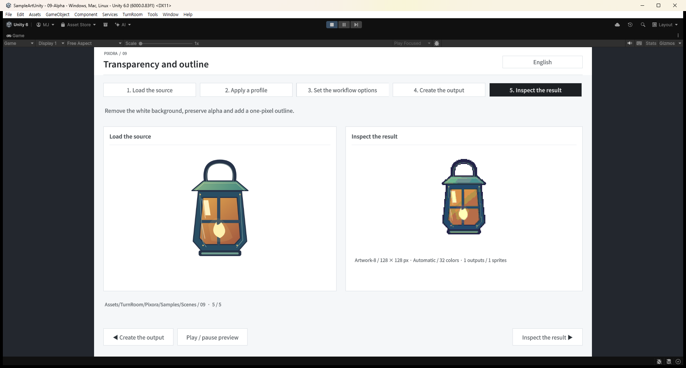

## 작업 결과

변환 코드와 09-Alpha가 참조하는 저장 출력 두 개를 갱신했습니다. 기존 출력의 불투명 픽셀 33개가 제거되고 손잡이를 포함한 전경 연결은 유지됐습니다. 프로젝트 커밋 434037a0을 푸시했습니다.

## 변경 내용

### 재현 조건

Unity 6000.0.83f1 / Windows / Built-in. 실제 독립 Unity 프로젝트와 샘플 09-Alpha, WayfarerLantern 512×512 → 128×128, 배경 제거·외곽선 켬.

### 재현 순서

WayfarerLantern.png와 Artwork-8 프로필로 PixelConverter.Convert를 실행합니다. 기존 저장된 09-Alpha Expected 미리보기 또는 Generated Images를 확인합니다.

### 기대 동작

흰 배경을 제거한 경계에 배경 혼합색으로 인한 밝은 점무늬가 남지 않으며 랜턴의 가는 손잡이와 불투명 전경을 유지합니다.

### 실제 동작

수정 전 실제 변환 PNG에서 손잡이와 외곽에 밝고 보랏빛인 점 형태 경계가 보였습니다. 준비 전경 3370픽셀, 외곽선 포함 결과 3682픽셀이었습니다.

### 원인

원본 PNG 262144픽셀 전체 알파가 255인 불투명 이미지이고 흰색 경계 안티앨리어싱 색상이 존재했습니다. 기존 Prepare는 축소 영역에서 한 지점만 읽고 배경색 거리만으로 제거한 후 알파를 1로 만들었습니다. 배경과 섞인 경계색이 전경으로 남고 팔레트·외곽선 처리로 강조되는 경로를 같은 입력의 실제 실행으로 재현했습니다.

### 적용 내용

배경 제거를 켠 축소에서만 원본 영역을 알파 가중으로 읽어 피복률을 계산합니다. 인접한 배경·같은 색상 방향의 가까운 전경을 기준으로 경계 배경 혼합을 복원하고 기존 alphaThreshold를 적용합니다.

배경 제거를 끈 경우와 원배율·확대의 최근접 샘플링은 보존했습니다. 원본 이미지·프로필·씬 GUID는 바꾸지 않고 Expected_3.png와 활성 Generated/09-Alpha/Images.png 두 파일의 픽셀만 다시 생성했습니다. 재현용 QA와 프로젝트 작성 지침에 회귀 항목을 보존했습니다.

## 검증

실제 마우스로 Inspect the result를 선택하고 캡처했습니다. 위 PNG는 1918×1030, 144461바이트 원본 캡처이며 자르기·리사이즈·재인코딩하지 않았습니다.

수정 전·후 실제 제품 출력:  

[회귀 결과](../assets/alpha-fringe-20261031/regression.json): 17개 검사 통과. 저피복률 점 제거, 1픽셀 선 연결, 배경 제거 해제 시 최근접 동작, 검은 배경·전경 색상, 완전 투명, 원배율·확대, 팔레트 제한, 랜턴 연결과 전경 면적 보존을 확인했습니다. 준비 전경 3340픽셀, 외곽선 포함 3649픽셀, 하나의 연결 성분을 유지했습니다.

영역 평균만 사용한 첫 시도는 잔상을 충분히 제거하지 못해 채택하지 않았습니다. 회귀 첫 실행의 색상 기대값은 shadeSteps 상한 32를 반영하지 않아 실패했고, 실제 설정 Validate에 맞춘 양자화 기대값으로 수정 후 재실행했습니다. 512→128 한 번의 실제 변환 측정은 57ms이며 일반 성능 보장은 아닙니다.

## 남은 사항

이 수정은 프로젝트 소스와 활성 샘플 출력에 적용했습니다. 기존 Artifacts의 unitypackage는 재생성하지 않았으므로 배포 전 이번 커밋으로 다시 내보내야 합니다. 불투명 이미지에서 원래 전경색과 배경 혼합을 완전히 역산할 수 있다고 주장하지 않습니다.

교훈은 Pixora 프로젝트 작성 지침에 배경 혼합 경계·피복률·가는 선 회귀 의무로 기록했습니다. 공통 전역 지침의 실제 픽셀 검증 원칙으로 충분해 새 전역 규칙은 추가하지 않았습니다. 이미지 원본 디자인이나 보고용 캡처 편집은 수행하지 않았습니다.

## 작업 시간

- 제안 시간: 10~20분
- 실제로 완료된 시간: 시작 2026-10-31 23:44:37 KST. 구현·회귀·실제 화면 검증 및 소스 푸시 확인 2026-11-01 00:01:25 KST, 16분 48초. 보고서 공개 배포는 이후 확인.
- XERJ: 사용 — XERJ alpha 검색 후 PixelConverter·원본 속성·프로필·실제 Unity 전후 실행으로 대조했습니다.
