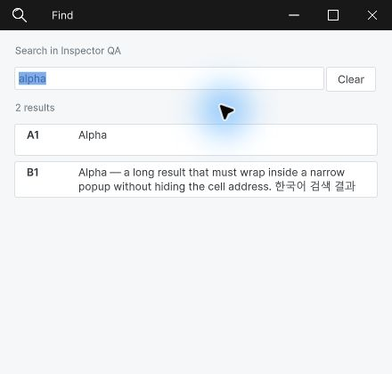
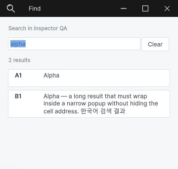
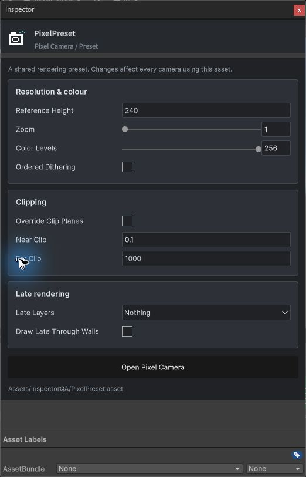
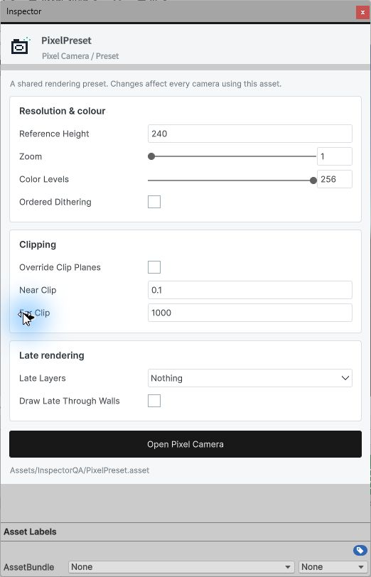
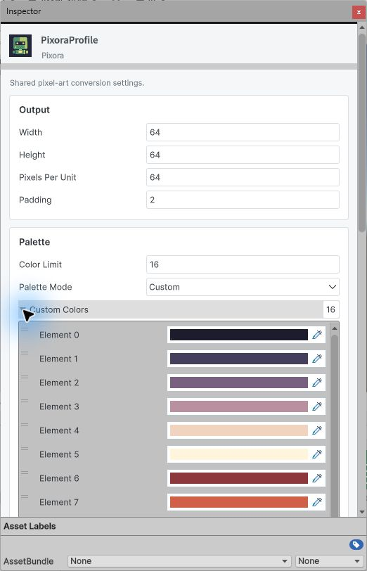

## 작업 결과

공통 Inspector 구현·제품 적용·컴파일·실제 Unity 화면과 새 문서 범위 검증 완료. 전체 QA는 verification 상태입니다.

## 변경 내용

### 적용 내용

`TemplateAssetInspector`와 `TemplateImporterInspector`가 제목·아이콘·설명·속성 카드·작업 버튼·기본 여백을 공유합니다. 임포터의 Apply/Revert와 기존 제품 열기·재생성 동작을 보존했습니다. 공통 버전은 1.4.0입니다.

Pixel Camera의 컴포넌트·프리셋, Pixora의 작업 원본·프로필·팔레트·튜토리얼, DataTable의 설정·테마·로컬라이제이션·임포터·워크시트·생성 테이블에 적용했습니다. 이후 생성되는 테이블은 빈 런타임 부모 `GeneratedDataAsset`를 사용합니다. 기존 사용자 생성 클래스는 재생성해야 이 부모를 채택합니다.

Find는 공통 제목줄, 좌우 16px 여백, 검색어 지우기, 결과 수, 고정 셀 주소와 줄바꿈 본문으로 바꿨습니다. 중복 Escape 콜백을 막고 창 복원 경로를 공유합니다. 긴 Inspector 라벨은 줄바꿈하고 배열의 펼침 화살표를 체크박스 스타일에서 제외했습니다.

실제 Unity 6000.0.83f1, English UI, 440px Find 팝업입니다. 기존 보고서의 가장자리에 붙은 배치를 새 여백·결과 행으로 교체했습니다.

## 검증

현재 소스로 6개 어셈블리 컴파일 exitCode 0. 실제 Unity에서 9개 에셋 유형의 공통 Inspector 생성을 확인했고, 생성 템플릿 에셋과 XLSX 임포터도 직접 표시했습니다.

실제 키보드 입력으로 프리셋 값을 180→240 변경, Undo와 Redo, 저장을 확인했습니다. 별도 Unity 프로세스를 종료 후 다시 실행하여 240 유지와 동일 공통 어셈블리 MVID를 확인했습니다. 양 테마, 360px 긴 라벨과 슬라이더 숫자 칸, 배열 펼침을 관찰했습니다.

Find의 빈 상태·무결과·다중 결과와 줄바꿈은 실제 화면으로 확인했습니다. B1 반환 콜백과 Escape 닫기는 Unity UI 이벤트로 검사했습니다. 이 결과를 물리 마우스·키보드 검사로 표시하지 않습니다.

원본 그대로인 네이티브 JPEG 11장, 합계 331,976바이트. 모두 200KB 미만이며 EXIF 없음, 이미지 크기·해시·현재 소스 및 QA 사본의 일치 검증. 3개 제품 × 9개 언어판의 관련 문서 범위 통과. Pixora 144개 장·90개 예제·언어 이동 통과, Pixel Camera 문서 검사 통과. UI 전체를 9개 언어로 시각 검증했다는 의미는 아닙니다.

교훈 검토: 배열 펼침과 불리언 체크박스는 구분해야 한다는 실제 화면 근거를 프로젝트 지침에 반영했습니다. 전역 지침은 변경하지 않았습니다. 템플릿 필수 목록에 공통 에셋 Inspector 요구를 추가했습니다.

[실행·컴파일·저장 재열기·문서 검사 기록](../assets/shared-inspector-20261101/verification.json)

## 남은 사항

Find의 물리 입력은 자동화 도구가 Unity 본창을 먼저 활성화하여 팝업이 가려지는 제한으로 미검증입니다. 별도 utility 호스트도 동일하게 본창 활성화의 영향을 받아 통과로 처리하지 않았습니다. 가려진 캡처는 게시에서 제외했습니다.

기존 DataTable 전체 가이드 검사는 캡처/소스 불일치·재캡처 대기 322건으로 미통과입니다. 과거 해시를 최신 값으로 덮지 않았습니다. 새 Inspector·Find 범위 11장과 27개 문서는 통과했지만 전체 메뉴얼은 완료로 등록하지 않습니다. 다른 사용자 에셋·모든 네이티브 선택기 조합의 전수검사는 수행하지 않았습니다.

## 작업 시간

- 제안 시간: Inspector 20~35분, Find 추가 5~10분
- 실제로 완료된 시간: 시작 2026-11-01 02:32:17 Asia/Seoul. 구현·해당 UI·새 문서 검사 확인 2026-11-01T02:55:01.945549+09:00; 전체 QA 미완료로 전체 완료 시각 미기록. 공개 게시 시간은 배포 확인 기록과 구분합니다.
- XERJ: 실패 — 노드 미실행·기존 데이터 디렉터리 잠금 오류 확인. rg로 대체하고 현재 소스와 실제 실행 결과 대조.
