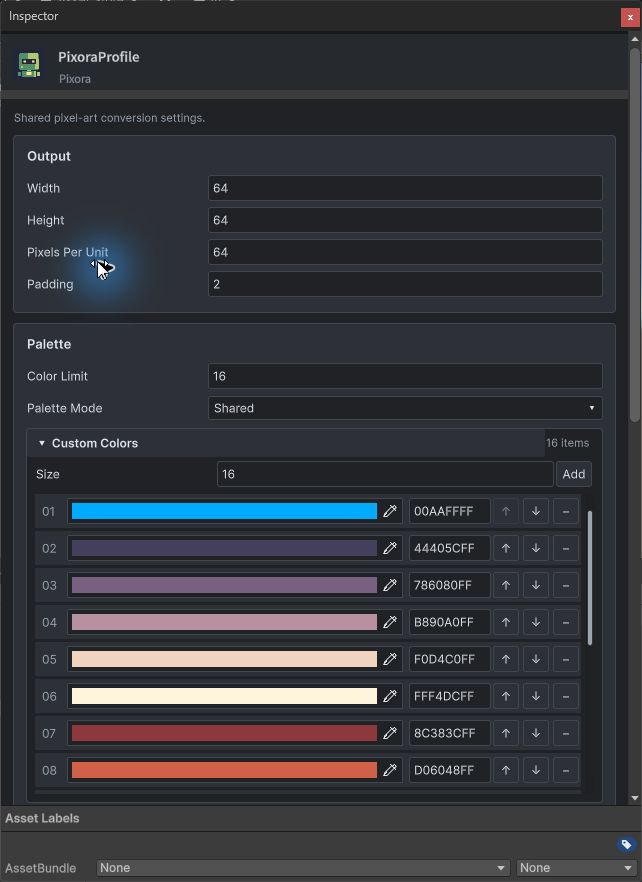
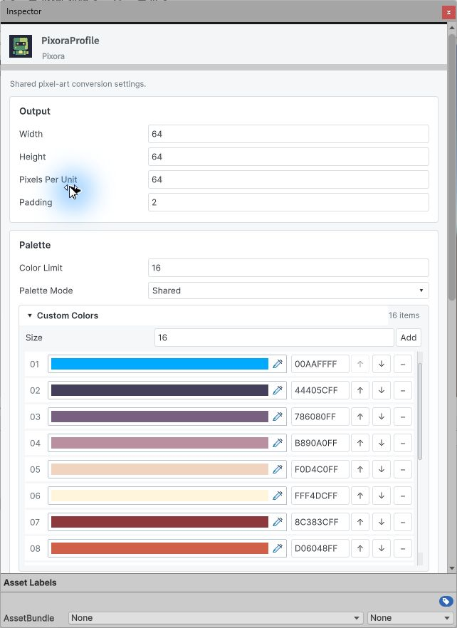
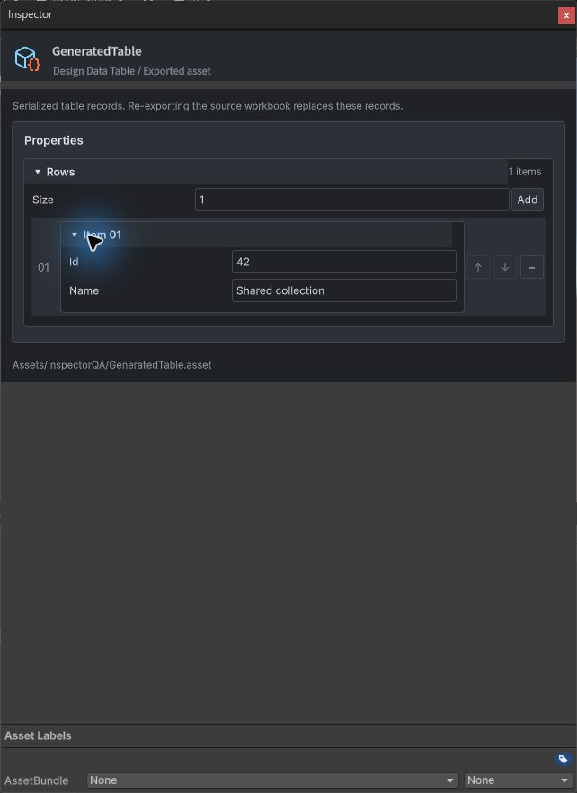
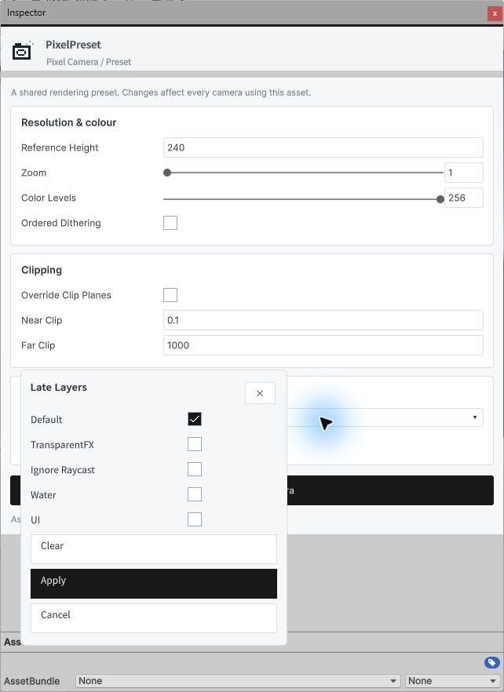

## 작업 결과

구현 및 현재 기능 검증 완료. Escape 유틸리티 창 동작과 과거 문서 전체 검증은 남겨 두었습니다.

## 변경 내용

### 적용 내용

Templete 1.5.0. TemplatePropertyCollection과 SerializedField 공통 생성 경로로 컬러 및 일반 배열·중첩 값을 연결했습니다. 색상 행에 RGBA·추가·삭제·위아래 이동·페이지를 제공하며 신규 색은 흰색입니다. TemplateInspectorPopover·EnumField·MaskField로 선택 UI를 공통화했습니다. 기존 Property API는 유지합니다.

## 검증

Unity 6000.0.83f1 실제 Inspector에서 색상 입력→물리 Ctrl+Z/Ctrl+Y, 추가→삭제→순서 이동, Enum Shared 선택, 팔레트 에셋 선택, RGBA 00AAFFFF 적용, Default 레이어 선택의 저장값을 대조했습니다. 일반 배열에 Id42/Name Shared collection 입력·저장·재열기 확인. 6개 어셈블리 컴파일 통과. 라이트·다크·380px 폭 확인. 현재 캡처 4장 해시와 27개 다국어 가이드 검사 통과. 이미지는 원본 JPEG 그대로 각200KB 이하이며 편집·재압축하지 않았습니다. 영어 UI만 시각 확인했습니다.

[검증 데이터](../assets/shared-property-lists-20261101/verification.json) Pixora 문서 검증 출력 위치를 별도 지정하여 재실행했고 9개 언어·144개 챕터·90개 코드 예제·언어 이동이 통과했습니다. 아카이브 검증은 603개 Markdown/HTML과 21,820개 로컬 링크를 통과했습니다.

## 남은 사항

실제 Escape는 유틸리티 Inspector도 닫았습니다. 도킹 Inspector의 Escape와 새 Unity 프로세스 재열기는 미검증입니다. 과거 DataTable 가이드 전체 검증에는 기존 소스 변경·재캡처 대기가 남아 있으며 전체 통과로 처리하지 않았습니다. Pixora 검증기 최초 출력 UNKNOWN 오류는 전용 출력 경로 지원으로 복구 후 통과했습니다. 교훈: 공통 Inspector에서 배열과 선택 UI도 SerializedField를 사용하도록 프로젝트 지침에 통합했습니다. 전역 새 규칙은 중복이므로 변경 없음.

## 작업 시간

- 제안 시간: 15~25분
- 실제로 완료된 시간: 구현·현재 범위 검증 18분 12초, 2026-11-01T03:38:28.844783+09:00; 공개 배포 확인 진행
- XERJ: 실패 — Status: XERJ node is not running; rg로 현재 소스 확인
