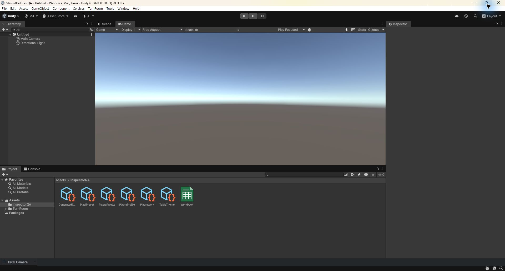
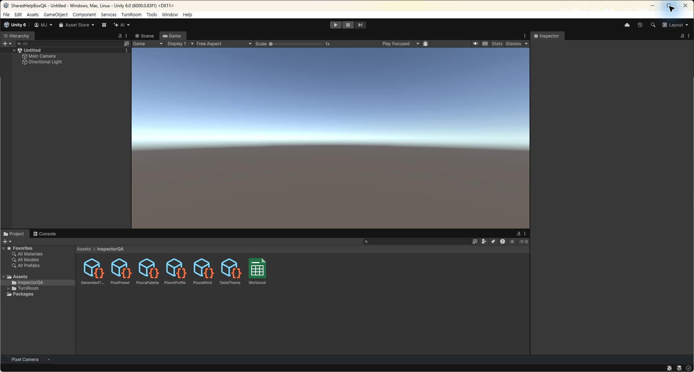

## 작업 결과

구현·컴파일·실제 네이티브 창 전환 비교 완료; 연속 마우스 드래그 QA는 남음

## 변경 내용

### 재현 조건

Windows / Unity 6000.0.83f1 / 100% DPI

### 재현 순서

Pixel Camera를 열어 최소화 목록을 표시합니다. 같은 editor update 안에서 주 창 위치·크기를 네 번 변경하고 각 WM_WINDOWPOSCHANGED 직후 목록 좌표를 읽습니다. 별도로 실제 시스템 최대화·복원 버튼을 클릭합니다.

### 기대 동작

목록이 Console 도킹 위치가 아니라 Unity 주 창 전체 하단, 상태 표시줄 위에 붙고 크기 변경 직후 폭과 위치가 일치함

### 실제 동작

수정 전 X 최대 138px, Y 160px, 폭 836px 오차. 수정 후 관찰 5개 메시지 모두 X·Y·폭 오차 0px.

### 원인

기존 UpdateBar는 EditorApplication.update에서만 GetMainWindowPosition 기반 외부 shelf를 이동했습니다. 네이티브 변경 직후 읽은 실제 좌표에서 갱신 전 오차를 재현했습니다.

### 적용 내용

주 창 client 좌표를 직접 읽어 하단 기준을 통일했습니다. 주 창 subclass에서 기본 메시지 처리를 보존한 뒤 WM_WINDOWPOSCHANGED에 shelf 위치·폭을 동기화합니다. 콜백은 Unity UI API를 호출하지 않고 포커스와 Z 순서를 바꾸지 않습니다. 재진입 방지, 동일 좌표 생략, 창 종료·도메인 재로드 시 해제를 포함합니다.

## 검증

3개 어셈블리 컴파일 통과. 실제 QA Unity에 로드된 전후 MVID와 CSV 기록을 보존했습니다. 네이티브 창 연속 변경 및 실제 최대화·복원 입력에서 하단 배치를 확인했습니다.

변경 전: 최종 위치는 하단이지만 변경 직후에는 목록 폭과 위치가 뒤처졌습니다.

변경 후: 동일 QA 프로젝트의 전체 하단 목록입니다. 정지 화면 자체로 지연을 증명하지 않으며 CSV와 함께 판단합니다.

[좌표·빌드 근거](../assets/shelf-follow-20261102/verification.json)

## 남은 사항

마우스 드래그 시도는 실제 창 크기가 바뀌지 않아 통과로 집계하지 않았습니다. 연속 물리 드래그, 다른 DPI·다중 모니터 이동은 미검증입니다. 사용자 프로젝트의 다른 씬 작업과 확인창은 변경하지 않고 별도 QA 프로젝트를 사용했습니다. 9개 언어에 하단 위치와 검증 범위를 안내했습니다. 기존 다른 스크린샷의 소스 불일치는 보존합니다. 교훈 검토: 기존 실제 중간 상태 검증 지침에 포함되어 전역 규칙 변경 없음.

## 작업 시간

- 제안 시간: 10~20분
- 실제로 완료된 시간: 2026-11-02 21:41:25 KST 시작, 21:59 KST 기준 약 18분 경과; 공개 확인 시각은 채팅 최종 보고에 기록
- XERJ: 실패 — Status 노드 미실행, Search 자동 시작 실패. rg와 현재 소스 및 실행 좌표로 대조
