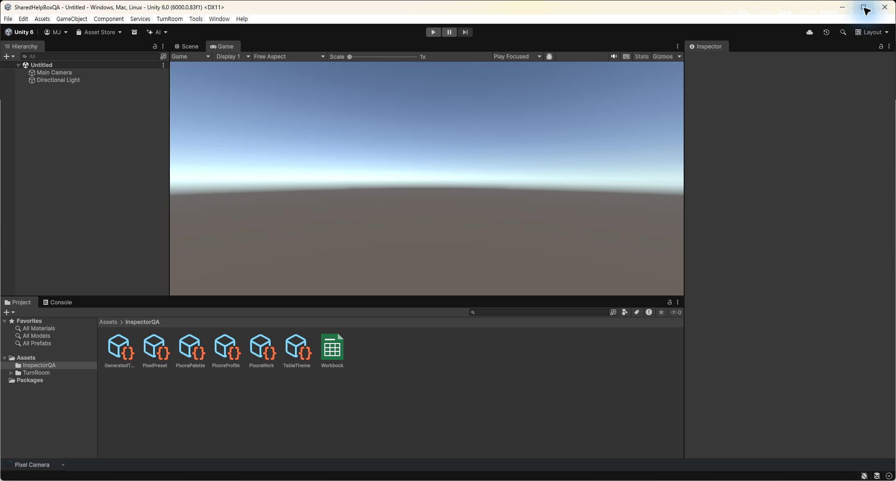
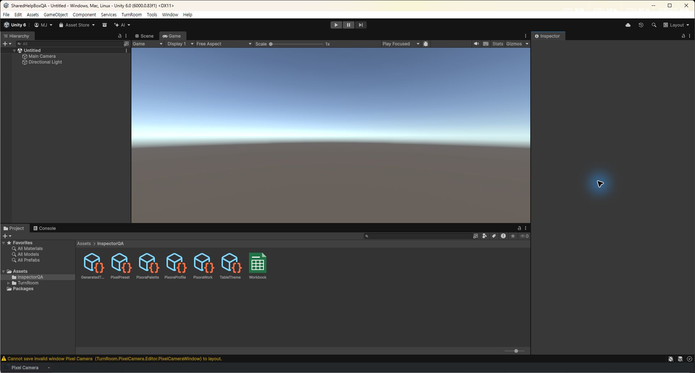

## 작업 결과

코드 적용·3개 어셈블리 컴파일·실제 Unity 화면 확인 완료

## 변경 내용

### 재현 조건

Windows / Unity 6000.0.83f1 / English QA UI

### 재현 순서

Pixel Camera 창을 열고 공통 최소화 목록이 표시된 Unity 하단에서 콘솔 상태줄·오른쪽 아이콘과 목록의 순서를 확인합니다.

### 기대 동작

Unity 콘솔 상태줄이 위, 최소화 목록이 아래

### 실제 동작

이전 수정에서 목록을 상태줄 위에 배치했습니다. 수정 후 실제 화면에서 상태줄 아래 목록을 확인했습니다.

### 원인

이전 위치 수정에서 하단 여백 20px를 두어 기존 통합 목록의 상대 순서를 반대로 해석했습니다. git 868f9ecd의 원본은 기본 상태줄 위쪽, 목록 아래쪽이었습니다.

### 적용 내용

목록의 하단 여백을 0으로 수정했습니다. Unity 기본 상태줄 공간은 기존 예약 계산으로 28px만 확장하고 기본 상태줄 자식은 상단 원래 높이에 보존합니다. 목록 제거·도메인 재로드 때 예약을 해제합니다. 네이티브 즉시 추종 경로는 유지합니다.

## 검증

3개 어셈블리 컴파일 통과. 별도 QA Unity에 수정본 MVID ed0b116a-f265-4967-ad20-3dc1e4d76ad6 로드 확인. 실제 화면에서 노란 콘솔 메시지와 오른쪽 아이콘은 위, Pixel Camera 목록은 아래에 표시되는 것을 확인했습니다. 9개 언어 안내도 같은 순서로 정정했습니다.

변경 전에는 최소화 목록 아래에 Unity 상태줄 아이콘이 있었습니다.

변경 후에는 콘솔 메시지·아이콘 아래에 최소화 목록이 있습니다. 화면의 invalid-window 경고는 QA 창 레이아웃 저장 중 표시된 메시지이며 이번 수정으로 해결했다고 주장하지 않습니다.

[빌드·소스 대조](../assets/shelf-order-20261102/verification.json)

## 남은 사항

연속 마우스 드래그와 다른 DPI 검증은 이전 보고서와 동일하게 남아 있습니다. 사용자 프로젝트의 다른 작업 씬 재로드 확인창은 변경하지 않았습니다. 이번 보고서는 원래 위아래 순서 복원만 완료로 기록합니다. 교훈 검토: 기존 원본·현재 화면 대조 의무에 포함되어 전역 지침 변경 없음.

## 작업 시간

- 제안 시간: 3~5분
- 실제로 완료된 시간: 2026-11-02 22:18:25 KST 시작, 22:26 KST 화면 확인까지 약 8분; 공개 확인 완료 시각은 채팅에 기록
- XERJ: 실패 — 노드 미실행; 현재 소스와 git 원본을 직접 대조
