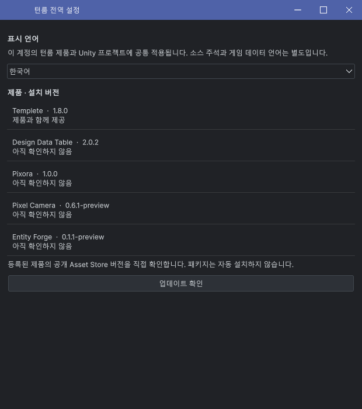
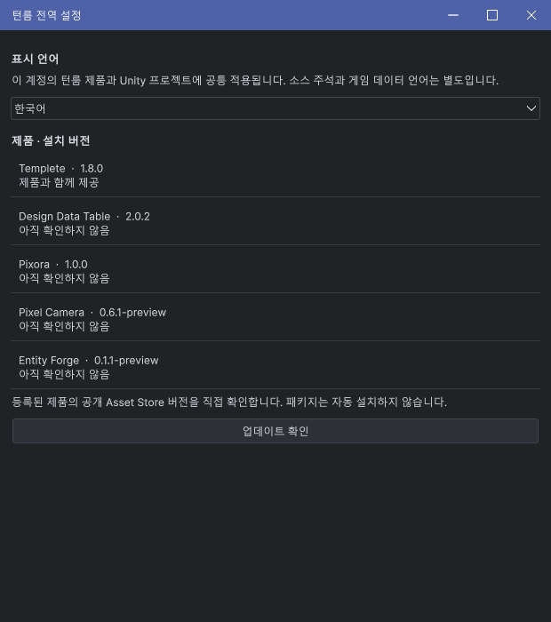
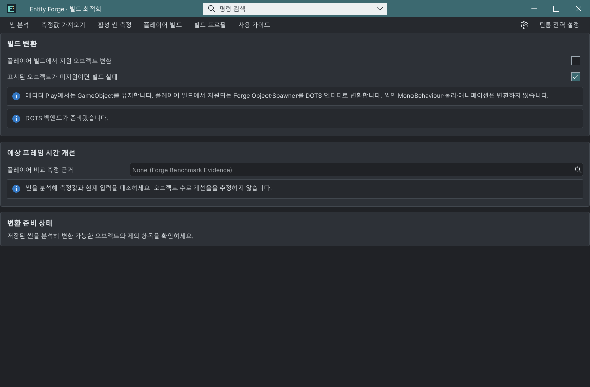

## 작업 결과

공통 프레임과 전역 설정에 적용했고 실제 Unity에서 확인했습니다. 아이콘 있는 창의 배치는 유지합니다.

## 변경 내용

### 적용 내용

아이콘이 없으면 brand=null로 전달하며 빈 슬롯을 만들지 않습니다. 제목은12px, 빠른 명령이 있으면 명령 뒤에 배치합니다. UI Toolkit과 IMGUI가 같은 좌표 계약을 사용하고 기존 단일 인자 API는 유지했습니다.

## 검증

Unity6000.0.83f1 실제 새 모듈 8b006f28-6212-4270-884c-3600a99ffe75에서 제목x12, 높이34, 컨트롤 위치와 씬 보존 확인. 아이콘 있는 Forge 제목x57와 Pixel 빠른 명령 포함 제목x113 확인. 수정 전 모듈에서 수집된 중간 기록은 새 코드 통과로 사용하지 않았습니다.

[검증 좌표·모듈 근거](../assets/title-without-icon-20261102/verification.json)

## 남은 사항

IMGUI null 경로는 코드 검토했으며 해당 형태의 실제 제품 창이 없어 별도 화면 검증하지 않았습니다. 기존 판매 패키지와 초안은 재생성·업로드하지 않았습니다. Affinity GIF 출력은 미검증이므로 원본 정지 화면으로 비교합니다. 교훈 검토: 변경 없음 — 기존 아이콘 슬롯 계약의 프로젝트 세부 규칙은 TempleteGallery에 기록했습니다.

## 작업 시간

- 제안 시간: 10~20분
- 실제로 완료된 시간: 8분 51초. 화면 검증 확인 2026-11-02 13:11:46 KST; 시작13:02:55 KST. 공개 배포는 이어서 확인합니다.
- XERJ: 사용 — TitleNameLeft 검색 결과를 현재 소스와 대조. 최초 제한 환경 연결 실패 후 권한 있는 실행에서 연결·검색 성공.
