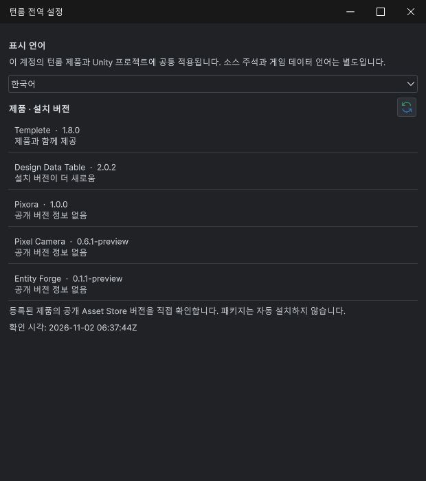
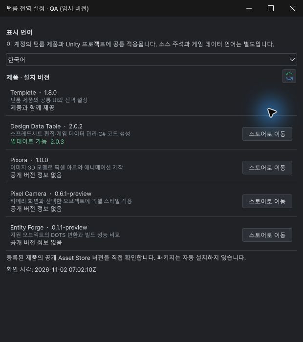
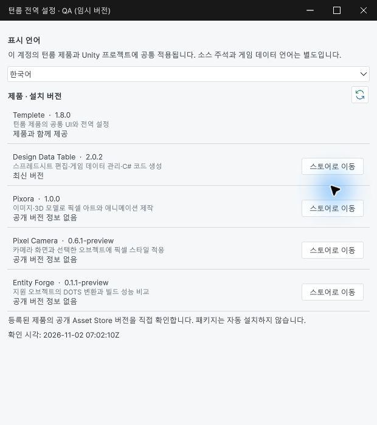

## 작업 결과

요청한 상태색·최신 버전 문구·스토어 버튼·조건부 업데이트 버튼과 이점 중심 설명을 구현했습니다. 전체 요청의 최종 화면·입력 검증까지 완료한 상태는 아닙니다.

## 변경 내용

### 적용 내용

업데이트 가능은 어두운 테마#6ED39B, 밝은 테마#197343으로 표시합니다. 동일 버전은9개 언어에서 최신 버전/Up to date 계열 문구로 정리했습니다. 4개 제품의 스토어 버튼은 설치 여부와 관계없이 검증된 제품 ID로 연결됩니다. 공통 Templete는 별도 판매 제품이 아니어서 스토어 버튼을 만들지 않습니다.

업데이트 버튼은 업데이트가 있는 설치 제품에만 나타납니다. 클릭 시 Unity 공개 API Window.Open(productId)로 해당 제품의 Package Manager를 엽니다. 자동 다운로드·가져오기를 실행하는 구현은 아닙니다.

- **Design Data Table**: 스프레드시트 편집부터 게임 데이터·C# 코드 생성까지, 반복 작업을 줄이세요.
- **Pixora**: 이미지와 3D 모델을 픽셀 아트·애니메이션으로 손쉽게 완성하세요.
- **Pixel Camera**: 카메라와 오브젝트에 픽셀 감성을 더해 게임의 비주얼을 완성하세요.
- **Entity Forge**: 지원 오브젝트의 DOTS 자동 변환으로 프로젝트 성능 최적화를 돕고, 전후 성능을 비교합니다.

## 검증

최종 로드 모듈cb717edd-d0cf-4544-b095-d57d0bb891e9: 실제 공개2.0.1에서 업데이트 버튼 없음, 메모리 시험값2.0.3에서 초록6ED39B·업데이트 버튼 표시·대상263724 확인. 실제 출시 버전2.0.3으로 보고하지 않았습니다. 실제 버전 파일은 수정하지 않았습니다.

9개 언어 문자열과5개 제품 설명·4개 Store URL 확인. 초기 구현의 동일 버전 문구 및 밝은 테마·테마 갱신 검사 통과. 최종 버튼 추가 후의 새 화면 캡처·직접 클릭·Package Manager 실제 선택은 미실행입니다.

설치/미설치 카탈로그14검사 통과. 9언어·현재57이미지 검사 오류0,45링크·5개 캡처 이력 보존 검사 통과. 마지막 문서 빌드는 과거 캡처의 소스 해시를 현재 코드로 바꾸지 않도록 수정했고 기존 커밋 해시를 복원·보존했습니다. 이 검사는 최신 UI의 시각 검증을 대신하지 않습니다.

[실제 검사값과 검증 범위](../assets/settings-store-actions-20261102/verification.json) · [Unity6000.0 공식 Package Manager 공개 API](https://github.com/Unity-Technologies/UnityCsReference/blob/6000.0/Modules/PackageManagerUI/Editor/UI/PackageManagerWindow.cs)

## 남은 사항

사용자가 물리 Escape로 Computer Use를 중지했습니다. 이후 화면 조작·Unity 재실행은 하지 않았습니다. 최종 화면 캡처, 실제 업데이트 버튼 클릭과 Package Manager 제품 선택, 실제 스토어 버튼 클릭, 최종 설명의 모든 언어·배율 배치는 확인 대기입니다.

미출시 세 제품의 스토어 페이지는 공개 전까지 표시되지 않을 수 있습니다. 판매용 패키지는 이번 코드 변경 후 재포장하지 않았습니다.

초기 CS0136/CS0029 컴파일 오류는 수정했습니다. 공통 스타일 파일 변경은 원복하고 전역 설정의 USS와 스타일 재적용으로 색상을 유지합니다. 확인되지 않은 상태를 완료로 표시하지 않았습니다. 교훈 검토: 기존 실제 화면 검증·캡처 해시 보존 규칙에 해당해 전역 지침 변경 없음.

## 작업 시간

- 제안 시간: 5~10분 — 이후 사용자 추가 요청2회 포함
- 실제로 완료된 시간: 코드·검증 기록 정리 34분 52초, 2026-11-02 16:26:52 KST. 시작2026-11-02 15:52:00 KST. 사용자 추가 요청2회(기능 설명·조건부 업데이트 버튼과 이점 중심 문구)를 포함했습니다. 최종 화면·클릭 검증은 사용자 화면 조작 중지로 미완료입니다.
- XERJ: 실패 — Status: node not running. 데이터 잠금 이력을 보존하고 rg로 현재 코드·제품 메타데이터·공식 API를 대조했습니다.
