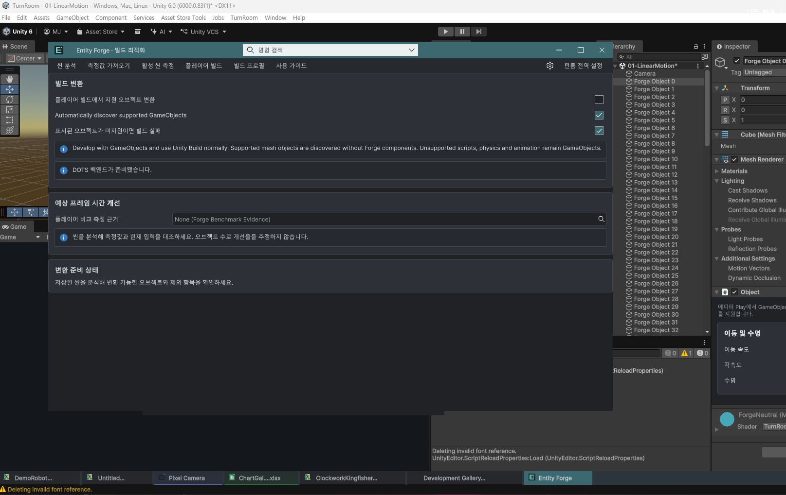
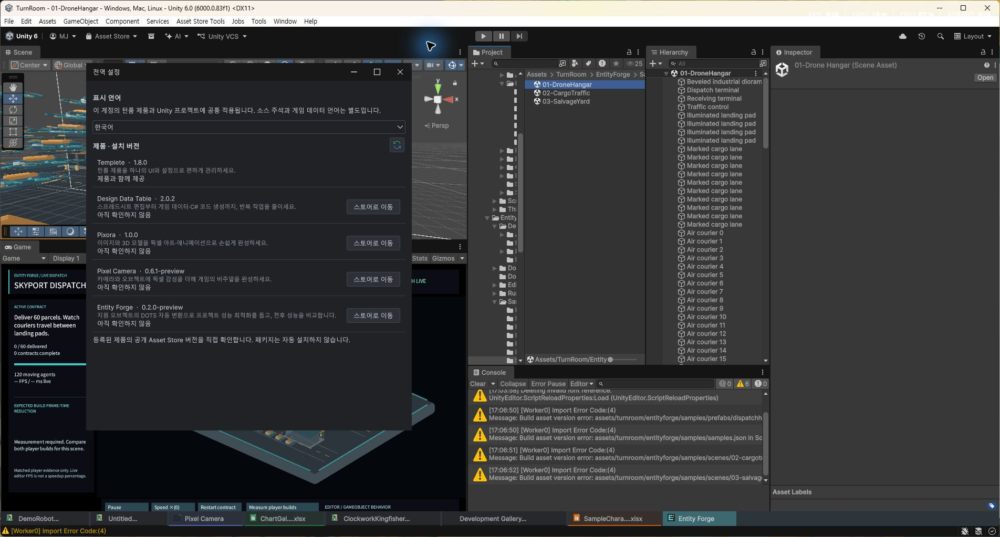
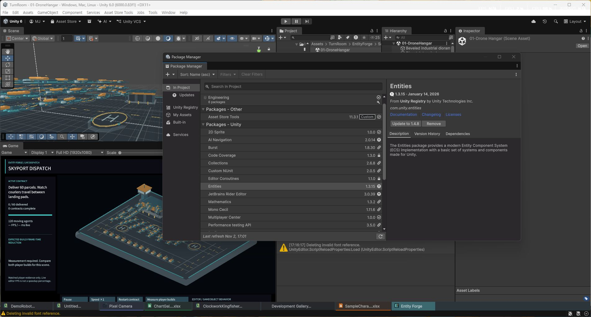

## 작업 결과

요청한 세 항목의 소스 수정을 구현하고 실제 Unity6000.0.83f1에서 대상 검사를 통과했습니다. 판매 포털의 새 패키지 업로드나 최종 제출은 실행하지 않았습니다.

## 변경 내용

### 적용 내용

공통 제품 명령을 Tools/TurnRoom으로 이동하고 단축키·검증 메뉴 쌍을 보존했습니다. Entity Forge는 Client.Add와 설치 폴링을 제거하고 공개 Window.Open(com.unity.entities)로 Package Manager를 엽니다. 편집 가능한 UXML·영구 이벤트·9언어 버튼 문구도 변경했습니다.

Pixora 모델2개의 메시 회전·배율을 원본 Blender에서 적용하고 FBX를 다시 내보냈습니다. 같은 Pixel Camera 모델 복사본도 갱신했습니다. Pixora 예제 프리팹의 불필요한 원점 오프셋을 제거했습니다. Pixel Camera 프리팹3개는 애니메이션 소유자와 경로를 보존하는 항등 루트를 추가하고 기존122+142+156개 오브젝트 ID를 모두 보존했습니다. 생성기도 수정했고 혼합 줄바꿈18파일을 정리했습니다.

기존9언어 안내 경로와 공통 실제 화면을 추가했습니다. 촬영 UI는 한국어이며9개 언어 레이아웃 전체의 시각 검증을 의미하지 않습니다. 과거 캡처의 해시는 변경하지 않았습니다.

수정 전: 사용자가 제공한 실제 화면의 최상위 TurnRoom 메뉴입니다. 전후 씬·창 내용은 달라 동일 상태의 전체 화면 비교로 판정하지 않았습니다.

수정 후: 실제 Unity의 Tools 하위 TurnRoom 진입을 확인했습니다.

Package Manager에서 Entities1.3.15가 선택되었습니다. 업데이트·삭제·설치는 실행하지 않았습니다.

## 검증

공식 Asset Store Tools11.3.1 실제 클래스의 메뉴명·줄바꿈·모델 회전·프리팹 변환 검사: 배포 포함 경로4제품×4검사 모두 Pass. 개발 보관 폴더의 구형 모델 경고는 실제 배포 범위와 분리했습니다. 5개 제품 메뉴 실제 실행 성공. Package Manager 열기 전후 manifest.json 동일. 실제 가져온 프리팹 루트·애니메이션 경로와 모델 회전 검사 통과. Blender 월드 정점 최대오차2.98e-8. 다른 미완성 작업을 제외한 스테이징 트리를 별도 복원해15어셈블리 컴파일 통과.

처음 targeted 명령은 이전 에디터 모듈에서 Unknown command로 실패했으며 실패 JSON을 보존했습니다. 내보내기는 패키지 생성 뒤 manifest 덮어쓰기가Win32 1224로 실패했습니다. 임시파일 교체로 수정하고 실제 새 모듈에서 manifest 교체를 통과했습니다. [검증 근거](../assets/submission-compliance-20261102/verification.json)

정책 근거: [Unity Asset Store 제출 지침](https://assetstore.unity.com/publishing/submission-guidelines)의2.5.1.a 및 외부 패키지 안내 원칙을 대조했습니다.

## 남은 사항

새로 생성한 패키지의 최종 소스 포함 대조·새 설치·포털 재업로드는 이번 보고에서 완료로 처리하지 않았습니다. 동시에 진행 중인 Forge 변경은 커밋에서 보존·분리했습니다. 기존 문서 캡처는 역사 자료이고 새 메뉴 화면만 최신 근거입니다. 전체 샘플 플레이 동작·모든 언어의 시각 배치는 이번 대상 검사와 구분합니다.

교훈 검토: Unity 제품의 메뉴·수동 의존성·배포 범위 검사 원칙을 프로젝트 AGENTS.md에 추가했습니다. Unity 제품에 한정된 규칙이라 전역 지침은 변경하지 않았습니다.

## 작업 시간

- 제안 시간: 20~40분
- 실제로 완료된 시간: 검증 기록 38분 29초, 2026-11-02 17:21:05.220 KST. 푸시·공개 확인 시각은 별도 확인합니다.
- XERJ: 실패 — Status: node not running; Search startup failed. rg와 현재 소스·실제 공식 검증기 판정 코드를 대조했습니다.
