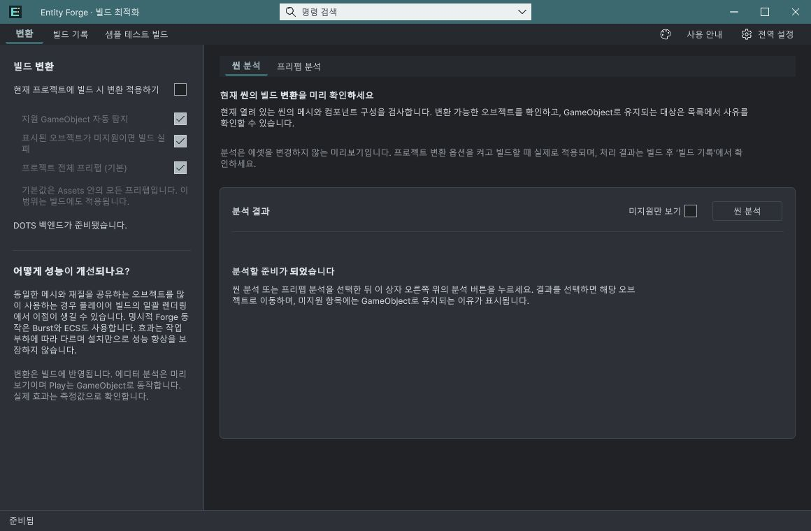
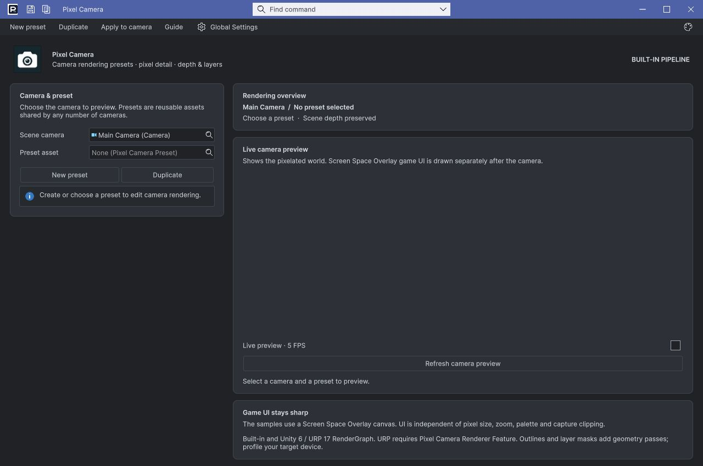

## 작업 결과

공통 문서 창에 Windows 셸 항목 등록을 추가했습니다. 이어서 Windows가 선택한 창의 활성화가 Unity에서 이전 문서로 되돌아가는 문제를 수정했습니다. 최종 제품 코드로 실제 Alt+Tab 양방향 전환을 확인했습니다. 기존의 미리보기만 표시되던 중간 수정은 전환 성공으로 세지 않았습니다.

## 변경 내용

### 재현 조건

Windows, Unity 6000.0.83f1. 독립 QA 에디터의 실제 Entity Forge / Pixel Camera 창. 동일 공통 소스를 개발 프로젝트와 기존 Entity Forge / Foliage QA 체크아웃에도 적용.

### 재현 순서

1. 제품 창 두 개를 연다.
2. Pixel Camera, Entity Forge 순으로 활성화한다.
3. Windows Alt+Tab을 눌러 Pixel Camera를 선택한다.
4. 반대 방향도 반복한다.
5. Ctrl+Alt+Tab으로 실제 Windows 미리보기 목록을 확인한다.

### 기대 동작

제품 문서가 Windows 미리보기 목록에 표시되고 선택한 문서가 실제 활성 창이 되어야 합니다.

### 실제 동작

원래 창의 확장 스타일은 APPWINDOW, owner=0이어도 셸 목록에 제품이 없었습니다. 셸 등록만 추가한 중간 단계에서는 미리보기는 표시됐지만 실제 전환이 되돌아갔고 사용자도 이를 확인했습니다. 네이티브 WM_ACTIVATE 진입 시 Pixel Camera였던 활성 창이 Unity 처리 후 Entity Forge로 바뀌는 것을 기록했습니다.

### 원인

현재 Unity6000.0.83f1 실행에서 두 경로를 확인했습니다. ShowPopup 생성 후 스타일/owner 변경과 프레임 새로고침만으로 기존 창의 셸 항목이 생성되지 않았습니다. ITaskbarList.AddTab 뒤 실제 미리보기가 표시됐습니다. 별도로 Unity의 기존 WM_ACTIVATE 처리 안에서 이전 문서로 재활성화가 발생했습니다. 다른 Unity 버전의 동일 동작은 미확인입니다.

### 적용 내용

- 공통 WindowFrame에 ITaskbarList 등록·해제와 네이티브 핸들 재생성 추적을 추가했습니다.
- 등록된 독립 ToolWindow에서 Windows가 실제 선택한 활성화만 처리합니다. 해당 Unity 뷰를 맞추고 Win32 기본 활성화로 네이티브 키보드 포커스를 설정합니다. 비활성화·다른 메시지는 원래 처리로 전달합니다.
- 도킹 창·목록 제외 창은 적용하지 않으며 창 종료/도메인 재로드 시 셸 항목과 서브클래스를 해제합니다.
- 반복 숨김/표시, 최대화 애니메이션, 외부 앱 강제 활성화는 추가하지 않았습니다.

[Microsoft ITaskbarList.AddTab](https://learn.microsoft.com/en-us/windows/win32/api/shobjidl_core/nf-shobjidl_core-itaskbarlist-addtab) · [Win32 WM_ACTIVATE](https://learn.microsoft.com/en-us/windows/win32/inputdev/wm-activate)

## 검증

최종 공통 소스를 실제 QA 에디터가 로드한 모듈을 기록하고 실험용 활성화 보정을 비활성화했습니다.

| 실제 키 입력 | 직전 문서 | 입력 후 실제 전면 창 | 확인 시각 KST |
| --- | --- | --- | --- |
| Alt+Tab | Entity Forge | Pixel Camera | 15:45:53.713 |
| Alt+Tab | Pixel Camera | Entity Forge | 15:46:42.364 |

10개 Runtime/Editor 어셈블리 최종 컴파일 exitCode0. 개발 Unity의 재컴파일 모듈도 별도로 확인했습니다.

[소스 해시·모듈·전환 시각·컴파일 근거](../assets/task-switch-native-20261104/verification.json)

### 수정 전 기준 문서 화면

아래는 수정 전 Entity Forge의 실제 화면입니다. 문서 본체 모양은 이번 수정 대상이 아니며 이 정지 화면만으로 Alt+Tab 실패를 판정하지 않습니다. 실패는 위 네이티브 메시지 기록과 사용자 관찰로 대조했습니다.

### 수정 후 실제 Alt+Tab으로 전환된 문서

최종 코드에서 Entity Forge로부터 Alt+Tab으로 전환된 Pixel Camera입니다. 서로 다른 문서·크기·언어이므로 스타일의 동일 배율 전후 비교로 주장하지 않습니다.

교훈 검토: 창 스타일 비트, 미리보기 등록, 선택 후 실제 활성 창을 각각 검증했습니다. 기존 전역의 실제 실행·검증 의무에 포함되므로 전역 지침 변경은 없습니다. 버전 한정 기술 근거는 이 보고서에 보존합니다.

## 남은 사항

실제 왕복 검증 범위는 Entity Forge와 Pixel Camera입니다. 다른 제품 종류와 사용자 정의 최소화 선반의 숨김 문서는 개별 인증하지 않았습니다. 기존 9언어 전체 가이드 교체와 선택 팝업 입력 QA는 기존 메뉴얼에 남깁니다. Windows 전체 미리보기 원본에는 다른 비공개 창이 보여 로컬에 보존했습니다. Affinity에서 공개용 영역 편집을 시도했으나 파일 접근 PERMISSION_DENIED로 내보내지 못해 편집본은 게시하지 않았습니다. 공개 이미지는 편집하지 않은 제품 창 원본입니다. 판매 패키지 업로드와 심사 제출은 하지 않았습니다.

## 작업 시간

- 제안 시간: 15–30분. 15:45 KST경 실제 전환 추가 수정·검증과 공개 작업으로 5–10분 추가 가능성을 안내했습니다.
- 실제로 완료된 시간: 2026-11-04 15:18:22 KST 시작. 최종 네이티브 왕복 확인 15:46:42 KST. 문서 작성 시점 15:53:33 KST까지 35.2분 소요. 공개 배포 검증 완료 시각은 채팅 최종 결과에 기록합니다.
- XERJ: 실패 — XERJ Status: node is not running. Search: startup failed. 현재 소스·호출은 rg로 확인했습니다.
