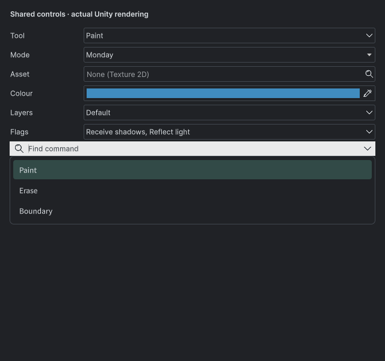
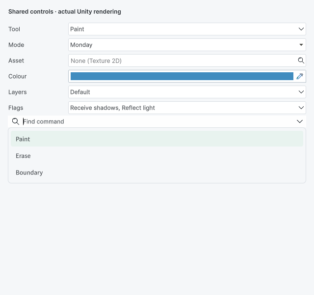
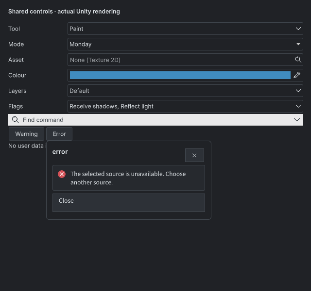
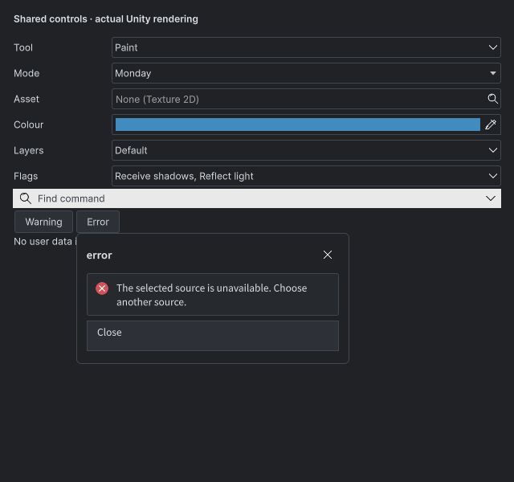
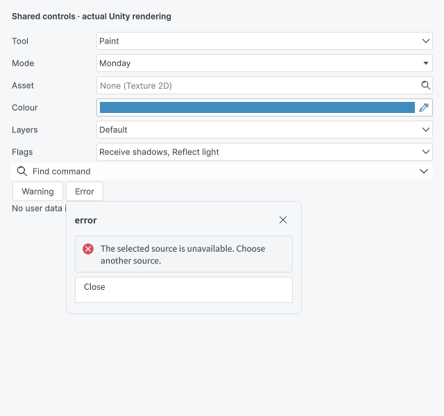
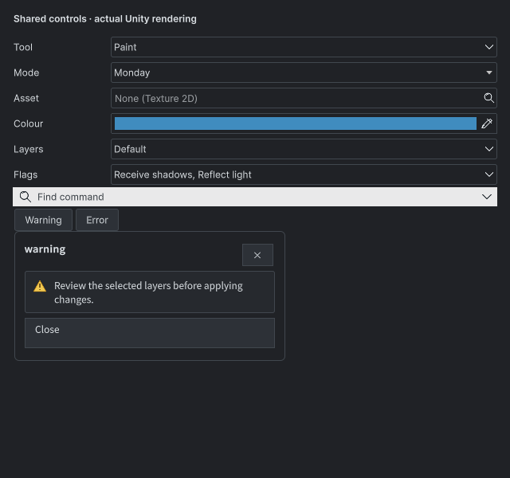
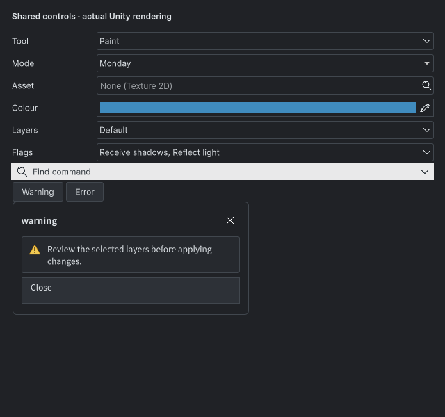
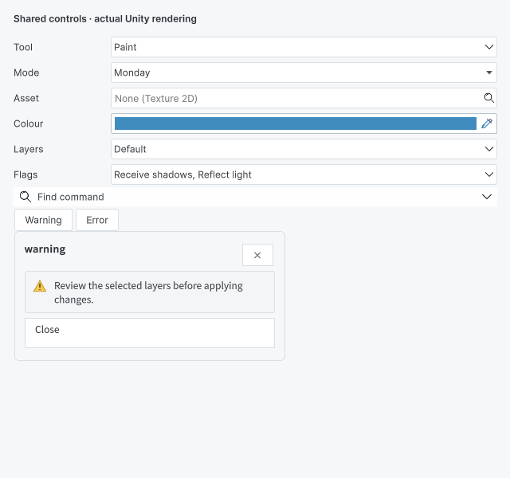
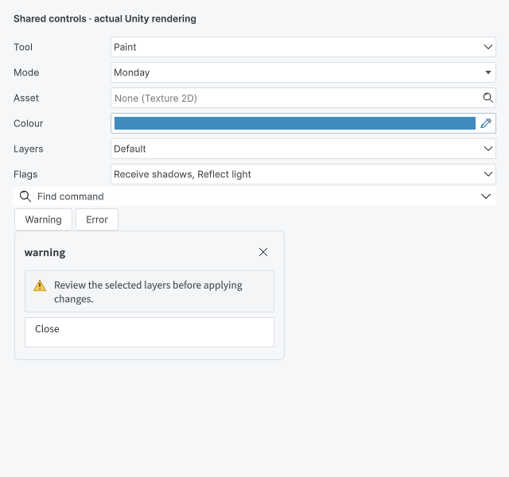

## 작업 결과

경고·오류 패널의 닫기 디자인을 통일했습니다. 명령 검색 메뉴는 기존 행 디자인을 유지하며 전후를 기록했습니다.

## 변경 내용

### 적용 내용

### commands-dark

전후 파일 SHA-256이 동일합니다. 이 화면은 변경되지 않았으며 수정 성과로 계산하지 않습니다.

수정 전 · 640×600 · en · 2026-11-04T05:08:16.9124704Z

수정 후 · 640×600 · en · 2026-11-04T05:44:23.9587787Z

### commands-light

전후 파일 SHA-256이 동일합니다. 이 화면은 변경되지 않았으며 수정 성과로 계산하지 않습니다.

수정 전 · 640×600 · en · 2026-11-04T05:04:21.5941117Z

수정 후 · 640×600 · en · 2026-11-04T05:45:10.4742157Z

### error-dark

박스형 × 대신 동일한 28px 공통 X를 적용했습니다. 제목과 세로 중심을 맞췄습니다.

수정 전 · 640×600 · en · 2026-11-04T05:08:18.8118739Z

수정 후 · 640×600 · en · 2026-11-04T05:44:25.9084827Z

### error-light

박스형 × 대신 동일한 28px 공통 X를 적용했습니다. 제목과 세로 중심을 맞췄습니다.

수정 전 · 640×600 · en · 2026-11-04T05:04:23.4841874Z

수정 후 · 640×600 · en · 2026-11-04T05:45:12.4511469Z

### warning-dark

박스형 × 대신 동일한 28px 공통 X를 적용했습니다. 제목과 세로 중심을 맞췄습니다.

수정 전 · 640×600 · en · 2026-11-04T05:08:17.8626600Z

수정 후 · 640×600 · en · 2026-11-04T05:44:24.9278651Z

### warning-light

박스형 × 대신 동일한 28px 공통 X를 적용했습니다. 제목과 세로 중심을 맞췄습니다.

수정 전 · 640×600 · en · 2026-11-04T05:04:22.5382731Z

수정 후 · 640×600 · en · 2026-11-04T05:45:11.4581359Z

## 검증

Unity 6000.0.83f1의 실제 GUIView 렌더를 캡처했습니다. 모형 이미지나 코드로 그린 UI가 아닙니다. 원본 PNG를 편집 없이 보존했습니다. before/after 크기·언어와 파일 해시를 대조했습니다. 제품 창은 실제 EditorWindow, Inspector는 임시 에셋 복제본에 실제 제품 Inspector 렌더러를 실행한 QA 호스트입니다. Light/dark는 에디터 환경 표기이며 소유 제품의 테마 설정은 따로 유지됩니다. DDT 본문은 두 환경 모두 자체 라이트 설정이 유지됐으므로 DDT 자체 다크 테마 검증으로 주장하지 않습니다.

## 남은 사항

실제 물리 입력의 선택값 반환·취소·X 클릭과 Windows Alt+Tab은 미확인입니다. 입력 도구에서 창 활성화 timeout 및 foreground PID 오류가 발생했습니다. 자동으로 팝업을 열어 촬영한 결과를 실제 키보드·마우스 통과로 처리하지 않았습니다. 기존 DDT 저장/삭제/About 확인 대화상자와 9언어 전체 제품 가이드의 과거 화면 갱신은 이 비교 결과로 통과 처리하지 않습니다.

## 작업 시간

- 제안 시간: 30–60분. 14:37 KST에 추가 10–15분을 안내했습니다.
- 실제로 완료된 시간: 2026-11-04 13:41:31 KST 시작. 화면 수정·재촬영·컴파일 확인 14:47:28 KST까지 66.0분. 보고서 공개 검증 시간은 채팅 최종 보고에 별도 기록합니다.
- XERJ: 실패 — XERJ Status 노드 미실행, Search 시작 시 인덱스 데이터 디렉터리 잠금으로 실패. 현재 소스는 rg로 대조했습니다.
