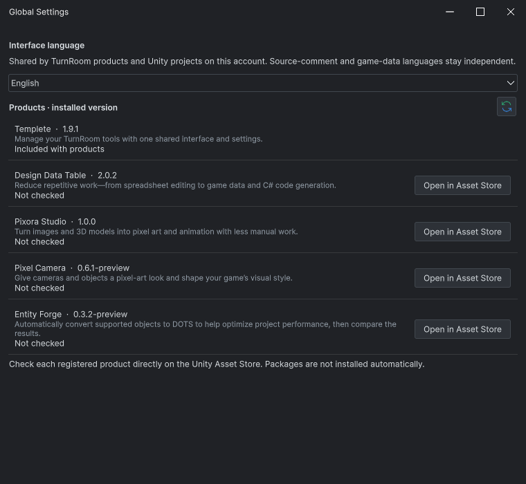
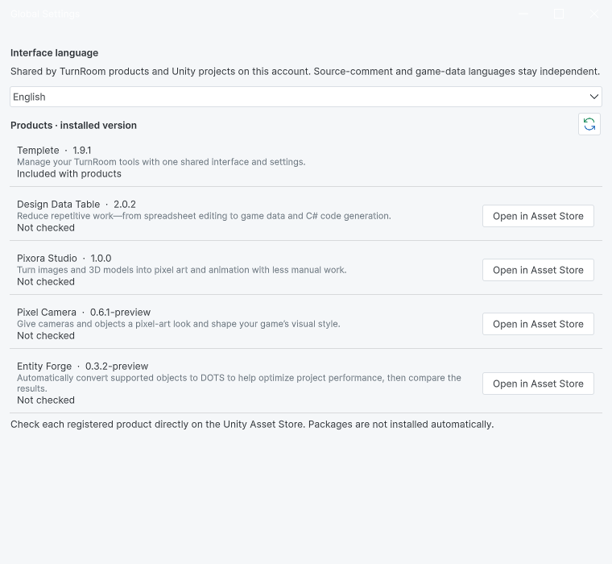
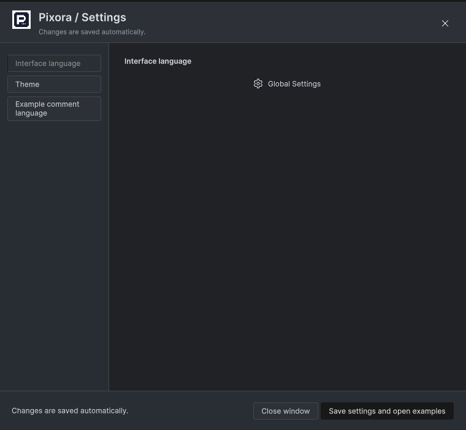
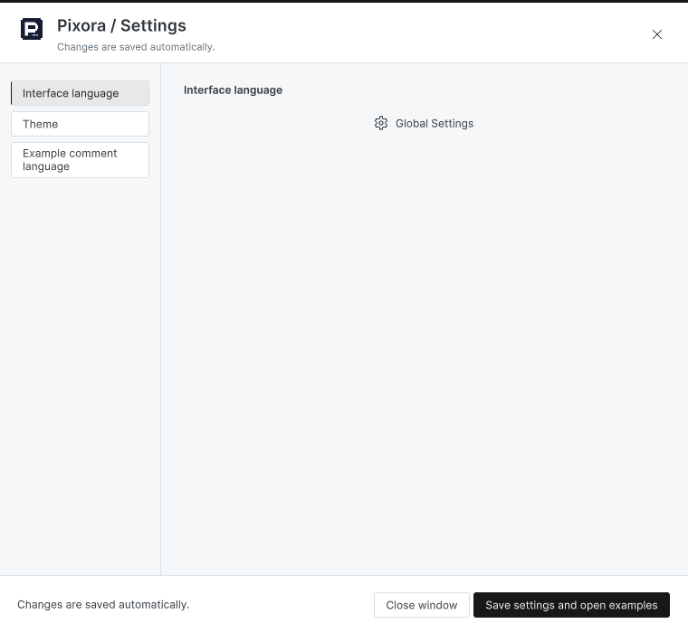
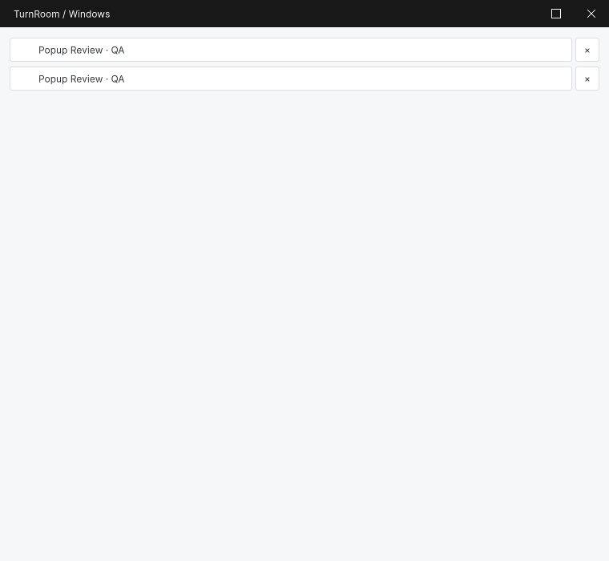
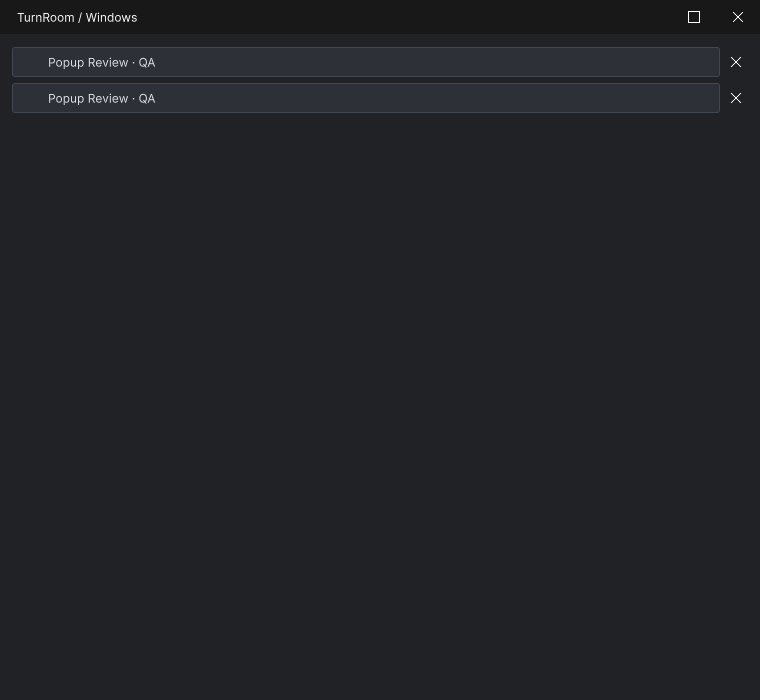
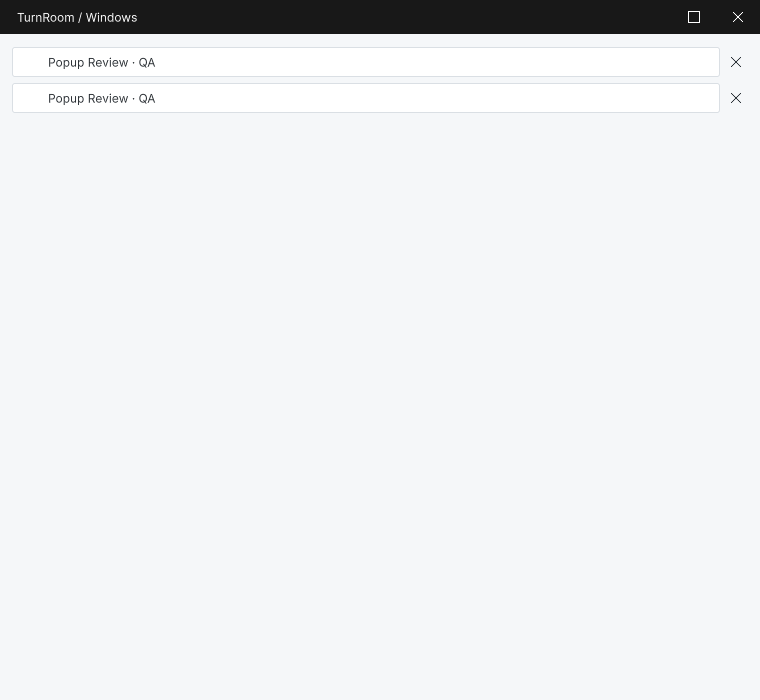

## 작업 결과

Windows 목록의 박스형 ×를 제거하고 다크 테마 상속을 수정했습니다. 설정 창은 감사 범위에 포함했으며 라이트 제목 대비 문제는 남겼습니다.

## 변경 내용

### 적용 내용

### extra-settings-dark

템플릿 표시 버전 1.9.0 → 1.9.1. 라이트 화면의 흰 제목/창 버튼 대비 부족은 남은 문제로 확인했습니다.

수정 전 · 760×700 · en · 2026-11-04T05:19:37.7352942Z

수정 후 · 760×700 · en · 2026-11-04T05:44:34.7735548Z

### extra-settings-light

템플릿 표시 버전 1.9.0 → 1.9.1. 라이트 화면의 흰 제목/창 버튼 대비 부족은 남은 문제로 확인했습니다.

수정 전 · 760×700 · en · 2026-11-04T05:21:33.6148344Z

수정 후 · 760×700 · en · 2026-11-04T05:45:21.2986547Z

### extra-setup-dark

전후 파일 SHA-256이 동일합니다. 이 화면은 변경되지 않았으며 수정 성과로 계산하지 않습니다.

수정 전 · 760×700 · en · 2026-11-04T05:19:38.3904936Z

수정 후 · 760×700 · en · 2026-11-04T05:44:35.3980251Z

### extra-setup-light

전후 파일 SHA-256이 동일합니다. 이 화면은 변경되지 않았으며 수정 성과로 계산하지 않습니다.

수정 전 · 760×700 · en · 2026-11-04T05:21:34.2936709Z

수정 후 · 760×700 · en · 2026-11-04T05:45:21.9156788Z

### extra-windows-dark

행의 박스형 ×를 공통 X 아이콘으로 교체했습니다. 다크 환경에서 목록 본문이 흰색으로 고정되던 부분도 수정했습니다.

수정 전 · 760×700 · en · 2026-11-04T05:19:36.7996885Z

수정 후 · 760×700 · en · 2026-11-04T05:44:34.1029374Z

### extra-windows-light

행의 박스형 ×를 공통 X 아이콘으로 교체했습니다. 다크 환경에서 목록 본문이 흰색으로 고정되던 부분도 수정했습니다.

수정 전 · 760×700 · en · 2026-11-04T05:21:32.7976960Z

수정 후 · 760×700 · en · 2026-11-04T05:45:20.6413974Z

## 검증

Unity 6000.0.83f1의 실제 GUIView 렌더를 캡처했습니다. 모형 이미지나 코드로 그린 UI가 아닙니다. 원본 PNG를 편집 없이 보존했습니다. before/after 크기·언어와 파일 해시를 대조했습니다. 제품 창은 실제 EditorWindow, Inspector는 임시 에셋 복제본에 실제 제품 Inspector 렌더러를 실행한 QA 호스트입니다. Light/dark는 에디터 환경 표기이며 소유 제품의 테마 설정은 따로 유지됩니다. DDT 본문은 두 환경 모두 자체 라이트 설정이 유지됐으므로 DDT 자체 다크 테마 검증으로 주장하지 않습니다.

## 남은 사항

실제 물리 입력의 선택값 반환·취소·X 클릭과 Windows Alt+Tab은 미확인입니다. 입력 도구에서 창 활성화 timeout 및 foreground PID 오류가 발생했습니다. 자동으로 팝업을 열어 촬영한 결과를 실제 키보드·마우스 통과로 처리하지 않았습니다. 기존 DDT 저장/삭제/About 확인 대화상자와 9언어 전체 제품 가이드의 과거 화면 갱신은 이 비교 결과로 통과 처리하지 않습니다.

## 작업 시간

- 제안 시간: 30–60분. 14:37 KST에 추가 10–15분을 안내했습니다.
- 실제로 완료된 시간: 2026-11-04 13:41:31 KST 시작. 화면 수정·재촬영·컴파일 확인 14:47:28 KST까지 66.0분. 보고서 공개 검증 시간은 채팅 최종 보고에 별도 기록합니다.
- XERJ: 실패 — XERJ Status 노드 미실행, Search 시작 시 인덱스 데이터 디렉터리 잠금으로 실패. 현재 소스는 rg로 대조했습니다.
