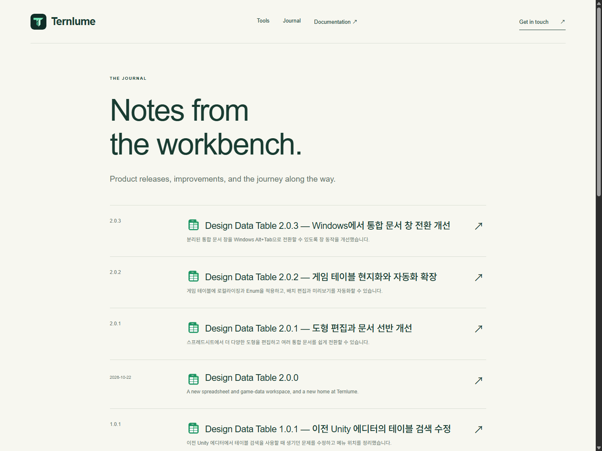
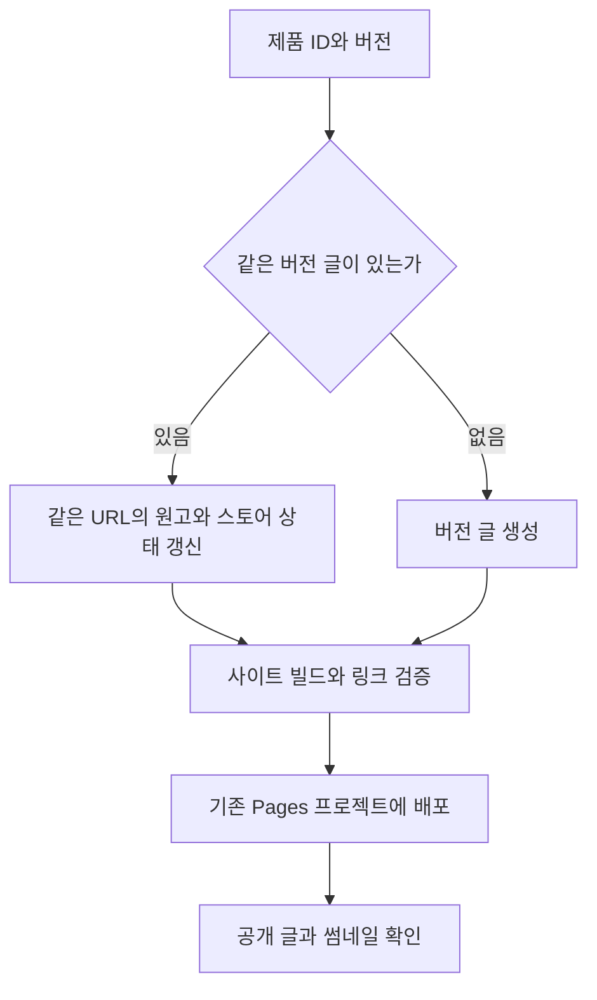
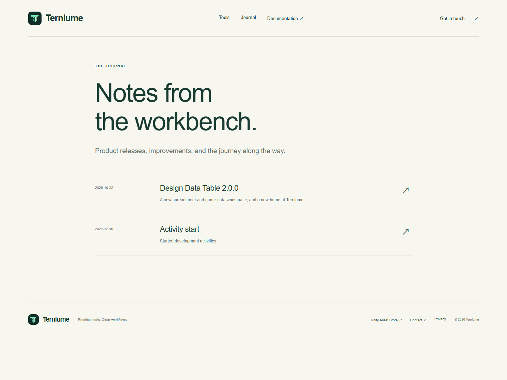
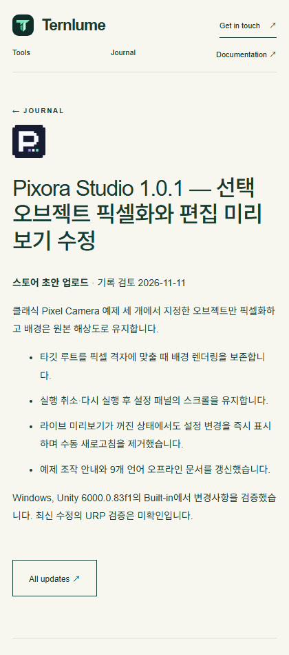

## 작업 결과

기존 Ternlume 사이트 원본을 Unity 제품 저장소의 Website/Ternlume에 병합했습니다. 5개 제품의 버전별 글 13건이 기존 공개 주소에서 열립니다. [Ternlume Journal](https://ternlume.pages.dev/updates/)

## 변경 내용

### 적용 내용



제품 ID와 정확한 버전을 글의 키로 사용합니다. 같은 버전 재업로드는 기존 글을 갱신합니다. Design Data Table 2.0.0은 기존 날짜 기반 URL을 재사용합니다. 초안·심사 제출·공개 기록은 본문에 각 상태로 표시합니다.



### 버전 글 키 검증과 표시

`Website/Ternlume/scripts/releases.mjs`가 중복 키와 미등록 상태를 거부하고, 기존 URL과 신규 버전 URL을 결정합니다. 두 함수의 전체 구현입니다.

```javascript
import { readFile } from 'node:fs/promises';

const versionPattern = /^\d+\.\d+\.\d+(?:-[0-9A-Za-z.-]+)?$/;
const statusLabels = {
  draft: '스토어 초안 업로드',
  submitted: '스토어 심사 제출 기록',
  approved: '스토어 승인 확인',
  published: '스토어 공개 확인',
  'historical-release': '과거 출시 기록',
  unverified: '스토어 상태 미확인',
};
const thumbnails = {
  'design-data-table': '/assets/design-data-table-logo.png',
  'entity-forge': '/assets/entity-forge-logo.png',
  'pixel-camera': '/assets/pixel-camera-logo.png',
  pixora: '/assets/pixora-logo.png',
  'pixora-studio': '/assets/pixora-studio-logo.png',
};
const existingPathByKey = {
  'design-data-table-2.0.0': '/2026/10/22/design-data-table-2-0-0/',
};

export async function loadReleases() {
  const input = new URL('../../../Docs/Store/TernlumeReleasePosts.ko.json', import.meta.url);
  const { posts, language, storeStatusAsOf } = JSON.parse(await readFile(input, 'utf8'));
  const keys = new Set();
  return posts.map(release => {
    const key = `${release.productId}-${release.version}`;
    if (!Object.hasOwn(thumbnails, release.productId) || !versionPattern.test(release.version) ||
        key !== release.slug || keys.has(key) || !Object.hasOwn(statusLabels, release.storeStatus)) {
      throw new Error(`Invalid or duplicate Ternlume release: ${key}`);
    }
    keys.add(key);
    return {
      ...release,
      language,
      storeStatusAsOf,
      statusLabel: statusLabels[release.storeStatus],
      thumbnail: thumbnails[release.productId],
      path: existingPathByKey[key] ?? `/updates/${key}/`,
    };
  });
}

export function renderRelease(release, escape) {
  const changes = release.changes.map(change => `<li>${escape(change)}</li>`).join('');
  const date = release.storePublishedAt?.slice(0, 10);
  return `<section class="prose release-details" lang="${escape(release.language)}">
    <p><strong>${escape(release.statusLabel)}</strong> · 기록 검토 ${escape(release.storeStatusAsOf)}${date ? ` · 스토어 공개일 ${escape(date)}` : ''}</p>
    <p>${escape(release.intro)}</p>
    ${changes ? `<ul>${changes}</ul>` : ''}
    ${release.compatibility ? `<p>${escape(release.compatibility)}</p>` : ''}
  </section>`;
}
```

### 대화 기록

- 사용자 · 기존 Ternlume 사이트와 TurnRoom을 합쳐 버전별 글을 게시해 달라고 요청했습니다.
- 사용자 · “기존 주소 유지, 연결 저장소 변경”으로 공개 주소 유지 범위를 확정했습니다.
- Codex · 기존 프로젝트가 Direct Upload임을 확인하고, 병합 커밋을 새 배포의 소스로 지정했습니다.

## 검증

로컬 빌드에서 HTML 39페이지와 로컬 참조 901개를 검증했습니다. 공개 글 13개와 썸네일 5종, 홈, 기존 글, 문서를 최종 빌드와 바이트 단위로 대조했습니다. 데스크톱 1440px Journal과 모바일 420px 개별 글의 실제 브라우저 화면을 확인했습니다.






## 남은 사항

Cloudflare의 기존 프로젝트는 Direct Upload 방식입니다. 주소를 유지하며 통합 저장소에서 직접 배포했고, 푸시 연동 자동 배포는 구성되지 않았습니다. 사용자가 예정한 기존 저장소 삭제 및 통합 저장소 이름 변경은 별도입니다. 원본 Git 이력은 검증한 로컬 번들에 백업했습니다.

## 작업 시간

- 제안 시간: 원본 탐색 3~5분, 병합·빌드·배포 10~20분.
- 실제로 완료된 시간: 2026-11-11 08:10:42 KST 시작. 08:21 KST까지 약 11분 동안 병합, 푸시, 공개 사이트 검증 완료. 보고서 공개 검증은 이후 별도 수행.
- XERJ: 미사용 — 이전 작업 기록, Git 원본, 사이트 빌드, Cloudflare 배포 정보와 공개 HTML을 대조했습니다.
