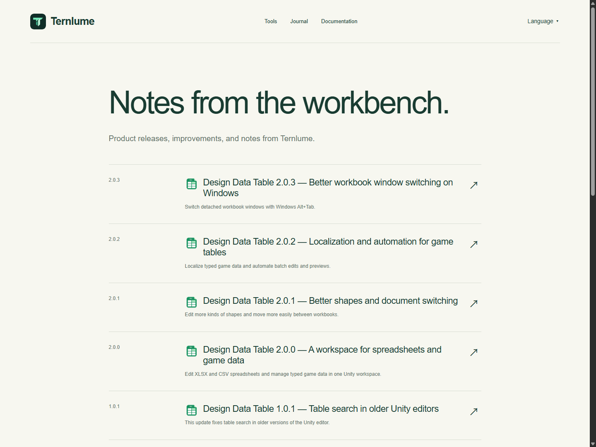
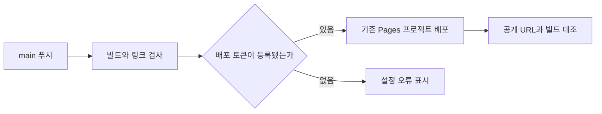
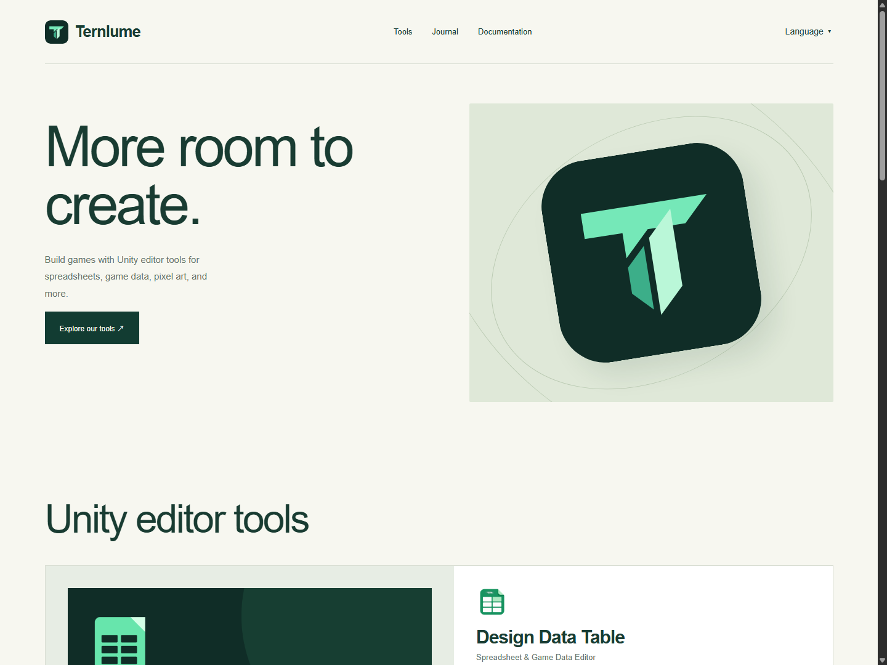
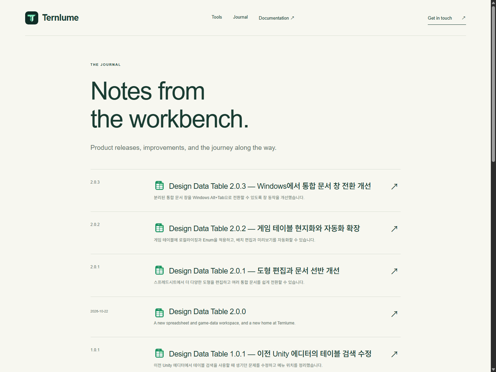
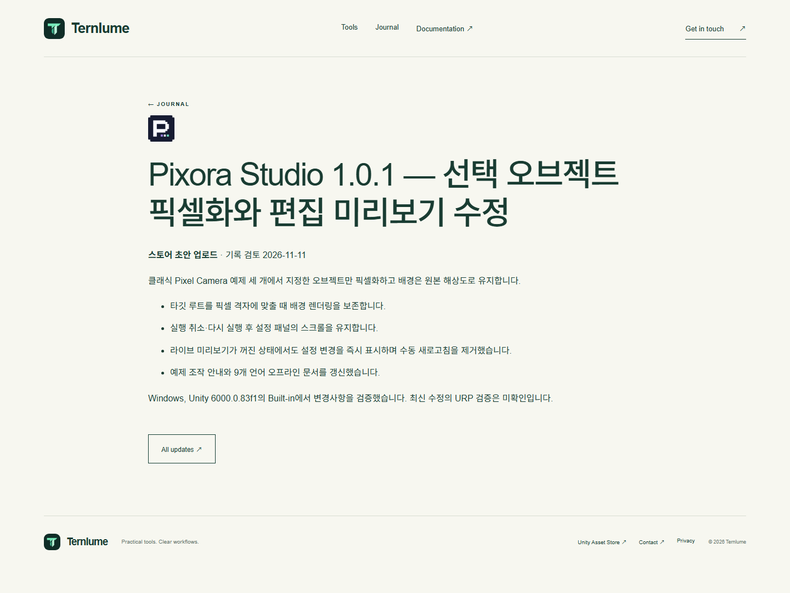
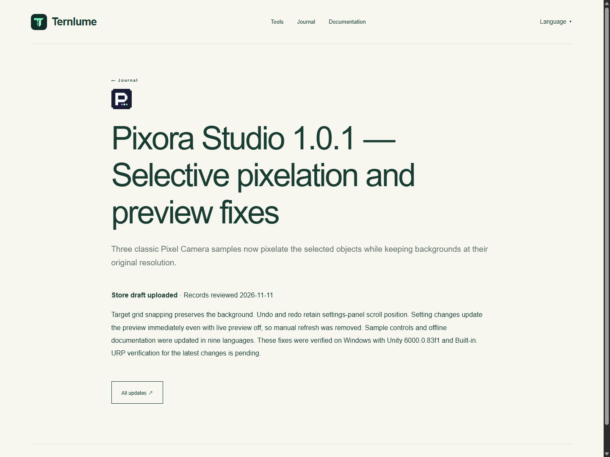
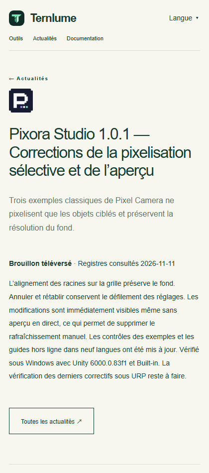

## 작업 결과

기존 Ternlume Pages 주소에 다국어 사이트를 배포했습니다. 영어 기본 URL과 기존 게시물 URL을 보존하고, 같은 페이지의 번역으로 전환하는 메뉴를 추가했습니다. [Ternlume](https://ternlume.pages.dev/)

## 변경 내용

### 적용 내용



홈, Journal, 개인정보, 404와 게시물 14건의 제목·요약·본문·스토어 상태를 영어, 한국어, 일본어, 간체, 번체, 스페인어, 프랑스어, 독일어, 브라질 포르투갈어로 제공합니다. 영어 외 언어에는 URL 접두사를 적용했습니다. 기존 문서 사본의 링크에서 대소문자 차이를 찾아 빌드 출력을 수정하고 Windows에서도 파일 이름의 대소문자를 정확히 검사합니다.


핵심 경로와 번역 검증은 `Website/Ternlume/scripts/locales.mjs`에서 처리합니다.

```javascript
import { readFile, readdir } from 'node:fs/promises';

export const languages = {
  en: 'English', ko: '한국어', ja: '日本語', 'zh-Hans': '简体中文', 'zh-Hant': '繁體中文',
  es: 'Español', fr: 'Français', de: 'Deutsch', 'pt-BR': 'Português (Brasil)',
};

const keys = [
  'tools', 'journal', 'docs', 'contact', 'privacy', 'language', 'skip', 'tagline', 'description',
  'heroTitle', 'heroText', 'explore', 'toolbox', 'productSubtitle', 'productText', 'typedData',
  'csharp', 'store', 'guide', 'compatibility', 'workspace', 'workspaceAlt', 'capture', 'allUpdates',
  'journalTitle', 'journalText', 'supportTitle', 'supportText', 'supportDetails', 'copy', 'copied',
  'copyFailed', 'privacyTitle', 'privacyText', 'emailTitle', 'emailText', 'externalTitle', 'externalText',
  'missingTitle', 'missingText', 'home', 'archive', 'checked', 'publishedOn', 'draft', 'submitted',
  'approved', 'published', 'historical-release', 'unverified',
  'openSheets', 'openSheetsText', 'structureData', 'structureDataText', 'generateData', 'generateDataText',
];

export function localizedPath(locale, path) {
  return locale === 'en' ? path : `/${locale}${path}`;
}

export async function loadLocales() {
  const data = {};
  for (const [locale, name] of Object.entries(languages)) {
    const source = new URL(`../site/locales/${locale}.txt`, import.meta.url);
    const lines = (await readFile(source, 'utf8')).trim().split(/\r?\n/);
    if (lines.length !== keys.length || lines.some(line => !line.trim())) {
      throw new Error(`Incomplete site translation: ${locale} (${lines.length}/${keys.length})`);
    }
    data[locale] = { name, ...Object.fromEntries(keys.map((key, i) => [key, lines[i]])) };
  }
  return data;
}

export async function loadPostTranslations(releases) {
  const data = {};
  const base = new URL('../site/posts/', import.meta.url);
  const expected = new Set([...releases.map(release => release.slug), 'activity-start']);
  for (const locale of Object.keys(languages)) {
    const folder = new URL(`${locale}/`, base);
    const files = await readdir(folder);
    if (files.length !== expected.size || files.some(file => !file.endsWith('.md') || !expected.has(file.slice(0, -3)))) {
      throw new Error(`Post translation coverage differs from the release index: ${locale}`);
    }
    data[locale] = Object.fromEntries(await Promise.all(files.map(async file => {
      const raw = (await readFile(new URL(file, folder), 'utf8')).trim();
      const [title, lead, ...lines] = raw.split(/\r?\n/);
      const body = lines.join('\n').trim();
      if (!title || !lead || !body) throw new Error(`Incomplete post translation: ${locale}/${file}`);
      return [file.slice(0, -3), { title, lead, body }];
    })));
  }
  return data;
}
```

GitHub Actions에 빌드·검사·Wrangler 배포·공개 조회를 추가했습니다. 기존 Direct Upload 프로젝트의 이름과 공개 주소를 사용합니다.



### 대화 기록

- 사용자 · 저장소 이름 변경 이후 로컬 원격 변경, 기존 주소의 푸시 연동, 사이트와 글의 9개 언어 지원을 요청했습니다.
- Codex · GitHub에서 두 저장소가 다른 ID로 반환됨을 확인하고 병합본의 실제 주소에 커밋했습니다. 다국어 사이트는 기존 Pages 프로젝트에 직접 배포했습니다.

## 검증

HTML 183개와 대소문자를 구분한 로컬 링크 4,937개를 검사했습니다. 공개 사이트의 9개 언어 171개 경로를 빌드 파일과 대조했습니다. 420px 모바일 브라우저에서 같은 게시물의 9개 언어를 실제로 클릭해 전환했고, 페이지 너비가 화면을 넘지 않는 것을 확인했습니다.

### 홈페이지




### Journal




### 개별 글





두 번째 푸시 실행은 Linux 설치, 빌드, 링크 검사를 통과했습니다. Cloudflare 토큰이 등록되지 않아 배포 단계에서 중단했습니다.

## 남은 사항

GitHub Actions의 Cloudflare 계정 변수는 저장했습니다. Pages Edit 토큰 시크릿이 없어서 푸시로 실제 배포되는 단계는 미완료입니다. Cloudflare 대시보드는 로그인 화면을 반환했고 Wrangler OAuth에는 토큰 생성 권한이 없습니다. GitHub에서 병합 저장소의 이름이 여전히 TurnRoom이며 Ternlume 주소는 별도 저장소로 확인돼 origin을 기존 병합 주소로 유지했습니다.

## 작업 시간

- 제안 시간: 초기 확인 3~5분, 전체 작업 25~40분.
- 실제로 완료된 시간: 2026-11-11 08:33:39 KST 시작. 08:56:44 KST에 최종 공개 사이트와 CI 단계를 검증했습니다. 23분 05초. Tracefolio 공개 검증은 별도입니다.
- XERJ: 미사용 — 사이트 파일, GitHub 저장소 ID와 Actions 로그, 공개 Pages 응답 및 브라우저 화면을 대조했습니다.
