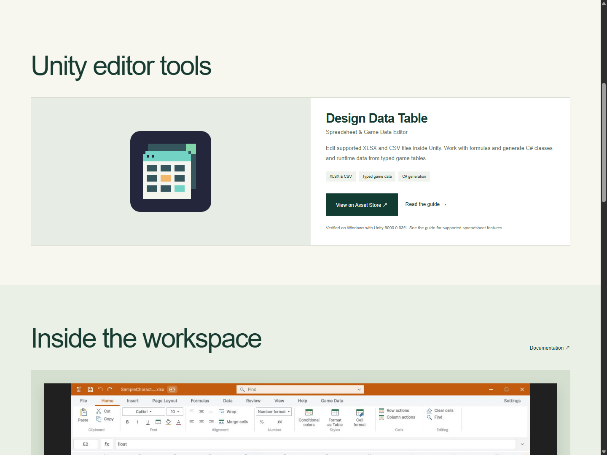
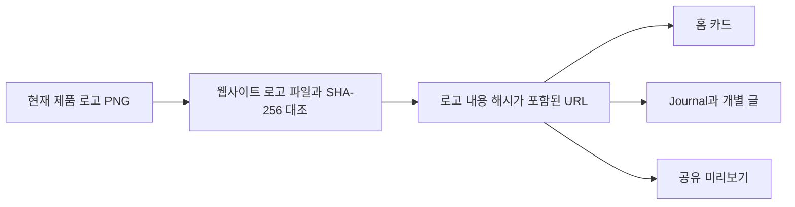
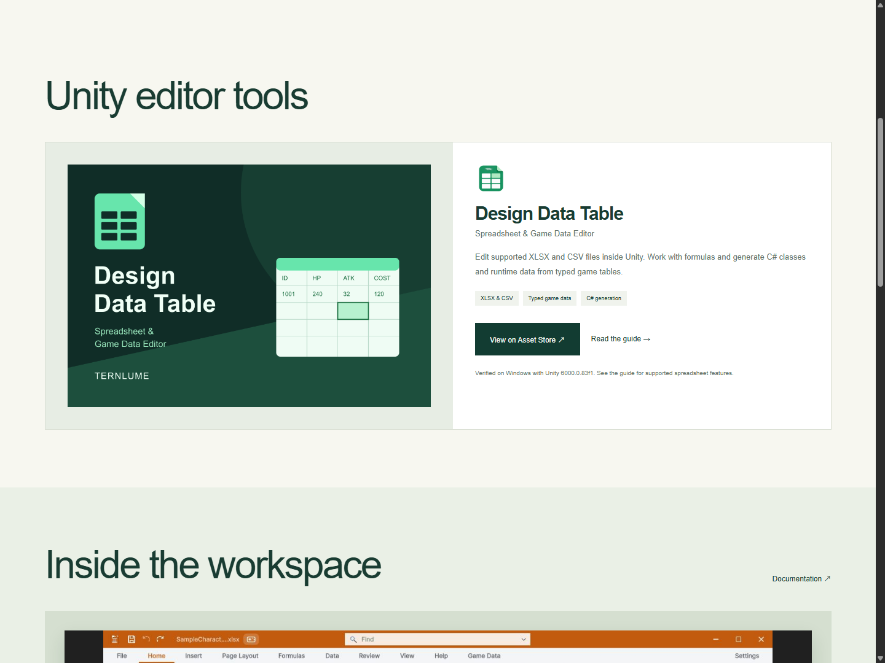
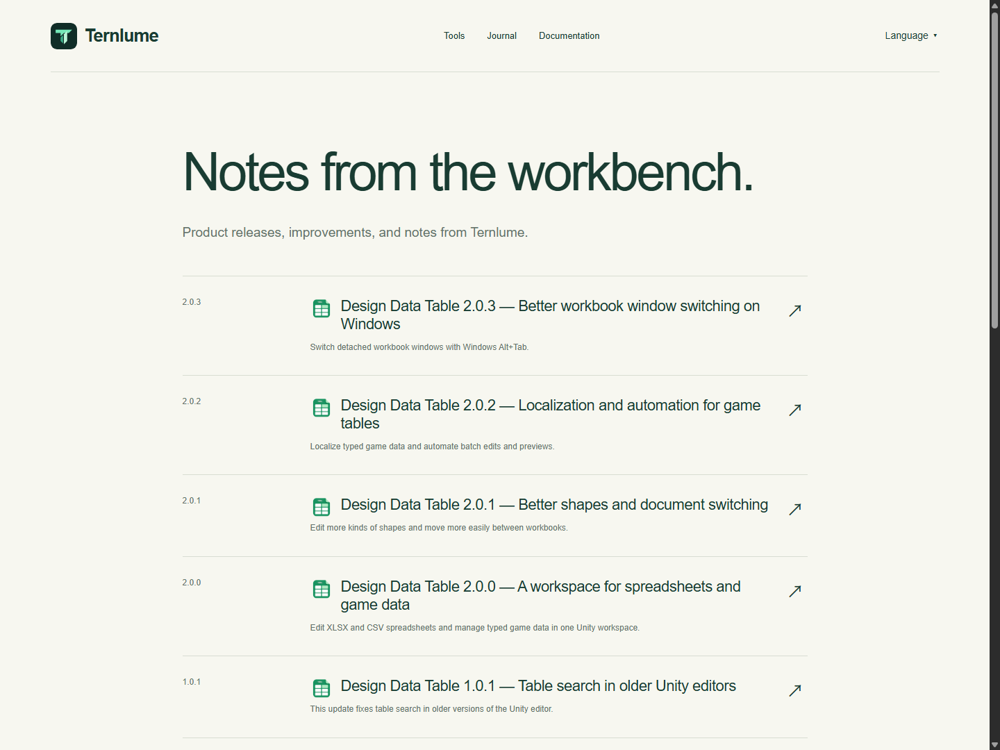
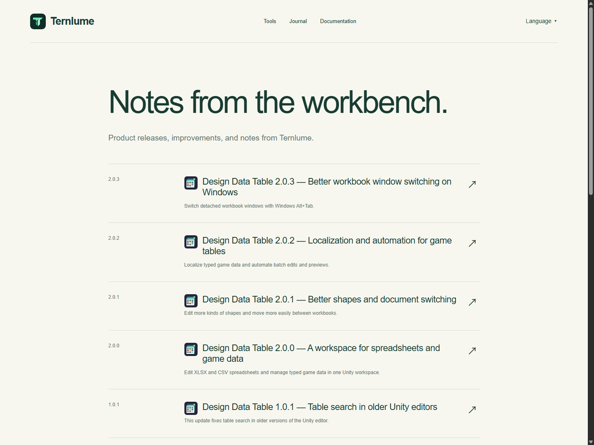
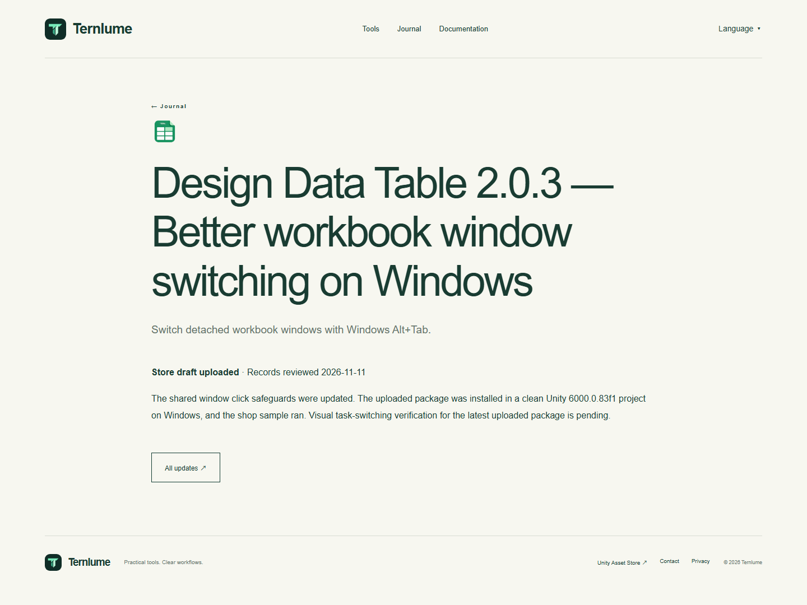
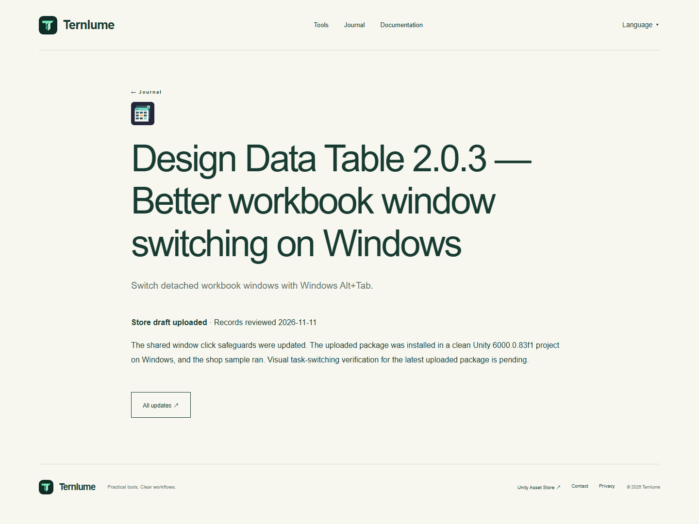

## 작업 결과

기존 Ternlume 주소에서 현재 Design Data Table 제품과 동일한 로고를 제공합니다. [제품 카드](https://ternlume.pages.dev/#tools) · [버전별 글](https://ternlume.pages.dev/updates/design-data-table-2.0.3/)

## 변경 내용

### 적용 내용



홈 커버 이미지에도 이전 로고가 들어 있어서, 그 자리에는 현재 로고를 직접 표시했습니다. Journal 목록, 버전별 개별 글과 공유 미리보기는 같은 로고 파일을 참조합니다. 이미지와 사이트 스타일의 캐시 갱신을 위해 파일 내용의 해시를 URL에 포함합니다.

```javascript
const logoFile = 'design-data-table-logo.png';
const logo = await readFile(new URL(`../site/assets/${logoFile}`, import.meta.url));
const logoVersion = createHash('sha256').update(logo).digest('hex').slice(0, 12);
export const designDataTableLogo = `/assets/${logoFile}?v=${logoVersion}`;
```



### 대화 기록

- 사용자 · “DDT로고가 예전꺼쓰네 교체 좀”
- Codex · 제품에 포함된 둥근 픽셀 로고를 확인하고 사이트에 남은 세 표시 위치를 교체했습니다.

## 검증

로컬 HTML 183개 및 참조 4,928개를 검사했습니다. 웹사이트 PNG와 제품 원본 SHA-256을 대조했습니다. 공개 페이지 171개를 빌드 출력과 비교하고 실제 브라우저에서 홈·목록·개별 글의 로고 이미지 로드를 확인했습니다.










## 남은 사항

프로덕션 주소에 직접 배포했습니다. Unity 제품에서 사용 중인 PNG를 그대로 복사했으며 새 미디어 제작은 없었습니다. 기존 원본 커버는 기록으로 보존했습니다.

## 작업 시간

- 제안 시간: 5~10분.
- 실제로 완료된 시간: 2026-11-11 09:03:40 KST 시작, 09:07:37 KST에 공개 로고와 페이지 대조 완료. 3분 57초. 작업 보고서 공개 확인 별도.
- XERJ: 미사용 — 웹 템플릿과 제품 로고 파일, 해시, 공개 사이트 이미지 응답을 확인했습니다.
