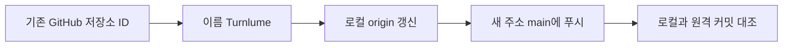
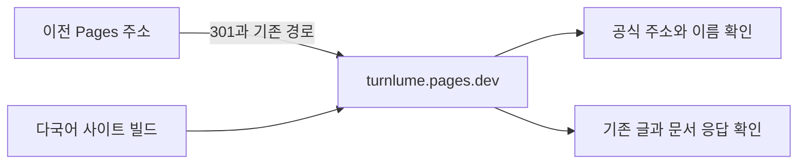
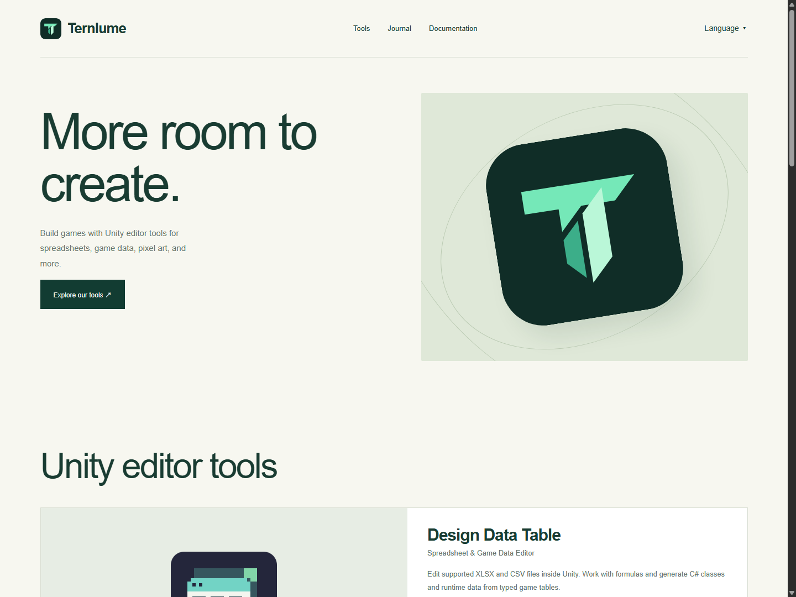
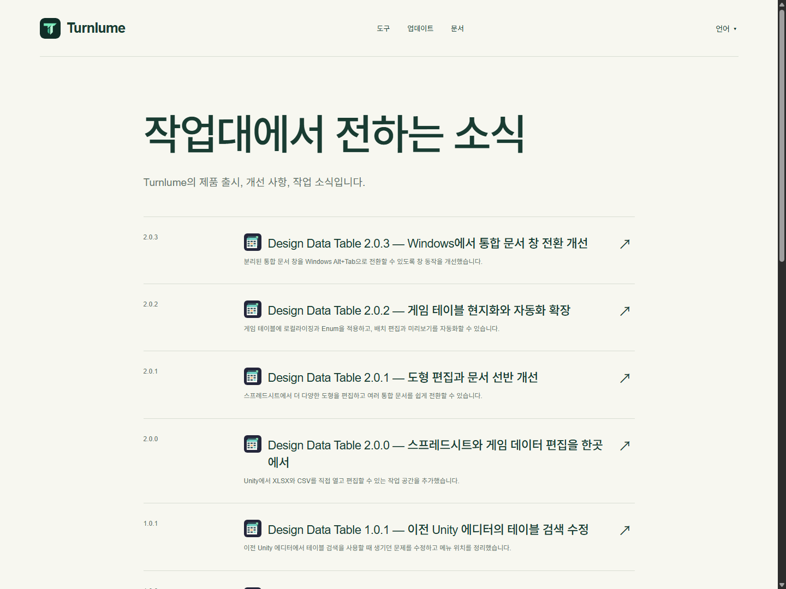
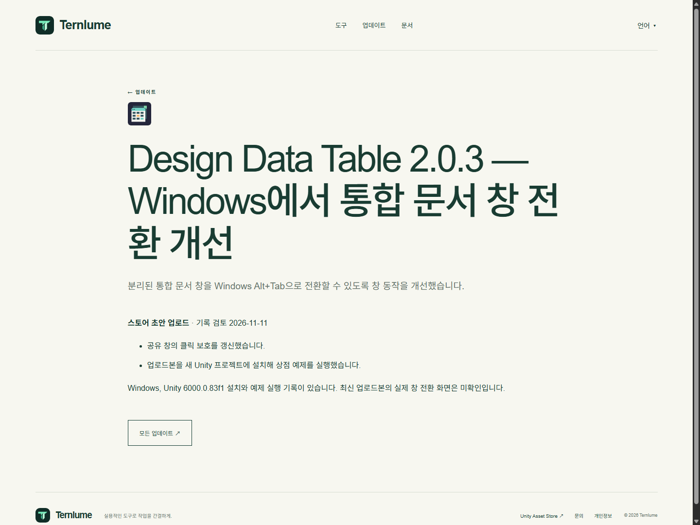

## 작업 결과

[MDJ0126/Turnlume](https://github.com/MDJ0126/Turnlume) 저장소와 [Turnlume 사이트](https://turnlume.pages.dev/)를 적용했습니다. 기존 ternlume.pages.dev는 각 경로를 새 주소로 301 연결합니다.

## 변경 내용

### 적용 내용


GitHub 저장소 ID 672617668을 유지하며 TurnRoom을 Turnlume으로 변경했습니다. 로컬 origin은 https://github.com/MDJ0126/Turnlume.git 입니다. main 커밋 8c94b7b7273896622b8a86aa0f57d69d9ac6b4a2가 로컬과 원격에서 일치합니다.



새 Cloudflare Pages 프로젝트 turnlume에 사이트를 배포했습니다. 사이트 표기와 공식 URL, 언어별 대체 URL, 사이트맵, 배포 명령과 프로젝트 지침을 새 이름으로 갱신했습니다. 저장소의 Website/Ternlume 폴더는 기존 작업 경로입니다.



이전 프로젝트의 배포 소스는 다음 두 규칙입니다.

```text
/ https://turnlume.pages.dev/ 301
/* https://turnlume.pages.dev/:splat 301
```

### 사이트 이름 적용 함수

공통 HTML이 설정의 이름과 URL을 사용하도록 조정했습니다. shell 함수 전체입니다.

```javascript
function shell(locale, path, title, description, body, thumbnail) {
  const t = locales[locale];
  const local = target => localizedPath(locale, target);
  const canonical = config.url + local(path);
  const alternates = Object.keys(languages).map(code =>
    `<link rel="alternate" hreflang="${code}" href="${escape(config.url + localizedPath(code, path))}">`).join('');
  const languageLinks = Object.entries(languages).map(([code, label]) =>
    `<a href="${localizedPath(code, path)}" lang="${code}" hreflang="${code}"${code === locale ? ' aria-current="page"' : ''}>${escape(label)}</a>`).join('');
  return `<!doctype html><html lang="${locale}"><head><meta charset="utf-8">
    <meta name="viewport" content="width=device-width,initial-scale=1"><title>${escape(title)}</title>
    <meta name="description" content="${escape(description)}"><meta name="theme-color" content="#123c32">
    <link rel="canonical" href="${escape(canonical)}">${alternates}
    <link rel="alternate" hreflang="x-default" href="${escape(config.url + path)}">
    <meta property="og:title" content="${escape(title)}"><meta property="og:description" content="${escape(description)}">
    <meta property="og:url" content="${escape(canonical)}"><meta property="og:image" content="${escape(config.url + (thumbnail || designDataTableLogo))}">
    <link rel="icon" href="/assets/ternlume.svg" type="image/svg+xml">
    <link rel="stylesheet" href="/assets/site.css"><link rel="stylesheet" href="/assets/localized.css?v=${localizedStyle}">
    <script src="/assets/site.js" defer></script></head><body>
    <a class="skip" href="#main">${escape(t.skip)}</a>
    <header class="site-header wrap">
      <a class="brand" href="${local('/')}">${escape(config.name)}</a>
      <nav><a href="${local('/')}#tools">${escape(t.tools)}</a><a href="${local('/updates/')}">${escape(t.journal)}</a><a href="${guide(locale)}">${escape(t.docs)}</a></nav>
      <details class="language-menu"><summary>${escape(t.language)} <span aria-hidden="true">▾</span></summary><div>${languageLinks}</div></details>
    </header>
    ${body}
    <footer class="wrap footer"><a class="brand" href="${local('/')}">${escape(config.name)}</a>
      <p>${escape(t.tagline)}</p><div><a href="${escape(config.publisher)}">Unity Asset Store ↗</a>
      <a href="${local('/')}#contact">${escape(t.contact)}</a><a href="${local('/privacy/')}">${escape(t.privacy)}</a></div>
      <small>© ${new Date().getUTCFullYear()} ${escape(config.name)}</small></footer></body></html>`;
}
```

### 대화 기록

- 사용자 · 자동완성으로 이름이 잘못됐다고 정정하고 “Turnlume으로 리포지토리 이름 바꾸고 깃도 바꾸고 주소도 그렇게 적용해”라고 요청했습니다.
- Codex · 저장소 ID와 이름 사용 가능 여부를 확인한 뒤 이름을 변경하고 새 Pages 주소를 배포했습니다.

## 검증

9개 언어로 생성한 HTML 183개와 로컬 참조 4,928개를 확인했습니다. 새 공개 주소의 171개 경로가 빌드와 일치합니다. 이전 주소의 언어별 글·홈·목록·개인정보, 이미지와 쿼리를 포함한 155개 301 응답을 대조했습니다. 홈페이지와 한국어 목록·글에서 새 이름과 공식 주소를 확인했습니다.









## 남은 사항

사이트는 Wrangler로 직접 배포했습니다. 기존 푸시 자동 배포의 Cloudflare API 토큰 등록은 별도 미완료 사항이며, 이번 변경으로 워크플로의 대상은 새 turnlume 프로젝트가 됐습니다. 과거 게시물의 당시 이름과 출처 기록은 유지했습니다.

## 작업 시간

- 제안 시간: 초기 확인 3~5분, 전체 8~15분. 장시간 중단 후 14:47 KST 재개 시점에는 5~8분 예상.
- 실제로 완료된 시간: 2026-11-11 09:10:53 KST 시작. 중단 구간을 거쳐 14:47:45 KST 재개. 14:50:22 KST에 사이트·리디렉션·원격 검증 완료. 전체 경과 5시간 39분 29초, 재개 후 해당 검증까지 2분 37초. 보고서 공개 검증 별도.
- XERJ: 미사용 — GitHub 저장소 ID, origin, 원격 커밋, Cloudflare 배포 응답과 공개 HTML·301 응답을 대조했습니다.
