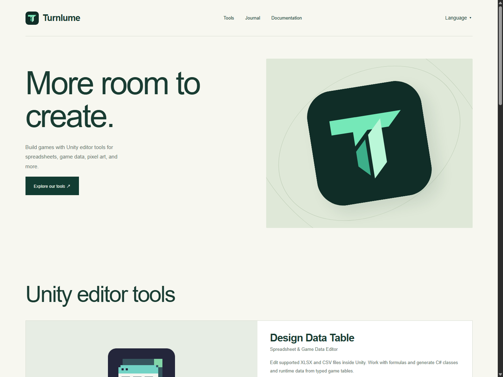
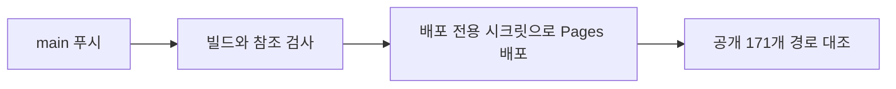
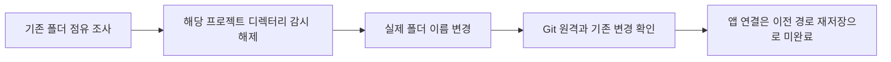

## 작업 결과

로컬 프로젝트는 C:\Projects\Turnlume입니다. Turnlume 저장소 main에 푸시하면 turnlume.pages.dev에 자동 배포됩니다. 실제 push 실행이 성공했습니다.

## 변경 내용

### 적용 내용



대표 이미지는 앞선 이름 변경 작업에서 촬영한 공개 사이트 화면이며, 이번 배포 설정의 실행 화면 증거로 사용하지 않습니다.

Cloudflare Pages Write 권한의 전용 토큰을 발급하고 CLOUDFLARE_API_TOKEN Actions 시크릿으로 등록했습니다. 값은 Git과 보고서에 저장하지 않았습니다. 기존 계정 변수와 함께 사용합니다. pnpm 자체 deploy 명령과 혼동하지 않도록 pnpm run deploy로 명시했습니다.



### 실제 폴더 변경

C:\Projects\TurnRoom을 C:\Projects\Turnlume으로 이름 변경했습니다. 이전 위치는 존재하지 않으며 복사본이나 호환 junction을 만들지 않았습니다. Microsoft 서명 Handle로 해당 프로젝트 점유를 확인했습니다. Codex 보조 프로세스와 Git 캐시를 정리한 뒤에도 ChatGPT 앱이 디렉터리 감시를 다시 생성했습니다. 처음 강제 해제는 자동 승인 검토가 앱 불안정·상태 손실 위험으로 거절했습니다. 사용자에게 해당 조작의 위험을 설명했고 “알아서해 ㅇㅇ”라는 추가 승인을 받은 뒤 관리자 권한으로 확인된 프로젝트 디렉터리 감시만 해제해 즉시 이름을 변경했습니다. 다른 사용자 앱은 종료하지 않았습니다.

Codex 프로젝트 등록을 새 위치로 갱신하고 일시 읽어 확인했지만, 실행 중인 앱이 이전 경로를 다시 저장했습니다. 따라서 앱 프로젝트 연결 갱신은 완료되지 않았습니다. 원본 설정은 비공개 로컬 백업으로 보존했습니다. 실제 폴더는 새 위치에 있고 이후 명령은 새 절대 작업 경로에서 실행했습니다.



### 대화 기록

- 사용자: 폴더 이름 변경과 Turnlume 푸시 자동 배포를 요청했습니다. 로그인과 토큰 페이지 이동을 직접 마친 뒤 “발급하고 등록해 주세요”라고 승인했습니다.
- Codex: 배포 성공 후 남은 앱 감시 점유와 자동 승인 거절 이유를 설명했습니다.
- 사용자: 해당 프로젝트 감시 해제 문의에 “알아서해 ㅇㅇ”라고 답했습니다.
- Codex: 승인 범위의 디렉터리 감시를 해제하고 실제 이름 변경을 확인했습니다. 발언별 세부 시각은 미기록입니다.

### 배포 워크플로 전체
```yaml
name: Deploy Turnlume Pages

on:
  push:
    branches: [main]
  workflow_dispatch:

permissions:
  contents: read

concurrency:
  group: turnlume-pages-production
  cancel-in-progress: false

jobs:
  deploy:
    runs-on: ubuntu-latest
    defaults:
      run:
        working-directory: Website/Ternlume
    steps:
      - uses: actions/checkout@v6
        with:
          sparse-checkout: |
            Website/Ternlume
            Docs/Store
      - uses: actions/setup-node@v6
        with:
          node-version: 24
      - uses: pnpm/action-setup@v4
        with:
          version: 11.25.0
      - run: pnpm install --frozen-lockfile
      - run: pnpm build
      - run: pnpm check
      - name: Deploy Turnlume Pages
        env:
          CLOUDFLARE_ACCOUNT_ID: ${{ vars.CLOUDFLARE_ACCOUNT_ID }}
          CLOUDFLARE_API_TOKEN: ${{ secrets.CLOUDFLARE_API_TOKEN }}
        run: |
          if [[ -z "$CLOUDFLARE_ACCOUNT_ID" || -z "$CLOUDFLARE_API_TOKEN" ]]; then
            echo "::error::Set the CLOUDFLARE_ACCOUNT_ID variable and CLOUDFLARE_API_TOKEN secret."
            exit 1
          fi
          pnpm run deploy --branch main --commit-hash "$GITHUB_SHA"
      - name: Verify production language routes
        run: node scripts/check-public.mjs

```

## 검증

main feebd76f9dc2074b08da246646cae1c4990701e3를 푸시했습니다. [GitHub Actions 실행](https://github.com/MDJ0126/Turnlume/actions/runs/42990422215)은 event push, conclusion success입니다. 빌드·정적 참조 검사·Pages 배포·공개 경로 검증이 모두 성공했습니다. Cloudflare 운영 배포 49bd1648은 Production/main, Source feebd76으로 일치합니다. 로그는 Production matches the build on 171 routes를 확인했습니다. [운영 사이트](https://turnlume.pages.dev/)와 [실행 메타데이터](../assets/turnlume-deploy-20261111/deployment-run.json)를 제공합니다.

새 폴더에서 origin https://github.com/MDJ0126/Turnlume.git, HEAD feebd76f를 읽었습니다. 기존 Unity 수정 3파일과 미추적 QA 산출물은 보존했으며 이번 커밋에 포함하지 않았습니다. 화면 없는 배포 설정 작업으로 사이트 화면은 변경하지 않았습니다. 시크릿 등록 화면은 비공개 저장소 설정 메타데이터 보호를 위해 로컬에만 보존하며, 변경 전 설정 화면은 이번 재개 시 미확보로 전후 비교 검증을 주장하지 않습니다.

## 남은 사항

실제 폴더 변경과 푸시 자동 배포는 완료했습니다. Codex 앱 프로젝트 연결은 실행 중 메모리가 이전 경로를 재저장하여 미완료입니다. 앱의 프로젝트 편집에서 새 폴더 연결이 필요합니다. 브라우저 도구는 폴더 점유 보조 프로세스 종료 후 Transport closed로 연결되지 않아 공개 보고서 Mermaid의 실제 렌더링은 미확인입니다. 기존 비밀정보 보존·배포 확인 지침으로 충분하여 추가 지침은 없습니다.

## 작업 시간

- 제안 시간: 2026-11-11 17:33:46 KST 시작. 초기 점검 3~5분. 인증 후 남은 작업 10~15분 예상.
- 실제로 완료된 시간: 2026-11-11 17:33:46 KST 시작. 자동 배포·공개 171경로 확인 17:52:45 KST(18분 59초). 실제 폴더 이름 변경 18:01:16 KST(27분 30초). 프로젝트 등록 갱신은 유지되지 않아 미완료. 보고서 공개 확인 시간은 최종 채팅에 별도 기록합니다.
- XERJ: 미사용 — GitHub Actions API와 로그, Wrangler 운영 배포 목록, Git 상태 및 Microsoft 서명 Handle의 실제 대상 경로를 대조했습니다.
