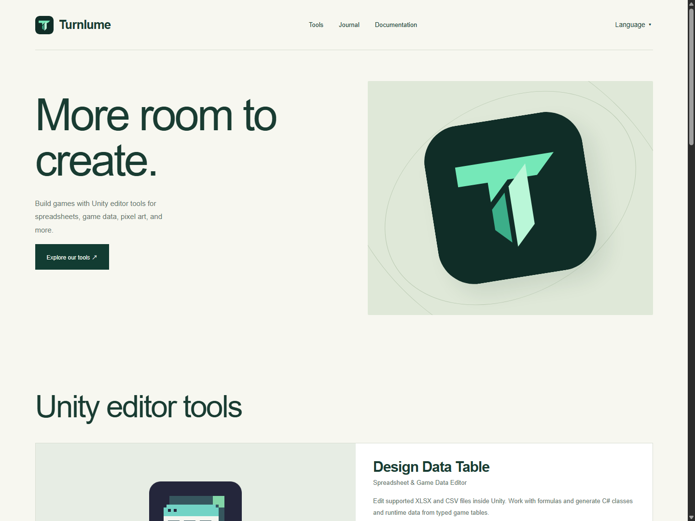
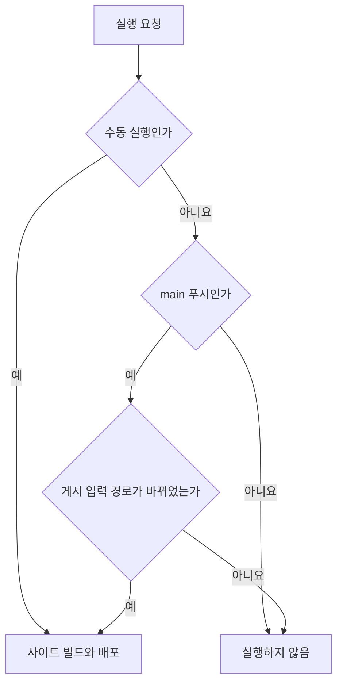

## 작업 결과

게시글·번역·사이트 리소스 또는 게시 버전 기록이 바뀐 main 푸시에서만 사이트 배포가 실행됩니다. Unity 코드만 수정한 푸시에는 실행되지 않습니다. 사이트 도구·배포 설정 변경과 수동 실행도 허용합니다.

## 변경 내용

### 적용 내용



대표 이미지는 이전 이름 변경 작업에서 촬영한 공개 사이트이며 이번 설정 변경의 화면 증거가 아닙니다. 사이트 화면 자체는 변경하지 않았습니다.

이전 설정은 main의 모든 push를 배포했습니다. 변경 후 .github/workflows/ternlume-pages.yml의 이벤트 설정 전체는 다음과 같습니다.

```yaml
on:
  push:
    branches: [main]
    paths:
      - 'Website/Ternlume/site/**'
      - 'Website/Ternlume/scripts/**'
      - 'Website/Ternlume/package.json'
      - 'Website/Ternlume/pnpm-lock.yaml'
      - 'Website/Ternlume/pnpm-workspace.yaml'
      - 'Docs/Store/TernlumeReleasePosts.ko.json'
      - '.github/workflows/ternlume-pages.yml'
  workflow_dispatch:
```

site에는 글·9개 언어 번역·홈·공개 문서·이미지·스타일이 포함됩니다. build.mjs의 입력과 releases/locales 모듈을 대조해 게시 버전 JSON도 포함했습니다. Unity Assets, QA 출력, README와 과거 Jekyll 원문은 필터에 포함하지 않았습니다. 배포 토큰이나 계정 권한은 바꾸지 않았습니다. README에 이 범위를 기록했습니다.



[GitHub 공식 경로 필터 설명](https://docs.github.com/en/actions/reference/workflows-and-actions/workflow-syntax#onpushpull_requestpull_request_targetpathspaths-ignore)에 따라 branches와 paths가 함께 만족돼야 push 실행이 생성됩니다.

### 대화 기록

- 사용자: 게시글 발행 때만 액션이 실행되는지 물었습니다.
- Codex: 현재 main의 모든 푸시에서 실행된다고 답했습니다.
- 사용자: “제한해야하지 않을까?”라고 요청했습니다.
- Codex: 사이트 게시 입력에만 경로 필터를 적용하고 Unity 개발 변경을 제외했습니다. 세부 발언 시각은 미기록입니다.

## 검증

설정 커밋 8ee1d527877a934bc5ba098ce8506303d2ab7e66의 [push 실행](https://github.com/MDJ0126/Turnlume/actions/runs/43006947178)이 success입니다. 설정 파일 자신이 허용 경로이므로 이번 배포는 정상 실행됐습니다. 사이트 본문 수정이 없어서 별도의 UI 전후 캡처는 필요하지 않습니다. README만 변경한 acf2a9c7a1458b330469698711eaa401e79b96ad를 별도로 푸시한 뒤, 최신 실행 목록에 해당 커밋 실행이 0개이고 마지막 실행은 허용 경로 커밋 8ee1d527인 것을 확인했습니다. [실행 확인 기록](../assets/turnlume-trigger-20261111/execution-evidence.json)을 첨부합니다. 이번 변경에 자동화 테스트를 작성하거나 실행하지 않았습니다. 기존 Unity 변경 3파일과 QA 산출물은 포함하지 않았습니다.

## 남은 사항

GitHub 공식 문서상 1,000개 초과 커밋 푸시 또는 diff 생성 시간 초과 시 경로 필터와 관계없이 실행될 수 있고, 경로 비교는 첫 3,000개 파일에 한정됩니다. 일반 푸시에 적용되는 표준 경로 필터입니다. 브라우저 도구가 현재 세션에서 제거되어 보고서 Mermaid의 실제 브라우저 렌더링은 미확인입니다. 기존 사이트 게시 지침은 유지하고 필터 운영 범위는 README에 통합했습니다.

## 작업 시간

- 제안 시간: 2026-11-11 19:48:31 KST 시작, 5~10분 예상.
- 실제로 완료된 시간: 설정 변경 push 실행 성공을 2026-11-11 19:50~19:51 KST에 확인했습니다. 최종 공개 보고서 검증 완료 시각은 채팅에 기록합니다.
- XERJ: 미사용 — rg로 빌드 의존 경로를 찾고 실제 워크플로·GitHub Actions API·공식 경로 필터 문서를 대조했습니다.
