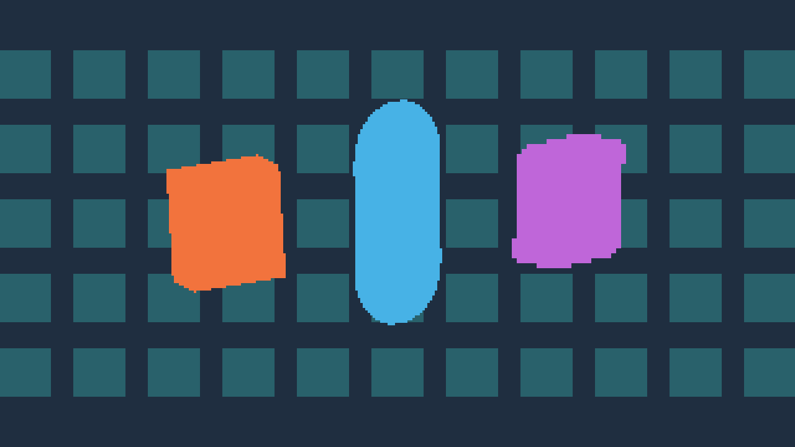
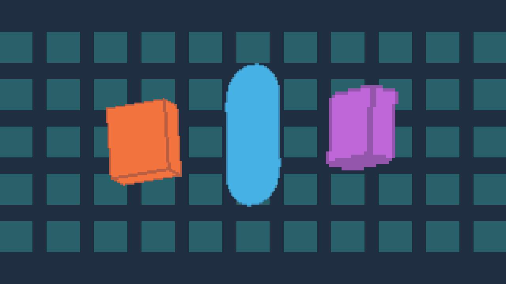
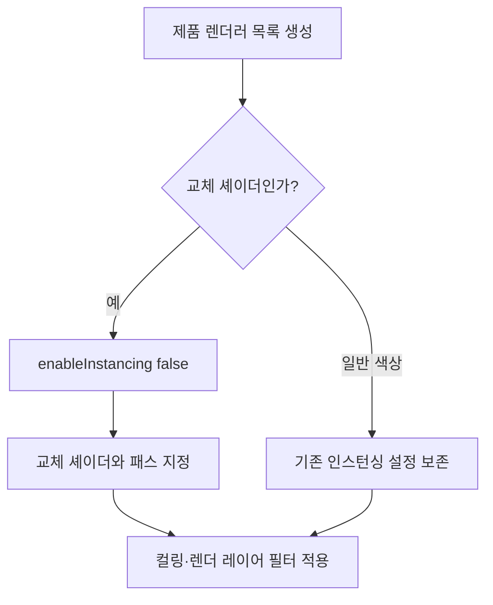

## 작업 결과

턴룸 저장소의 Pixora Studio / Pixel Camera 원본 렌더 코드에 교체 셰이더 패스의 GPU 인스턴싱 제한을 반영했습니다. 일반 색상 패스·기존 API·샘플 씬과 제품/판매 버전은 유지했습니다. 패키지 재수출·스토어 업로드는 하지 않았습니다.

참조 · 동일 격리 장면에서 효과 OFF(구버전 버그 화면이 아닙니다)


결과 · 수정 제품으로 대상 3개만 4/8px 합성



법선 외곽선 경로



## 변경 내용

### 적용 내용

변경 경로는 Assets/TurnRoom/PixoraStudio/PixelCamera/Integrations/URP/PixelCameraRendererFeature.cs입니다. 원본 재질의 인스턴스 데이터와 다른 교체 셰이더를 함께 사용한 패스에서 정의되지 않은 행렬·오브젝트 ID가 관찰됐던 문제를 수정합니다. Fantasya 전용 클래스의 전체 파일을 덮어쓰지 않고 제품 원본의 해당 목록 생성 분기에만 적용했습니다.



핵심 수정 메서드 전체:

```csharp
            RendererListHandle List(RenderGraph graph, ContextContainer frame, int mask, bool transparent, Shader replacement = null, uint renderingMask = uint.MaxValue)
            {
                var rendering = frame.Get<UniversalRenderingData>(); var camera = frame.Get<UniversalCameraData>(); var light = frame.Get<UniversalLightData>();
                var drawing = RenderingUtils.CreateDrawingSettings(tags, rendering, camera, light, transparent ? SortingCriteria.CommonTransparent : camera.defaultOpaqueSortFlags);
                if (replacement != null)
                {
                    drawing.enableInstancing = false;
                    drawing.overrideShader = replacement;
                    drawing.overrideShaderPassIndex = 0;
                }
                return graph.CreateRendererList(new RendererListParams(rendering.cullResults, drawing, new FilteringSettings(transparent ? RenderQueueRange.transparent : RenderQueueRange.opaque, mask, renderingMask)));
            }
```

Pixel Camera 원본 문서 9개 언어와 Studio 통합·Pixel Camera 생성 문서 18개를 갱신했습니다. Version.json의 검증 범위와 모듈/루트 README도 갱신했습니다. Tools/PixelCamera/CaptureTemporal.ps1 -Launch로 실행하는 소유 표식 기반 격리 캡처 도구와 실제 근거를 Docs/Testing/2026-11-12/pixel-camera-instancing에 남겼습니다. 다른 DDT·Templete 창 작업은 보존했습니다.

## 검증

현재 제품 Runtime과 URP 소스를 그대로 새 격리 프로젝트에 복사했습니다. 소스 SHA-256 일치를 확인했고 Editor·Samples·Development를 설치하지 않은 상태에서 컴파일과 실제 렌더를 수행했습니다.

- Unity 6000.0.83f1 / URP 17.0.4 RenderGraph / Windows DX11 / Linear / 1280×720
- 대상3개·4/8px 두 그룹·배경 인스턴스55개
- 기본24프레임: 인접 변동0·인스턴싱 경고0
- 깊이/법선 외곽선12프레임: 인접 변동0·경고0
- 비대상 배경 검사 영역521600픽셀 차이0, renderingLayerMask 복원 확인
- 효과 OFF/ON 차이3465픽셀, 실제 geometry captures7

[제품 렌더 수치](../assets/pixel-camera-instancing-20261112/render.json) · [복사 소스 해시](../assets/pixel-camera-instancing-20261112/source.json) · [생성 문서 근거](../assets/pixel-camera-instancing-20261112/documentation.json)

생성된 문서18개, 장396개, 본문 링크·이미지1053개를 실제 생성 JavaScript를 실행하는 정적 어댑터로 확인했습니다. 장·언어 전환, 아이콘 경로, DDT 공통 CSS 일치를 검사했고 네이티브 브라우저 QA와 구분합니다. 초기 임시 캡처 도구의 internal Active 참조 컴파일 오류는 공개 FindObjectsByType로 수정한 뒤 통과했으며 원본 실패 로그는 보존했습니다.

대화 기록(발언 시각 미기록): 사용자 “턴룸 프로젝트, 픽셀 스튜디오에도 반영해줘” → AI가 제품 원본과9개 언어 문서 반영을 안내 → 원본에서 동일 분기를 확인하고 실제 제품 격리 렌더 결과를 안내했습니다. 원래 Fantasya 재현은 [기존 보고서](https://mdj0126.github.io/codex-config/projects/fantasya/reports/2026-11-11-bug-20261111155151183-v1.0.0.html)에 분리해 보존했습니다. 썸네일 후보는 실제 after-first.png이며 이미지 편집 없이 직접 캡처 PNG를 보존했습니다.

2026-11-12 사용자 승인: “턴룸 보고 자료 공개·main 반영·푸시·배포 승인”. 이 승인으로 제품 격리 렌더 4장·핵심 수정 함수·프레임/경고 수치·문서 검증 근거를 중앙 아카이브에 게시합니다.

## 남은 사항

제품 Editor UI는 변경하지 않았습니다. 전체 Editor/판매 패키지 신규 설치,9개 언어의 네이티브 브라우저 눈 검토, 다른 GPU·모바일·정량 GPU 성능·패키지 재수출·스토어 업로드는 미실행입니다. 제품 원본의 소스 반영과 판매 배포는 구분합니다. 고객 패키지에는 개발 캡처 도구를 포함하지 않습니다. 목록 카드 썸네일은 아카이브 기능 제한으로 미확인입니다. 새 모체 공용 후보는 없습니다. 이 코드는 Pixora URP 제품에 직접 의존하며 SampleProjectForUnity는 변경하지 않았습니다. 실제 실행·시간적 비교는 기존 지침으로 충분해 지침 추가 없음입니다. 턴룸 저장소 자체의 커밋·푸시는 하지 않았습니다.

## 작업 시간

- 제안 시간: 2026-11-12 01:29:18 KST 시작, 제안15~25분
- 실제로 완료된 시간: 원본 소스·문서·실제 제품 렌더 완료: 18분 52초, 2026-11-12 01:48:10 KST. 승인 후 공개 게시: 2026-11-12 01:54:25 KST 시작, 배포·외부 확인 진행 중입니다.
- XERJ: 미사용 — 사용자 전역 지침에 따라 rg·정확한 제품 원본·Unity 로그·직접 렌더·해시 대조를 사용했습니다.
