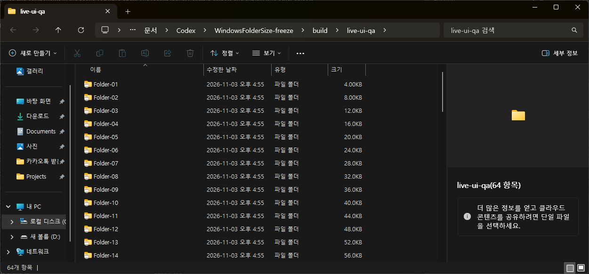

## 목표와 완료 기준

다수 폴더 크기 조회가 브로커 응답을 기다리지 않게 수정

완료 기준: 무응답 서버·다수 조회에서 호출 즉시 반환, 캐시 갱신·장애 시 숫자 유지, 호환성 검사와 설치 파일 생성, 공개 보고. 작업 방해 금지에 따라 설치·탐색기 재시작은 보류. 추가 승인 범위: 1.0.13 실제 설치, 설치/빌드 파일 해시와 탐색기 로드 DLL 일치, 64폴더 화면 조작 및 생성·변경·삭제 용량 반영, 전후 실제 화면과 공개 검증 보고.

후속 3회차 · 순차 진행 · 전체 6개 · 이번 실행 T05, T06

## 순차 작업 메뉴얼

| 순서 | 작업 | 실행 절차 | 완료 기준 | QA 절차 | 상태 |
| --- | --- | --- | --- | --- | --- |
| T01 | 동기 대기 재현 | 현재 IPC 호출과 지연 서버의 실제 대기 시간 대조 | 문제 경로와 재현 수치 확인 | 20ms CallNamedPipe에 350ms 지연 응답 적용 | 완료 |
| T02 | 비동기 캐시 구현 | UI는 캐시만 조회, IPC는 제한 시간 있는 전용 스레드로 분리 | UI 경로에서 IPC와 대기 제거 | 무응답·지연·다수 폴더·숫자 유지 테스트 | 완료 |
| T03 | 회귀와 산출물 고정 | 네이티브 속성 표시 회귀, 빌드, MSI 구조와 해시 확인 | 테스트 통과 및 최신 단일 설치 파일 | headless 테스트 실행과 MSI 검증 | 완료 |
| T04 | 보고·공개 검증 | QA 근거와 적용 보류 사유를 공개 보고서로 게시 | 개별 보고서 외부 접근 성공 | 빌드·링크 검사와 배포 SHA·HTTP 본문 확인 | 완료 |
| T05 | 1.0.15 충돌 수정·설치 검증 | 로더 진입 버퍼 축소, 작은 스택 회귀와 비동기 검사, MSI 검증, 실제15 설치·로드 DLL 대조 | MSI0, 설치/빌드 DLL SHA256 일치, 실제 탐색기15 DLL, 설치 이후 새 충돌 이벤트 없음. 실제 크기 표시 기준은 T06에 유지. | 설치로그·파일 SHA256·실제 프로세스 모듈 확인 | 완료 |
| T06 | 실제 GUI 반복 QA와 공개 결과 | 64폴더 탐색·정렬·이동과 파일 수정/생성/삭제를 조작하여 응답·용량 반영 확인, 전후 캡처와 보고 게시 | 메뉴 없는 초기 표시, 64폴더 UI응답·정확한 변경 반영, 브로커 부재 시에도UI응답 | 실제 화면 값, QAfixture 크기, 전후 캡처·공개URL 대조 | 차단 |

### T05 · 1.0.15 충돌 수정·설치 검증 · 화면 대조

## QA 반복 기록

### Q01 · step · 2026-11-03T07:33:13.2203206Z

지연 응답의 동기 대기 재현

- T01 r1 · pass: 20ms 설정의 CallNamedPipe가 지연 응답에 364.37ms 대기 · 근거: src/async_cache_test.cpp 실제 named pipe 서버 350ms 지연
### Q02 · step · 2026-11-03T07:33:13.2203206Z

최초 캐시 경합 검증 실패 보존

- T02 r1 · fail: try_lock 경합 때 기본 queued 응답으로 돌아가 숫자 유지 검사 실패 · 근거: 첫 test-async 실행의 numeric retention FAIL
### Q03 · regression · 2026-11-03T07:33:13.2203206Z

호출 스레드별 마지막 스냅샷으로 경합 수정 후 재검증

- T02 r1 · pass: 10000회52.54ms, 최악136.90µs; 100ms IPC deadline111.81ms; 호출 스레드 I/O0; 숫자 유지 PASS · 근거: scripts/test-async.cmd 실행 결과
- T03 r1 · pass: 진행률·큐·실패·완료의 Windows 속성/COM 표시 모두 통과; MSI 검증0; SHA256일치 · 근거: DisplayTest·ProgressTest, WiX ICE 검사; SHA256 0161022c296a7e569c34a22fe3f63e02cca50853c7d838e1818d368a083fb3f8
### Q04 · final · 2026-11-03T07:40:22.4937206Z

전체 코드·headless QA와 공개 보고 확인

- T01 r1 · pass: 364.37ms 지연 대기 재현 완료 · 근거: test-async 출력과 공식API조건대조
- T02 r1 · pass: 10000회 비대기조회·캐시갱신·장애숫자유지 통과 · 근거: 수정후 test-async PASS
- T03 r1 · pass: 빌드·네이티브표시·MSI·원본dist 해시 동일; Defender검사0 · 근거: 고정MSI SHA256 0161022c296a7e569c34a22fe3f63e02cca50853c7d838e1818d368a083fb3f8
- T04 r1 · pass: 850 보고서·30171 로컬링크 검증, CI06f650ae 배포성공, 공개개별보고서200 및 본문일치 · 근거: https://mdj0126.github.io/codex-config/projects/windowsfoldersize/reports/2026-11-03-bug-20261103073314431-v1.0.0.html
### Q05 · step · 2026-11-03T08:01:20.5134574Z

설치 시작 후 관리자 보안 창에서 대기

- T05 r1 · blocked: Windows 관리자 승인이 필요한 보안 창이 표시돼 설치 대기. 보안 창 자동 조작 금지 규칙에 따라 승인 요청 전달. · 근거: 설치 로그 MSI_LUA Elevation required; 실제 broker file version1.0.11; ComputerUse window consent.exe 확인
### Q06 · step · 2026-11-03T08:23:56.6975158Z

1.0.13 설치 성공과 실제 GUI 초기화 실패

- T05 r1 · pass: MSI0, 설치된 broker·maintenance·DLL hash가 빌드와 동일; 실제13 DLL 로드 · 근거: install-1.0.13.log MainEngineThread0;프로세스3256;Explorer10376모듈13
- T06 r1 · fail: 새 창에서 공백, 클래식 메뉴 호출 뒤에야 크기 표시. 별도24232 Explorer는11 DLL 유지 · 근거: 실제ComputerUse전후tree·module대조; nativeautostartprobe13status0/14status1
### Q07 · regression · 2026-11-03T08:33:17.4885400Z

실제13 브로커의64폴더와 차액 갱신 검사

- T06 r1 · pass: 64폴더합계전부정확.4KB→1MiB31ms,추가2KiB2344ms,삭제250ms,복원1344ms.정상변경 중pending없음.이 검사는 브로커에 대한 검사이며 전체GUI QA통과를 의미하지 않음. · 근거: build/live_backend_qa.cpp 실행출력;실제설치13 broker3256 session1
### Q08 · step · 2026-11-03T08:33:17.4962207Z

14수정 회귀 통과와 두 번째 UAC 대기

- T05 r2 · blocked: 14자동초기화status1/13baseline0;비동기10000호출59.86ms;native표시·MSI검증통과.설치는Windows관리자승인대기. · 근거: install-1.0.14.log MSI_LUA Elevation required; 사용자에게 두 번째 승인 카드 전달
### Q09 · step · 2026-11-03T09:22:42.2744237Z

14 실제 탐색기 충돌과 작은스택 재현

- T05 r2 · fail: Windows Application1000 Explorer.EXE / WindowsFolderSizeHook14 / c0000005 /9ce7. 재링크MAP에서stackprobe. 64KiB LoadLibrary 초기화1114 재현. · 근거: 로컬 Windows Event1000 및 small_stack_test 실행
### Q10 · regression · 2026-11-03T09:22:42.3009624Z

15 설치·네이티브 회귀, GUI는사용자제어금지로보류

- T05 r3 · pass: MSI0, 실제15 DLL 두프로세스, 설치/빌드해시동일. smallstack0, autoStart1, asyncstressPASS, MSIICE0. · 근거: install15.log, 파일SHA256, 프로세스모듈, test출력
- T06 r3 · blocked: 64폴더실제화면크기미표시. 자동표시·변경·GUI조작미통과. 사용자제어금지로화면조작종료. · 근거: 컴퓨터유즈마지막AX 및 사용자메시지

## 남은 작업과 다음 반복

사용자 화면 제어 재허용 후 크기 미표시 원인 확인, 실제64폴더 초기표시·변경·정렬/이동·브로커장애 GUI QA. 완료로 보고하지 않음.

이전 회차: [메뉴얼 열기](../../../projects/windowsfoldersize/reports/2026-11-03-manual-windowsfoldersize-nonblocking-20261103-20261103083324229-v1.0.6.html)

## 작업 시간

- 제안 시간: 후속 설치·GUI QA 5~10분
- 실제로 완료된 시간: 16:54:20 KST 착수,18:19:28 KST15설치. 현재 전체GUI QA미완료. 제안5~10분초과.
- XERJ: 미사용 — MCP 미제공, 프로젝트 검색 스크립트 없음; rg와 현재 소스로 대조
