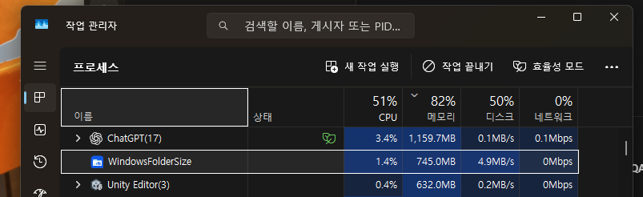

## 작업 결과

구현·빌드·네이티브 회귀·MSI검증·소스푸시 완료. 실행 중인 기존 버전은 교체하지 않았습니다.

## 변경 내용

### 적용 내용

파일별 전체경로 메모리map과 복구용 중복map을 생산경로에서 제거하고 Windows내장SQLite B-tree에 저장합니다. DB페이지캐시2MiB,mmap비활성,임시데이터디스크보관. 동시스캔2개, 정상차액우선, 통지4096,스캔조각8ms양보,CPU상한2%→1%,idle100ms. 변경된파일의전후차액·하위삭제·이름변경을 DB에서처리하고정상변경은애니메이션복구로전환하지않습니다. 기존bin인덱스는보존하되새DB최초1회검증필요.

## 검증

동일150000레코드기존map+복구사본 최대WS116002816B, 디스크DB9302016B(약92.0%감소),SQLite캐시2154960B.신규평균CPU전체시스템0.729%,106266ms.이는합성fixture측정으로실제프로세스전체메모리상한·일반적인성능보장이아닙니다.최종range쿼리수정후10000레코드회귀통과,실제파일생성7B→19B→삭제0B,DB재열기·이동·하위삭제·롤백통과. 생산scannerWorker를콘솔시험에서직접실행해초기7B→변경19B→삭제0B,정상변경recovering없음확인. native빌드및MSI ICE0. SHA256 DFA898FAAC89B84C6AEFE43CBE2AD5D9268B31CB0C6A1AD2E55B2FB8869642ED. 소스fdcd4fa 푸시.

사용자가제공한기존실행화면40324B 원본을편집없이보관했습니다.새버전은설치하지않아실행후UI화면과전후GUI비교는없습니다.

## 남은 사항

화면제어금지에따라설치·탐색기재시작·GUI조작미실행.현재실행중인15에는최적화가아직적용되지않습니다.16 MSI는C:\Projects\WindowsFolderSize\dist에최신본만존재합니다.최초DB검증은디스크IO와제한으로느릴수있으며실제사용중메모리·CPU는설치후QA필요.기존크기자동표시GUI미통과상태도해결했다고보고하지않습니다.교훈검토:기존자원측정·화면비간섭지침을적용,새전역규칙없음.

## 작업 시간

- 제안 시간: 5~10분
- 실제로 완료된 시간: 2026-11-03 19:16:44 KST 시작. 구현·시험·빌드·푸시완료, 공개보고검증진행.설치·GUI검증완료시각없음.
- XERJ: 미사용 — XERJ MCP미제공,현재소스rg·WindowsSDKwinsqlite헤더·실제시험으로대조.
